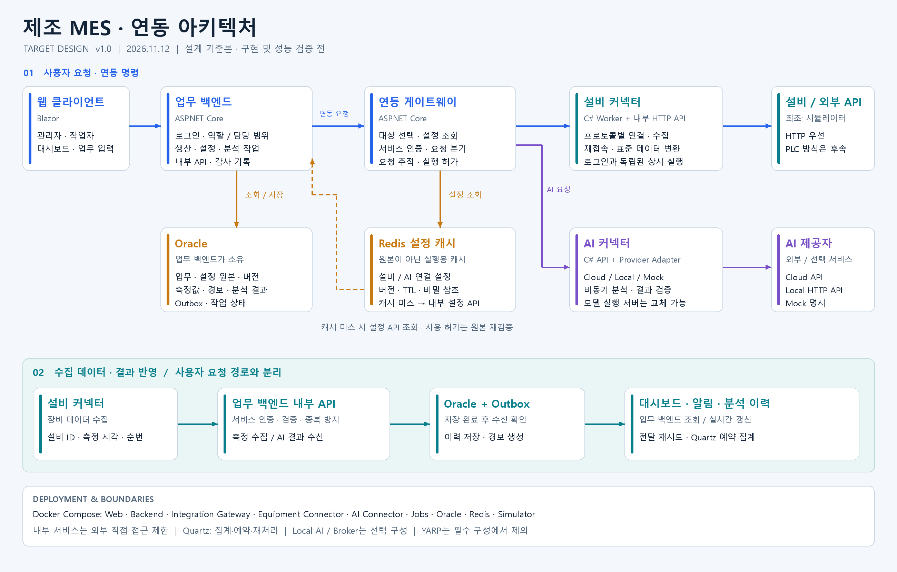
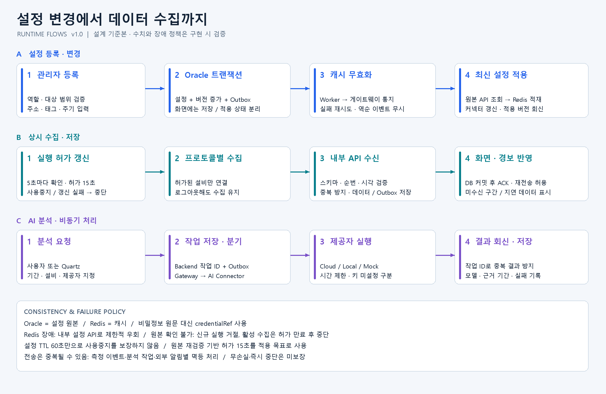

# 제조 MES · 연동 아키텍처 설계 기준 v1.0

작성일: 2026-11-12 / GPT  
상태: 사용자가 선택한 구조를 구체화한 설계 기준본. 코드·실장비·성능 검증 전.  
범위: 업무 백엔드 → 연동 게이트웨이 → 설비·AI 커넥터, Oracle 설정 원본, Redis 캐시, 상시 수집과 비동기 분석.



## 1. 이번에 정리한 결정과 가정

- 사용자 선택: 업무 백엔드 뒤에 연동 게이트웨이를 두고 설비·AI 커넥터로 분기한다. 장비 설정을 Redis에서 조회하는 구성을 사용한다.
- 구현 기준 제안: Blazor 화면, ASP.NET Core 업무 API·연동 게이트웨이·AI 커넥터, C# 설비 Worker, Oracle, Redis, Quartz Worker를 Compose로 묶는다.
- 이전 YARP 진입 게이트웨이 중심 제안은 이 문서로 대체한다. YARP는 선택적인 외부 리버스 프록시이며 현재 필수 서비스가 아니다.
- 첫 설비 연동은 외부 HTTP 시뮬레이터로 검증한다. 실제 PLC 프로토콜·SDK는 장비 조건을 확인한 뒤 추가한다. HTTP 통신 성공을 PLC 검증 완료로 표현하지 않는다.
- 게이트웨이·커넥터는 각각 하나의 인스턴스로 시작한다. 다중 인스턴스 수집 분산과 장애 인계는 후속 범위다.
- 캐시 TTL, 실행 허가 시간, 수집 주기 등 아래 수치는 초기 개발·시연용 제안이며 부하·장애 테스트 후 조정한다.

## 2. 서비스별 책임과 데이터 소유권

| 구성 | 책임 | 소유·접근 데이터 | 포함하지 않는 일 |
|---|---|---|---|
| Blazor Web | 관리자·작업자 화면, 입력 검증, 서버 상태 표시 | 업무 백엔드가 공개한 데이터 | Oracle·Redis·커넥터 직접 접근 |
| 업무 백엔드 | 로그인, 역할·담당 범위 검증, 생산업무, 설비·AI 설정 등록, 작업/경보/분석 결과 저장 | Oracle의 업무·설정·작업·수집·Outbox 테이블 | PLC 연결 유지, 모델 직접 실행 |
| 연동 게이트웨이 | 내부 요청 인증, 대상 ID 해석, 설정 캐시, 커넥터 선택, 실행 허가 전달, 추적 | Redis 캐시와 내부 설정 API. Oracle 직접 접근 없음 | 생산 승인 규칙, 프로토콜 해석, AI 추론, 측정 데이터 영구 보관 |
| 설비 커넥터 | 수집 시작/중지·연결 테스트, 프로토콜 어댑터, 재접속, 데이터 표준화, ACK 전 재전송 | 적용 중 설정·연결 상태·제한된 전송 버퍼 | 사용자 로그인 처리, Oracle 직접 수정, 실설비 안전 제어 |
| AI 커넥터 | 분석 작업 실행, Cloud/Local/Mock 어댑터, 제공자 타임아웃·응답 검증·결과 회신 | 작업별 입력 스냅샷·실행 상태. 영구 상태는 업무 API에 기록 | 사용자 권한 원본 관리, 업무 테이블 SQL 조회, PLC 제어 |
| Jobs Worker | Quartz 집계·예약 분석·Outbox 전달·실패 재처리 | 내부 업무 API 사용. Quartz 자체 작업 저장소는 전용 테이블 | 생산·설정 테이블 직접 갱신 |
| Oracle | 설정 원본·업무 이력·작업 상태·측정값·Outbox 영구 저장 | 업무 백엔드 소유 스키마, Quartz 전용 영역 분리 | 실행 중 설비 연결 |
| Redis | 재구성 가능한 연결 설정 캐시 | 게이트웨이가 쓰고 읽음. 서비스별 ACL | 설정 원본, 영구 작업 큐, 비밀정보 공동 보관함 |

모듈은 Identity / Production / Equipment / Quality / Alerts / Reporting / Integration / AI로 구분하되, 업무 백엔드는 초기 하나의 배포 단위로 유지한다. 연동 경계는 내부 API와 메시지 스키마로 정의한다. 공용 라이브러리에 업무 엔티티나 ORM 모델을 통째로 공유하지 않는다.

### 배포 형태

```text
Blazor Web → MES Backend → Integration Gateway → Equipment Connector → Simulator / PLC
                                           └→ AI Connector → Cloud / Local / Mock
Equipment Connector → MES 내부 수집 API → Oracle → 대시보드·경보
AI Connector → MES 내부 결과 API → Oracle → 분석 이력·유지보전 알림
Integration Gateway → Redis / MES 내부 설정·허가 API
Quartz Worker → MES 내부 API / Integration Gateway
```

측정값은 요청 분기 계층을 반복 통과하지 않고 내부 수집 API에 직접 전송한다. 게이트웨이는 명령·설정 경계, 수집 API는 데이터 저장 경계다. AI 결과 역시 내부 결과 API로 회신한다.

## 3. 인증·권한 경계

1. 사용자 인증은 업무 백엔드가 담당한다. 웹은 서버 세션/보안 쿠키를 기본 후보로 두고 CSRF 보호를 적용한다. 관리자/작업자 역할 외에 담당 라인·설비 범위도 검사한다.
2. 클라이언트는 등록된 `targetId`와 허용된 `operation`을 전송한다. 임의 URL·프로토콜·파일 경로를 전달해 실행시키지 않는다.
3. 업무 백엔드가 발급한 내부 호출 자격으로 게이트웨이에 접근한다. 서비스별 인증 대상(audience), 발급자, 만료, 기능 범위를 검증한다. 사용자 ID 헤더만으로 신뢰하지 않는다.
4. 내부 요청에는 `requestId`, `jobId`, `actorId`, `targetId`, `operation`, `configVersion`, `correlationId`를 포함한다. 예약 작업은 사람의 세션 대신 예약 작업 주체를 기록한다.
5. 게이트웨이는 요청 서비스의 기능 범위와 대상 설정을 검사한다. 커넥터는 지정된 서비스·작업 종류·대상·설정 버전·실행 허가를 검사한다. 조회 권한이 연결 설정 변경이나 설비 쓰기 권한으로 이어지지 않는다.
6. 최초 범위는 읽기 수집·연결 테스트·분석이다. PLC 쓰기/안전 제어는 구현하지 않는다. 추가 시 별도 권한·승인·감사 정책이 필요하다.
7. 내부 포트는 호스트에 공개하지 않고 Compose 네트워크로 제한한다. 외부 공개 배포 시 TLS와 서비스 통신 보호를 적용한다. 네트워크 격리만으로 인증을 대체하지 않는다.

## 4. Oracle 설정 모델

| 논리 테이블 | 핵심 필드·목적 |
|---|---|
| IntegrationTarget | targetId, kind(Equipment/AI), displayName, connectorType, enabled, configVersion, updatedAt |
| EquipmentConnection | targetId, protocol, approvedEndpoint, pollIntervalMs, timeoutMs, credentialRef |
| EquipmentTagMapping | targetId, sourcePath/address, metricCode, dataType, unit, scale, offset |
| AiProviderConfig | targetId, providerKind(Cloud/Local/Mock), approvedEndpoint, model, credentialRef, timeout, enabled |
| ConnectorRuntime | targetId, instanceId, appliedConfigVersion, connectionState, lastHeartbeatAt, lastError |
| IntegrationJob | jobId, requestId, targetId, operation, inputSnapshotRef, configVersion, attempt, state, deadline, error |
| TelemetryEvent | eventId, equipmentId, streamId, sequence, occurredAt, receivedAt, schemaVersion, payload |
| OutboxEvent | eventId, type, aggregateId, version, payload, createdAt, attempts, nextAttemptAt, deliveredAt |
| AiAnalysisResult | jobId, attempt, provider, model, inputPeriod, dataCoverage, resultVersion, risk, evidence, mockFlag |

이것은 ERD 작성 전 논리 모델이다. 시계열 보존기간·파티션·인덱스·태그별 정규화 방식은 실제 수집량을 산정한 뒤 확정한다. Oracle이 장비 원천 데이터를 무제한 보관한다고 가정하지 않는다.

## 5. Redis 설정 관리

### 캐시 구조

```json
{
  "key": "mes:integration:config:equipment:FILLER-01",
  "value": {
    "targetId": "FILLER-01",
    "connectorType": "equipment-http",
    "protocol": "http",
    "endpoint": "htt<LOCAL_PATH>",
    "pollIntervalMs": 1000,
    "timeoutMs": 2000,
    "credentialRef": "equipment-filler-01",
    "enabled": true,
    "configVersion": 7,
    "cachedAt": "2026-11-12T13:00:00Z"
  }
}
```

- AI 설정 키: `mes:integration:config:ai:{targetId}`. 장비와 제공자 설정을 구분한다.
- 초기 캐시 TTL은 60초. 설정 변경 이벤트로 즉시 무효화를 시도하되 TTL만으로 사용중지를 보장하지 않는다.
- 게이트웨이만 캐시를 관리한다. 커넥터가 Redis 키 구조나 Oracle 스키마에 의존하지 않도록 필요한 설정을 버전과 함께 전달한다.
- 캐시 미스는 `MES 내부 설정 API`를 통해 원본에서 읽고 캐시를 재구성한다. Redis 전체 키 스캔으로 활성 설비 목록을 복원하지 않는다.
- Redis 장애 시 원본 API로 제한적으로 우회한다. 동시 재조회 병합, 요청 수 제한, 짧은 타임아웃으로 업무 DB에 조회 폭주가 생기지 않게 한다.
- Redis에는 장비 비밀번호·AI API 키 원문을 넣지 않는다. 초기 로컬 구성은 Compose secret 파일을 필요한 커넥터에만 읽기 전용 주입하고 `credentialRef`로 찾는다. 운영 비밀관리 시스템은 후속 교체 지점이다.
- 등록 주소는 승인된 호스트·포트·프로토콜 범위로 제한하고 리다이렉트 이후에도 검증한다. 임의 서버 내부 주소에 접근할 수 있는 범용 프록시를 만들지 않는다.

### 등록·수정·삭제 순서

1. 관리자가 저장하면 업무 백엔드가 검증하고 Oracle에서 설정 수정, `configVersion + 1`, 설정 변경 Outbox를 같은 트랜잭션으로 저장한다. 동시 수정은 버전 충돌로 거절한다.
2. 화면에는 `저장된 버전`과 `적용된 버전`을 별도로 표시한다. DB 저장 성공을 장비 연결 성공으로 표시하지 않는다.
3. Jobs Worker가 Outbox를 읽어 게이트웨이의 설정 변경 API를 호출한다. 실패하면 재시도한다. Redis와 DB를 동시에 커밋한다고 가정하지 않는다.
4. 게이트웨이가 해당 캐시를 지우고 원본 API에서 최신 설정을 다시 읽는다. 같은/이전 버전 이벤트가 늦게 도착해도 적용 버전을 낮추지 않는다.
5. 커넥터에 새 설정을 전달하고, 연결을 갱신한 뒤 `appliedConfigVersion`과 상태를 업무 API에 보고한다. 비활성이면 연결 해제한다.
6. 진행 중 원본 조회가 구버전을 캐시에 다시 쓰는 경쟁을 줄이기 위해 대상별 갱신을 직렬화하고, 재검증에서 확인한 최소 버전보다 오래된 응답은 캐시 적재·적용하지 않는다. 다중 게이트웨이는 후속 동시성 설계 대상이다.
7. 삭제는 우선 비활성·삭제 표시와 버전 증가로 처리한다. 활성 커넥터와 기존 이력을 확인하기 전 설정 행을 물리 삭제하지 않는다.

### 실행 허가와 설정 적용 지연

캐시의 `enabled=true`만으로 계속 수집하지 않는다. 게이트웨이가 업무 백엔드에서 원본의 활성 상태·버전·대상 허용 범위를 확인하고 커넥터에 짧은 실행 허가를 준다.

- 초기 목표: 5초마다 갱신, 원본에서 발급하는 허가 유효기간 15초. 원본 확인 없이 허가를 새로 연장하지 않는다.
- 허가는 대상 ID·버전·커넥터 인스턴스·만료를 묶는다. 게이트웨이 중계 시에도 원래 만료를 연장하지 않는다.
- 허가 확인은 매 측정값마다 하지 않는다. 메타데이터는 Redis에서 읽고 활성 상태·버전만 주기적으로 원본에서 확인한다. 활성 설비 목록은 페이지/배치 조회 가능하게 한다.
- 사용중지를 확인하면 즉시 새 수집을 중단한다. 갱신 실패 시 유효 허가 동안만 계속하고 만료되면 중단한다. 수집 전 허가를 검사하고 호출 타임아웃을 남은 허가 시간 안으로 제한한다.
- 따라서 사용중지 적용은 즉시성·하드 실시간을 보장하지 않는다. 정상 프로세스 기준 15초 허가 기간과 진행 중 호출 취소 오차 내 중단을 테스트 목표로 삼는다. 실제 안전 정지 장치로 사용하지 않는다.
- 이미 측정되어 버퍼에 있던 값은 측정 시점의 허가·버전을 확인해 지연 수신할 수 있다. 권한 만료 후 새 측정은 별도로 거절·감사한다.

## 6. 데이터 수집 흐름



1. 커넥터 시작 시 게이트웨이를 통해 활성 대상과 최신 설정을 받는다. 원본의 활성 상태와 실행 허가를 확인한 뒤 연결한다. Redis에 남아 있는 키만 보고 자동 연결하지 않는다.
2. HTTP 어댑터는 수집 주기대로 조회한다. 후속 OPC UA 구독/Modbus 폴링도 같은 커넥터 계약에 맞춰 추가한다. 지원 프로토콜별 필수 입력 필드는 등록 화면에서 달라진다.
3. 커넥터는 원천 값을 공통 포맷으로 변환한다.

```json
{
  "eventId": "01J-DEMO-EVENT",
  "schemaVersion": 1,
  "equipmentId": "FILLER-01",
  "streamId": "connector-session-001",
  "sequence": 1024,
  "configVersion": 7,
  "occurredAt": "2026-11-12T13:01:02Z",
  "metrics": [
    {"code": "temperature", "value": 72.5, "unit": "C", "quality": "good"},
    {"code": "total_count", "value": 524, "unit": "count", "quality": "good"}
  ]
}
```

4. 내부 수집 API는 서비스·대상·허가·설정 버전, 이벤트 스키마, 값/단위, 시각 허용 범위와 최대 배치 크기를 검사한다. 서버가 `receivedAt`을 부여한다.
5. `eventId` 및 `(equipmentId, streamId, sequence)`에 고유 제약을 두고 같은 이벤트의 재전송을 성공으로 처리한다. 커넥터 재시작 시 streamId를 새로 발급한다. 동일 ID에 다른 내용이 오면 충돌로 거절·기록한다.
6. 원천 측정값과 후속 처리 Outbox를 Oracle 트랜잭션으로 저장한 뒤 ACK한다. ACK 전 네트워크 단절이면 같은 이벤트를 재전송한다.
7. 경보 평가와 집계는 저장 이벤트를 멱등 처리한다. 같은 설비·경보 종류의 활성 건을 중복 생성하지 않고, 지속 초과·복귀 조건을 사용한다. 지연 이벤트를 현재 상태로 덮어쓰지 않는다.
8. 최신 대시보드는 업무 백엔드의 읽기 모델/실시간 갱신으로 반영한다. 그래프 조회는 Oracle 집계 데이터에서 제공하며, 최신값과 과거 통계의 반영 시차를 표시한다.
9. 누적 카운터는 이전 값과의 차이를 생산량으로 계산한다. 리셋·롤오버·순서 역전·시계 오차를 구분하고 수동 실적과 이중 합산하지 않는다.

수집 연결 상태(Connected/Disconnected/Retrying)와 설비 운전 상태(Running/Idle/Fault/Stopped)는 독립 필드다. 통신이 끊겼다는 이유만으로 설비가 정지했다고 단정하지 않는다.

### 수집 장애 정책

- 단기 재전송 버퍼는 커넥터 메모리에 초기 10,000 이벤트 한도로 둔다. 상한 도달 시 새 폴링을 중단하고 데이터 공백을 기록한다. 무제한 메모리 축적을 허용하지 않는다.
- 프로세스/컨테이너 종료 시 ACK 전 메모리 데이터는 손실될 수 있다. 최초 버전은 무손실 수집을 보장하지 않는다. 영속 로컬 스풀 또는 브로커는 후속 확장이다.
- 연결 실패는 지수 백오프와 지터로 재시도한다. 잘못된 주소·인증 실패는 재시도 폭주 대신 설정 오류 상태로 전환한다.
- DB 커밋 후 응답 유실은 재전송·고유 제약으로 처리한다. 재접속 후 같은 측정값의 단순 재조회는 원천 sequence 지원 여부에 따라 별도 중복 정책이 필요하다.

## 7. 사용자 요청·AI 작업 흐름

### 연결 테스트

`사용자 → 업무 백엔드 권한 검증 → 게이트웨이 원본 재검증/캐시 설정 조회 → 해당 커넥터 → 연결 결과`.

연결 테스트는 짧은 타임아웃의 동기 응답으로 처리하고 실제 수집 활성화와 구분한다. 등록되지 않은 임의 URL 테스트는 제공하지 않는다.

### 지속 수집 시작/중지

설비 활성화/비활성화를 Oracle의 원하는 상태로 저장하고 Outbox로 적용한다. 관리자가 로그아웃해도 수집은 계속된다. 게이트웨이나 커넥터 재시작 시 원본의 원하는 상태를 재조회해 복구한다. 별도 일회성 시작 명령에만 의존하지 않는다.

### AI 분석

1. 사용자 또는 Quartz가 설비·기간·분석 종류·제공자 ID를 지정한다. 업무 백엔드가 권한과 입력 데이터 확보 여부를 검사한다.
2. 업무 백엔드가 입력 스냅샷, 분석 작업, 발송 Outbox를 저장하고 `202 + jobId`를 반환한다. 상태는 Queued → Dispatched → Running → Succeeded/Failed/TimedOut/Cancelled로 관리한다.
3. Jobs Worker가 게이트웨이에 작업을 전달한다. 게이트웨이는 제공자 설정·활성 상태를 재검증하고 AI 커넥터에 전달한다. 수신 확인과 분석 완료는 다르다.
4. AI 커넥터가 작업 ID·시도 번호로 실행 수락을 보고한다. 영구 작업 상태는 업무 백엔드에 남기고, 메모리 작업만 수락한 상태를 최종 성공으로 표시하지 않는다.
5. Cloud / Local HTTP / Mock 어댑터가 동일한 요청·결과 계약을 사용한다. 로컬 Python 추론 서버는 모델 실행이 필요할 때 선택 서비스로 추가한다. 커넥터는 장시간 작업을 사용자 HTTP 요청에 묶어두지 않는다.
6. AI 입력은 기간별 집계·표본과 데이터 품질·공백률을 포함한다. 원시 데이터를 무제한 제공자에 보내지 않는다. 필요한 큰 입력은 내부 API의 스냅샷 ID로 조회한다.
7. 결과에는 모델·제공자·분석 기간·근거·권고·실행 시각·입력 버전·mockFlag를 남긴다. 미검증 위험 점수를 확률이나 실제 고장 보장으로 표현하지 않는다.
8. 결과 콜백은 업무 API가 `jobId + attempt`와 현재 상태를 검사한다. 타임아웃/취소/교체된 시도의 늦은 응답은 결과 이력으로 분리하고 현재 결과를 덮어쓰지 않는다.
9. 재시작·통신 실패로 중복 실행될 수 있다. 내부 결과는 멱등 처리하되 외부 제공자 비용까지 exactly-once를 보장하지 않는다. 자동 재시도 여부는 호출 결과의 불확실성과 제공자 멱등 지원에 따라 정한다.
10. API 키 미설정은 NotConfigured, 데이터 부족은 InsufficientData, 모의 실행은 Mock으로 표시한다. AI 장애는 생산 실적 저장을 막지 않는다. 결과에 따른 유지보전 권고는 공통 경보·알림 모듈로 연결한다.

## 8. 초기 내부 API 계약

아래 경로는 역할을 고정하기 위한 초안이며 구현 전 OpenAPI로 구체화한다.

| 호출자 → 대상 | 경로 예시 | 의미 |
|---|---|---|
| Web → Backend | POST /api/equipment-connections | 권한 검사 후 설정 저장 |
| Backend/Jobs → Gateway | POST /internal/integration/connection-tests | 등록 대상 연결 테스트 |
| Jobs → Gateway | POST /internal/integration/config-changes | 버전 포함 설정 변경 통지 |
| Gateway → Backend | GET /internal/integration/targets/{id}/config | 원본 설정 조회 |
| Gateway → Backend | POST /internal/integration/leases/renew | 활성/버전/실행 주체 재검증 및 허가 |
| Gateway → Equipment | PUT /internal/equipment/{id}/desired-state | 멱등 설정·활성 상태 적용 |
| Equipment → Backend | POST /internal/telemetry/batches | 이벤트 배치 저장·ACK |
| Connectors → Backend | POST /internal/connector-status | 적용 버전·상태·마지막 오류 |
| Web/Quartz → Backend | POST /api/analyses 또는 내부 대응 API | 분석 작업 생성 |
| Jobs → Gateway → AI | POST /internal/ai/jobs | jobId·attempt·스냅샷 전달 |
| AI → Backend | POST /internal/analyses/{jobId}/results | 멱등 결과 반영 |

서비스 공통 응답에는 requestId, correlationId, errorCode를 사용한다. 민감한 연결 자격증명·사용자 토큰·제공자 API 키는 로그에 남기지 않는다. 게이트웨이는 클라이언트가 지정한 서비스명 대신 등록된 connectorType을 코드/허용 목록에 매핑한다.

## 9. 알림·Quartz·브로커 경계

- 측정/업무 저장과 Outbox 저장은 한 트랜잭션이다. 전달은 at-least-once를 전제로 소비자를 멱등 처리한다.
- Quartz는 시간대별 통계, 예약 AI 작업 생성, Outbox 전달·재시도, 오래된 작업 상태 점검을 실행한다. 초 단위 설비 수집 루프는 커넥터가 담당한다.
- 통계 키는 설비·기간·집계 종류로 유일하게 두고 재실행 시 동일 구간을 갱신한다. 스케줄 중복 실행을 막고 실패 이력을 보관한다.
- 경보 발생과 개인 알림함을 구분한다. 개인 알림함은 수신자별 읽음, 경보는 발생·복귀·확인·조치 상태를 저장한다.
- 이메일·채팅 발송 실패는 생산 저장 트랜잭션에 전파하지 않는다. `(eventId, recipientId, channel)`로 중복 억제하고 재시도·최종 실패·수동 재처리를 둔다.
- 초기 브로커는 필수로 확정하지 않는다. 후속 Kafka 등 도입 시 Outbox→브로커→알림 소비자 경로로 확장한다. Redis 캐시와 대량 메시지 처리를 같은 책임으로 취급하지 않는다.

## 10. Compose 실행 구성

| 서비스 | 기본 실행 | 영속 데이터·외부 의존 |
|---|---|---|
| web | 포함 | UI. Interactive Server의 웹소켓/재연결 검증 |
| mes-backend | 포함 | Oracle, 비밀 파일, 인증 키 저장소 |
| integration-gateway | 포함 | Redis, 내부 설정 API. 캐시는 재구성 가능 |
| equipment-connector | 포함 | 내부 HTTP API와 상시 Worker를 한 호스트 프로세스에 구성 |
| ai-connector | 포함 | C# API·백그라운드 실행부. 기본 Mock 또는 NotConfigured |
| jobs-worker | 포함 | Quartz 전용 Oracle 테이블, 내부 API |
| oracle | 포함 | 데이터 볼륨 |
| redis | 포함 | 영속 보관은 필수 아님. 재시작 복구 검증 |
| equipment-simulator | 포함 | HTTP 측정·카운터·고장 주입 |
| local-ai | 선택 profile | 모델·드라이버·GPU 지원 검증 후 추가 |
| broker | 후속 선택 | 기술 선정 전. 기본 이미지에 구현 완료로 표시하지 않음 |

Compose로 전체를 함께 실행·중지하되 서비스 간 의존성은 healthcheck와 앱 자체 재연결로 처리한다. stop/start와 데이터 볼륨 삭제는 별개다. 로컬 AI가 꺼져도 생산 업무와 Mock 시연이 가능해야 한다. 여러 컨테이너를 운영한다는 사실 자체를 완성된 MSA라고 표현하지 않는다.

## 11. 검증할 시연·장애 조건

1. 관리자 설비 등록 후 Oracle 저장 버전과 커넥터 적용 버전이 일치한다. 작업자는 설정 변경 API가 거절된다.
2. Redis 키 삭제·Redis 재시작 후 내부 설정 API로 복구한다. 재구성 시 비활성 장비는 연결하지 않는다.
3. 설정 저장 직후 게이트웨이 통신을 끊어도 Outbox가 남고, 복구 후 최신 버전만 적용된다. 역순 이벤트와 조회 경쟁도 검증한다.
4. 사용중지를 설정한 뒤 캐시가 남아 있어도 허가 재검증/만료로 수집이 중단된다. 실제 중단 지연과 진행 중 호출 종료 시간을 측정한다.
5. 로그아웃 후에도 활성 설비 수집이 유지되고, 커넥터 재시작 후 원본 활성 목록으로 복구한다.
6. 같은 이벤트를 두 번 보내도 생산량·경보가 이중 생성되지 않는다. DB 저장 후 ACK 유실도 재현한다.
7. 통신 단절과 실제 설비 정지를 구분하며, 버퍼 상한·프로세스 종료의 데이터 공백을 화면에 표시한다.
8. 분석은 jobId로 추적되고 Mock/키 미설정/실패/취소·늦은 결과를 구별한다. 실제 모델 정확도·1660 Ti 실행은 별도 검증한다.
9. 외부 알림 실패 시 생산 입력이 성공하고, 재시도로 발송 상태가 복구된다. 실제 발송은 자격증명 준비 후 확인한다.
10. Compose 재시작 후 계정·작업지시·실적·경보·분석 작업 이력이 유지된다.

## 12. 포트폴리오 사용 안내와 후속 작업

- 현재 그림은 최종 제출용으로 재사용할 수 있는 편집 가능한 설계 기준본이다. 실제 구현 완료를 뜻하지 않는다. 구현 후 배포 구조와 일치시키고 검증 결과를 붙여 제출본으로 갱신한다.
- 전체 구성도: [PNG](MES-architecture-v1.png) / [SVG](MES-architecture-v1.svg)
- 설정·수집·AI 흐름: [PNG](MES-runtime-flows-v1.png) / [SVG](MES-runtime-flows-v1.svg)
- SVG는 확대해도 선명하다. 한글 표시는 맑은 고딕 또는 대체 한글 글꼴이 필요할 수 있다. PNG는 글꼴 설치 없이 공유 가능하다.
- 후속: 화면별 입력/검증·권한표 → 논리·물리 ERD → API/이벤트 OpenAPI·JSON Schema → 프로젝트 골격·Compose → 시뮬레이터 기반 수직 시연.
- 미확정: 실제 PLC 프로토콜, DB/.NET 공급자 버전, 브로커, 무료 채팅 제공자, AI 모델과 GPU 실행 방식, 데이터 보존량.

## 공식 참고 자료

- Redis 캐시와 무효화: http<LOCAL_PATH>
- 캐시와 원본 저장소 경계: http<LOCAL_PATH>
- OPC UA 서버·구독 개념: http<LOCAL_PATH>
- Blazor 실행 방식: http<LOCAL_PATH>
- YARP 역할: http<LOCAL_PATH>
- Python 모델 실행 프로세스·메모리 고려: http<LOCAL_PATH>

API 경로·테이블·수치·장애 정책은 이 프로젝트의 설계 선택이며, 참고 제품이 기본 제공하는 완성 기능이나 벤치마크 결과가 아니다.
