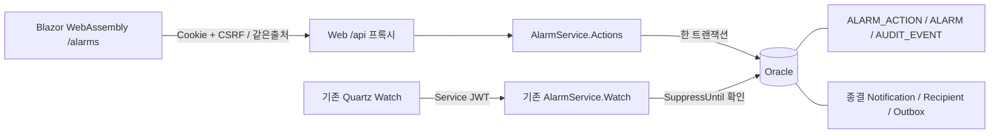

# FactoryMES — 경보 조치·정상 종결·강제 종결

작성: 2026-11-14. GPT: 규격/Backend/DTO/Oracle검증/배포/통합 기록. Claude: 관리자·작업자 Blazor 화면/브라우저검증/Backend 독립 읽기 검토.

## 업무 흐름과 이번 구현

통신이 복구됐다는 사실과 사람이 필요한 조치를 끝냈다는 사실은 다르다. 이전 단계의 ACTIVE→RECOVERED와 ACK에 조치 이력을 연결하고, 관리자가 조건을 확인한 뒤 종결하게 했다. 작업자는 담당 설비 경보에 본인 조치를 등록하고 시작·결과 완료를 기록한다. 관리자는 적격 담당자를 지정하거나 대신 처리할 수 있고, 정상 또는 예외 종결을 수행한다.

이번 범위는 기존 contracts/v1.1의 조치 4개 API(등록/목록/시작/완료), 종결 2개 API, 관리자·작업자 화면과 검증이다. HIGH 임계치·외부 알림 전달·AI·조치 취소/재배정·종결 취소는 추가하지 않았다. 기존 31테이블·53FK와 이전 로그인·수집·업무 흐름을 사용한다.

## 1. 상태와 권한 규격

| 동작 | 상태·조건 | 권한 |
|---|---|---|
| 조치 등록 | ACTIVE/RECOVERED, 경보 최신 버전, 내용1~1000자 | 관리자: 적격 사용자 배정 / 범위 내 작업자: 본인만 |
| 조치 시작 | OPEN→IN_PROGRESS, 경보·조치 최신 버전 | 관리자 또는 경보 범위 내 조치 담당 작업자 |
| 조치 완료 | IN_PROGRESS→DONE, 결과1~1000자 | 같은 권한 |
| 정상 종결 | RECOVERED, ACK 있음, DONE≥1, 미완료0, 사유 필수 | 관리자 |
| 강제 종결 | ACTIVE, 미완료0, 사유 필수 | 관리자 |

적격 담당자는 활성 관리자 또는 해당 경보에 접근할 수 있는 활성 작업자다. 작업자 경보 접근 범위는 현재 담당 작업(RELEASED/RUNNING/PAUSED/SUBMITTED)의 설비 또는 본인 WorkPause.AlarmId에 명시된 경보다. 단지 조치 owner라는 이유만으로 기존 경보 접근 범위를 넓히지 않았다. 작업이 끝나 범위에서 빠진 작업자의 남은 조치는 관리자가 처리해야 한다.

조치 완료는 복구나 ACK·종결을 자동으로 만들지 않는다. OPEN에서 바로 DONE으로 건너뛰면 409다. 시작·완료를 반복 호출해 최초 시각/결과를 덮을 수 없다. CLOSED 경보에는 새 조치/시작/완료/재종결을 허용하지 않는다. 작업자는 종결 API에 403, 범위 밖 경보/조치는 404, 다른 owner 변경은 403이다.

정상 종결은 CLOSED/NORMAL, 관리자 ID·시각·사유를 남긴다. 강제 종결은 CLOSED/FORCED로 남기고 복구·ACK를 만들어내지 않는다. 강제는 ACK나 DONE1건을 요구하지 않으며 조치가 아예 없는 경우도 허용한다. 다만 하나라도 OPEN/IN_PROGRESS 조치가 있으면 예외 종결도 막는다.

## 2. 비교와 설계 판단

| 대안 | 결정 | 이유·대가 |
|---|---|---|
| 복구되면 자동 종결 | 사람 조치·ACK·관리자 검토 후 종결 | 센서 신호 복귀와 업무 완료를 분리해 제조 현장 이력을 설명할 수 있다. |
| 조치 한 번에 완료 | 등록→시작→완료 | 담당 배정과 착수/완료를 구분하고 시작·결과 시각을 보존한다. |
| 관리자만 조치 입력 | 작업자 본인 입력 + 관리자 지정/대행 | 실제 현장 작업자는 본인이 한 조치를 남기고, 관리자는 권한이 필요한 종결을 맡는다. |
| 조치 owner에게 모든 경보 권한 | 기존 설비/명시 이력 범위 유지 | owner ID로 다른 설비의 정보 접근권이 생기지 않게 한다. 대신 담당 해제 후 관리자의 대행이 필요하다. |
| 조치 버전만 검사 | 경보와 조치 버전 모두 검사 | 경보 복구·ACK·다른 조치 추가 사이에 오래된 화면으로 상태를 변경하는 경쟁을 막는다. |
| 강제 종결이 복구 처리 | FORCED 이력과 30분 억제 | 고장 신호가 남아 있는 예외를 복구로 꾸미지 않고 즉시 반복되는 경보 폭주를 제한한다. |
| 강제 종결 때 미완료 조치 무시 | 미완료0 조건 유지 | 아직 진행 중인 일을 종결 뒤 수정 불가능 상태로 방치하지 않는다. |
| 억제 별도 타이머/Redis | 기존 AlarmRule.SuppressUntilUtc | 재시작에도 보존되는 Oracle 원본이며 기존 Quartz가 판정할 수 있다. 추가 서비스가 필요 없다. |
| 종결 체크를 브라우저에만 | 서버 트랜잭션에서 재검사 | 화면은 안내이며 동시 사용자와 위조 요청에도 같은 조건을 적용한다. |
| 조치 변경을 ACK 이벤트로 전송 | 조치 감사만, 종결은 실제 lifecycle 이벤트 | 존재하지 않는 변경 타입이나 가짜 ACK를 만들지 않는다. parent version의 이벤트 번호에는 빈 구간이 생길 수 있다. |

30분은 이번에 새로 임의 결정한 시간이 아니라 기존 v1.1 강제 종결 계약을 구현한 것이다. 억제는 경보 발생만 제한한다. 설비 수집이나 작업지시를 중지하지 않는다. 30분 뒤에도 데이터가 오래됐으면 기존 Watch가 새 ACTIVE 에피소드를 만들 수 있다. 억제는 정상 복구의 증거가 아니다.

## 3. 서비스 구조·잠금·동시성



- 생성: PRODUCT 테이블 참조 검증 잠금 → ALARM. 기존 사용자/작업 배정 변경과 같은 잠금을 써서 적격 담당자 검증과 변경이 겹치지 않게 한다.
- 시작·완료: ALARM → ALARM_ACTION.
- 정상 종결: ALARM을 먼저 잠근 뒤 조치의 미완료/완료 개수를 검사한다.
- 강제 종결: INTEGRATION_TARGET → ALARM_RULE → ALARM. 기존 Watch와 같은 순서다. Alarm을 잠근 뒤 Rule을 잡는 역순을 만들지 않는다.
- 모든 조치 변경이 부모 ALARM을 잠그므로 새 조치 등록과 종결이 서로 직렬화된다. 종결이 먼저면 후속 조치 생성은 CLOSED409, 조치 생성이 먼저면 종결의 이전 parent version이409다.
- 두 사용자가 같은 expectedVersion으로 조치를 생성하면 한 요청만 생성되고 다른 요청은409다. 실패한 트랜잭션의 조치/감사는 남지 않는다.

조치 생성/시작/완료 때 부모 경보의 UpdatedAtUtc를 변경 표시해 공통 SaveChanges가 경보 버전을 증가시킨다. 응답의 AlarmVersion은 저장 후 값이다. 시작/완료 시 조치 버전도 오른다. 최초 시작 시각은 완료 시 보존하고, 완료 시각은 시작보다 앞설 수 없게 한다.

종결은 Alarm close 필드 + (강제라면) Rule.SuppressUntilUtc/버전 + alarm.changed Outbox + 감사 + 본인 알림함/수신자/notification.created Outbox를 한 트랜잭션으로 저장한다. 외부 HTTP/메일/채팅 호출을 트랜잭션 안에 두지 않는다. 실패하면 종결만 남거나 억제만 남는 부분 저장 없이 롤백한다.

생성의 PRODUCT 전역 잠금은 현재 작은 단독 프로젝트에서 기존 참조 검증 규칙을 재사용한 선택이다. 기준정보·작업지시와 동시 생성이 많아지면 병목이 될 수 있고, 향후 전용 참조/배정 잠금 설계와 부하 검증이 필요하다. 이번 작업은 수평 확장·대규모 처리 성능을 검증한 것이 아니다.

## 4. 데이터와 API

기존 ALARM_ACTION의 owner/status/content/result/started_at_utc/completed_at_utc/version을 사용했다. 수정·삭제·재배정 API는 없다. 결과는 DONE 전환에서 한 번 저장한다. ALARM에는 close_kind/closed_by/closed_at_utc/close_reason을 저장하고, 생성 당시 rule snapshot/version은 바꾸지 않는다. ALARM_RULE의 suppress_until_utc와 version은 강제 종결 시 함께 바뀐다.

| 메서드 | 경로 | 요청 → 응답 |
|---|---|---|
| GET | /api/v1/alarms/{alarmId}/actions | limit/cursor → PageResult<AlarmActionView> |
| POST | /api/v1/alarms/{alarmId}/actions | ActionCreate(expectedVersion,ownerId,content) →201 AlarmActionView |
| POST | /api/v1/alarm-actions/{actionId}/start | ActionStart(expectedVersion,expectedAlarmVersion) → AlarmActionView |
| POST | /api/v1/alarm-actions/{actionId}/complete | ActionComplete(expectedVersion,expectedAlarmVersion,result) → AlarmActionView |
| POST | /api/v1/alarms/{alarmId}/close | ReasonCommand(expectedVersion,reason) → AlarmView |
| POST | /api/v1/alarms/{alarmId}/force-close | ReasonCommand(expectedVersion,reason) → AlarmView |

AlarmActionView는 actionId/alarmId/ownerId/status/content/result/version/alarmVersion이다. 숫자 ID는 문자열이다. canonical DTO에 없던 생성·착수·완료 시각과 closedBy를 응답에 임의 추가하지 않았다. DB의 해당 시각·관리자 ID는 Oracle 검증으로 확인한다. 목록은 actionId 오름차순 keyset, 기본50/최대100이다. 목록 행과 parent version은 같은 SELECT 스냅숏에서 읽는다.

작업자에게 ownerId 외 다른 담당자의 계정·이메일 같은 개인정보를 추가 노출하지 않는다. 본문은 trim하고 원문 길이·공백만 입력을 검사한다. 새 API도 기존 공통 Cookie/HTTPS/출처/CSRF·예외 처리 그룹에 연결했다. 별도 API키·유료 호출은 필요 없다.

종결 이벤트는 기존 mes.alarm.changed.v1의 CLOSED/FORCE_CLOSED다. 생성·시작·완료 조치는 alarm.action.created/started/completed 감사 로그로 남긴다. 종결 알림 제목은 정상/강제를 구분한다. 신규 Outbox는 PENDING으로 보존되고 외부 전달기는 아직 없다. DB 원자성과 상태별 중복 방지를 보장하며, Kafka 전달이나 end-to-end exactly-once를 구현했다고 주장하지 않는다.

## 5. 관리자·작업자 화면과 실패 처리

기존 /alarms 경보 상세에 별도 AlarmActions 컴포넌트를 붙였다. 작업자는 본인 담당 조치를 등록/시작/결과 완료한다. 관리자는 담당 사용자 ID를 입력할 수 있고 기본값은 본인이다. 사용자는 기존 기준정보 관리 화면의 사용자 ID를 참고할 수 있다. 새 사용자 검색 API나 임의 목록 권한은 추가하지 않았다.

조치 목록은 모든 페이지를 읽어 미완료/완료 개수를 미리 보여 준다. 페이지 크기는 최대100이지만 총량은 제한하지 않았으므로 경보 하나에 조치가 아주 많아지면 화면 읽기 비용이 커진다. 현재 규모에서는 단순하고 정확한 조건 미리보기를 택했고 대량 조치 성능은 후속이다. 최종 종결 판정은 항상 서버다.

관리자 정상/강제 조건과 사유 입력을 보여 주고, 강제는 복구가 아니며 30분 억제라는 안내 및 확인 체크를 추가했다. API 권한·조건은 체크 UI와 별도로 강제한다. CLOSED에서는 변경 입력/버튼을 숨긴다. 규칙 표에는 억제 종료 시각을 KST로 표시한다.

목록을 읽기 전에는 변경을 막는다. 409는 입력을 유지하고 경보·조치 최신 값을 다시 읽는다. 최신 조회가 실패하면 변경을 막고 재시도 버튼을 남긴다. POST 결과가 불확실한 네트워크/5xx는 자동 재전송하지 않고 새로고침으로 이력을 확인하게 한다. 서버 parent version 때문에 이미 처리된 이전 요청이 새 조치로 중복 저장되는 것도 막힌다.

경보 전환 중 늦은 응답 문제는 @key=AlarmId로 인스턴스를 분리하고 폐기 여부/스냅숏 ID를 확인해 막았다. 버전은 @key에 넣지 않아 같은 경보의 충돌 뒤 입력이 보존된다. GPT가 로딩 중 전송 가능성과 이전 응답의 새 입력 초기화 가능성을 지적했고 Claude가 배포 전에 보완했다.

## 6. 검증 전략·fixture 구분

- GPT Tooling verify-alarm-actions: 다른 업무 데이터를 건드리지 않는 고유 라인/설비/disabled 연결/규칙·portal RELEASED 작업과 ACTIVE/RECOVERED 경보를 DB에 seed한다. 전이·권한·종결은 실제 HTTPS Cookie+CSRF API로만 검증한다. 이 seed를 실제 Quartz 발생 검증이라고 부르지 않는다.
- Claude verify-alarm-actions.cjs: 고유 연결의 실제 Simulator 첫 측정→poll60초/stale2초로 Quartz ACTIVE→작업자 조치→수집1초/stale20초로 실제복구→ACK→정상종결→두 번째 실제ACTIVE→관리자 조치/강제종결을 브라우저로 검증한다. 서버 중지·가짜 경보 API 없이 실제 기존 경로를 사용한다.
- 기존 경보48/알림함UI13/업무UI12/orders44/auth35를 회귀 확인한다. 통과한 같은 항목을 변경 없이 반복하지 않는다.
- 검증 종료 시 자기 연결/규칙만 중지, 미착수 작업만 취소하고 경보/조치/알림/감사 이력은 남긴다. 계정/비밀번호/DB 볼륨을 초기화하지 않는다.

```powershell
docker compose -f deploy/compose.yaml run --rm tooling verify-alarm-actions
Set-Location tests/browser
node verify-alarm-actions.cjs
```

실행 결과는 verification-results/alarm-actions-verification.json, FactoryMES-browser-alarm-actions-verification.json과 화면 캡처에 남긴다. 비밀·쿠키·토큰은 저장하지 않는다. 결과·건수는 실제 실행이 끝난 뒤 아래에 확정한다.

## 7. 협업·읽는 순서·후속

규격: 공유 FactoryMES-경보조치종결-동시구현분담-v1.md. 질문 1~7(DTO 시각/closedBy 생략, 취소 API 없음, ACK 없는 강제 허용, 전체 목록 조건 미리보기, 억제 표시, 입력 검사)은 기존 계약대로 확인했다. 날짜 기록18:10 이후에 요청/수락/답변/완료를 누적했다.

코드 순서: Contracts/AlarmActions.cs → Backend/Features/Alarms/AlarmEndpoints.cs → AlarmService.Actions.cs → 기존 AlarmService.Watch.cs의 종결 이벤트/제목 → web-client/Components/AlarmActions.razor 및 Pages/Alarms.razor → Tooling/AlarmActionVerification.cs → tests/browser/verify-alarm-actions.cjs.

다음 후보는 HIGH 임계치와 경보 억제 만료/재발 시연 확대, 조치 취소/재배정·관리자 편의 검색, 외부 Outbox 전달/메일·무료채팅 Mock, 통계/Mock AI다. 임의로 이번 단계 범위에 추가하지 않았다.

## 8. 장애 주입 시험·조회 경쟁 보강·판정 오류 정정

기본226개 통과 뒤 새 조치 목록 GET에만 장애를 주입하는 좁은 검증을 추가했다. Claude가 최초에는 실패 안내가 나왔는데 fieldset이 잠기지 않았다고 보고해, GPT도 화면 결함으로 받아들였다. 이후 수정 배포본에서도 같은 위치에서 시험이 실패했고, 실제 원인은 Playwright isDisabled()가 fieldset 요소 자체의 disabled 속성을 검증하는 방법이 아니었던 데 있었다.

최종 시험은 DOM fieldset.disabled와 내부 조치 등록 버튼의 비활성 상태를 함께 확인하도록 고쳤다. 이 판정으로 GET 장애 시 변경 차단·입력 보존과 수동 재조회 후 해제가 통과했다. 앞선 "제품 결함이 확인됐다"는 설명은 근거가 부족해 정정한다. 데이터 저장/권한 문제는 발생하지 않았다. 중간 실패 시도는 통과 합계에 넣지 않는다.

동시에 코드 검토에서 Changed 콜백 뒤의 명시 LoadAsync와 OnParametersSetAsync가 중복 조회할 가능성이 있어 조회 경쟁 방어를 보강했다. RequestedKey로 같은 키의 자동 조회를 한 번만 시작하고, 실패 후에는 수동 재조회만 허용한다. AwaitingParent와 Blocked로 부모의 최신 AlarmVersion 전달을 기다리고, 경보별 인스턴스/버전별 입력 보존/늦은 응답 폐기 규칙을 유지한다. 이것은 코드상 가능한 경쟁을 막는 보강이며, 최초 시험이 운영 결함을 재현했다고 주장하지 않는다.

Claude 임시 Release0/0 후 GPT가 Web만 재배포했다. Backend/DB 이미지는 변경하지 않았다. Claude 최종13/13에는 조치 목록 GET 장애와 실제 강제 종결 후 연결/규칙을 활성 상태로 두고12초(Quartz2주기 이상) 동안 새 ACTIVE가 생기지 않는 확인이 포함된다. 억제 전체30분 만료/만료 후 재발을 기다린 검증은 아니다. 최종 요청에서2회 실행했으며 첫 실패는 테스트 판정 오류, 두 번째가 통과다. 기존 API/광범위 회귀는 반복하지 않았다.

## 9. 최종 통합 검증 확정

| 검증 | 통과 | 실행 주체 |
|---|---:|---|
| 새 조치/종결 Oracle·API | 63 | GPT |
| 새 조치/종결 실제 브라우저 | 13 | Claude 최종 / GPT 기본11 선행 |
| 기존 경보/알림함 브라우저 | 13 | GPT |
| 기존 MANUAL 업무 브라우저 | 12 | GPT |
| 기존 수집/Quartz 경보 Oracle·API | 48 | GPT |
| 기존 MANUAL 업무 Oracle·API | 44 | GPT |
| 기존 인증/DB매핑/내부권한 | 35 | GPT |
| 합계 | 228 | 최종 항목 기준 |

최종 새 브라우저는 조치 목록 GET 장애 → 변경 차단 → 목록 수동 재조회 → 입력 보존/변경 재개와 실제 강제 종결 뒤 연결/규칙을 활성 상태로 둔 다음 Quartz 주기의 신규 ACTIVE 억제까지 포함한다. 장애 주입은 재시도 버튼을 누르기 전까지 해당 경보 목록 GET에만 500을 반환해 차단 상태를 결정적으로 확인한다. 원 서버는 중지하지 않는다. 기본11과 실패한 중간 실행은 최종 합계에 중복 합산하지 않았다.

조회 경쟁 방어 보강은 RequestedKey와 AwaitingParent로 부모의 최신값 전달을 기다린 뒤 버전별 조회를 한 번만 시작하는 방식이다. Blocked/Disposed/이미조회완료/이미시도한키는 자동 조회를 생략하고, 같은 키의 실패는 수동 재시도만 한다. Claude 임시 Release0/0 후 GPT가 Web만 재빌드/배포했고, Claude가 최종 브라우저를 실행했다. 최종 runtimeErrors0/SKIP0. 기존 회귀는 공통 배포 직후 결과이며, 이후 변경은 AlarmActions 컴포넌트뿐이다. 최종 Web은 새13으로 검증했고 Backend/기존 Pages가 바뀌지 않아 종전 회귀는 반복하지 않았다.

전체 Release 경고0/오류0, 최종 Web publish 성공, Docker9개 healthy. 로그인 session.js SHA256은 d0148270cd0107270701837b4c902683d5eb3c75182eca932e74c522378804ad로 이전과 같다. 계정/암호·DB 볼륨·DDL을 초기화하지 않았다. 유료 API/외부 발송은0이다.

모든 검증 fixture 연결/규칙은 마지막에 중지하고 미착수 지시는 취소했다. 조치·경보·알림·감사 이력은 남겼다. 중간 장애 시험에서 수집 중지 전에 복구하지 못한 ACTIVE 경보 이력도 남는다. 중지가 복구의 증거가 아니므로 자동 종결/삭제하지 않았다. 관리자가 남은 조치를 완료하고 필요하면 사유로 강제 종결할 수 있다.

결과 원본은 verification-results, 공유폴더와 작업공간 outputs에 문서·JSON7개·health·검증목록·화면 사본을 보존했다. scaffold-verification.json의 business APIs not yet implemented는 기존 인증검증 보고서에 남아 있는 오래된 scope 설명이다. 이번 실제 구현 상태와 업무 검증은 본 문서와 별도 업무 결과를 기준으로 읽는다.
