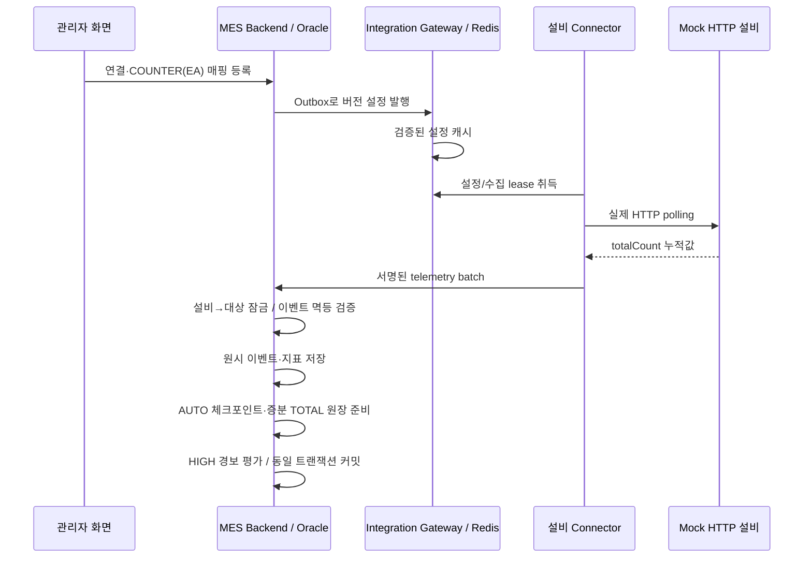

# AUTO 생산실적과 로그 설계 (2026-11-17)

이 문서는 구현 규격과 실제 검증 결과를 분리한다. 검증 결과는 아래 검증 절과
verification-results의 해당 실행 보고서를 기준으로 읽는다. 유료 호출·실제 AI·외부 발송은 없다.

## 업무와 데이터 흐름

관리자는 같은 설비의 활성 `COUNTER / EA / scale=1 / offset=0` 매핑을 고르고
AUTO 작업지시를 발행한다. 작업자는 점검·시작·불량 입력·중지·재개·제출을 수행한다.
관리자 마감 후 기존 KST 통계가 MANUAL과 AUTO의 동일 순원장을 재집계한다.

## 비교와 결정

| 문제 | 비교한 대안 | 구현 결정과 이유 |
|---|---|---|
| 자동 생산량 | 종료-시작 raw / 각 수집 증분 원장 | 증분 원장. 중지·리셋·작업 전환을 raw 차이 하나로 구분할 수 없다. |
| 초기값 | 기존 누적값 전량 / 버튼 때 마지막값 / 명령 뒤 첫 GOOD | 명령 뒤 첫 GOOD는 기준만 확정하고 0건. 이전 작업과 명령 직전 불확실 구간을 이월하지 않는다. |
| 리셋 | 감소를 0으로 자동복구 / wrap 추정 / 사용자 확인 | 이상 표시·합산 중지 후 사유 필수 기준 재확인. PLC별 wrap 규격이 없으므로 추정하지 않는다. |
| 갱신 방식 | Quartz가 raw 재조회 / 저장 시 투영 | 원시 이벤트·AUTO 원장·체크포인트를 같은 Oracle 트랜잭션에 저장해 중간 실패/재전송의 중복을 막는다. |
| 중복 | timestamp 하나 / event·stream·sequence | 기존 이벤트 멱등키와 원장 UUID, 작업별 cursor를 함께 쓴다. |
| 수동 중복 | AUTO에도 TOTAL 허용 / 자동·수동 합계 분리 | AUTO의 수동 TOTAL과 자동 TOTAL 역분개를 거절한다. 작업자는 수동 REJECT와 해당 수동 불량 역분개만 한다. |
| 동시 편집 | 매수집 WorkOrder Version 증가 / 무제한 명령 재시도 | 정상 AUTO 투영만 편집 Version을 보존한다. 사용자 명령·리셋/이상 전이는 기존 Version 검증을 유지한다. |
| 통계 | 별도 AUTO 계산기 / 기존 마감 순원장 SQL | TOTAL/REJECT/REVERSAL가 같은 원장이므로 CLOSED AUTO를 기존 SQL에 포함한다. |

첫 기준값이 확정될 때까지 설비 생산을 시작하지 않는 운영 절차가 필요하다. 버튼과 첫 계측 사이의
생산을 임의로 포함하지 않는다. 실제 PLC의 원자적 start/stop latch가 생기면 별도 프로토콜로 개선한다.

## 수집 경계

- 시작·재개·리셋 확인은 `AcceptAfterUtc`와 `AwaitingBaseline`을 저장한다.
  측정과 수신 시각 모두 명령 이후인 첫 유효 샘플은 기준만 잡는다.
- `AUTO_COUNTER_STATE`는 작업별 raw·stream·sequence·telemetry·측정/수신 시각을 보존한다.
  PAUSED에서도 cursor는 전진하지만 TOTAL은 만들지 않는다. 재개는 새 기준을 기다린다.
- 원시값 감소는 `CounterInvalid`와 감사 이벤트를 남기고 합산을 중단한다.
  값이 다시 증가해도 자동 해제하지 않는다. 담당 작업자나 관리자의 사유 있는 재확인이 필요하다.
- 같은 이벤트 재전송은 기존 DUPLICATE 응답으로 끝난다. cursor보다 오래된 sequence/측정과
  시각이 같은 다른 stream은 합산하지 않는다. 같은 stream의 sequence gap은 Warning을 남기되
  연속 누적 카운터 차이로 빠진 polling 증가분을 보존한다.
- 새로운 stream은 측정 시각이 앞서고 raw가 연속이면 증분을 보존하며 감소하면 리셋으로 처리한다.
- 최신 설정과 다른 이벤트·매핑 없음·BAD 품질은 생산 원장으로 만들지 않는다.
  시작/재개/제출/재확인은 현재 설정의 최신 GOOD와 측정·수신 freshness를 모두 요구한다.
- 제출은 아직 기준 대기·리셋 미확인·최신 계측 미소비이면 거절한다.
- 다음 작업은 별도 체크포인트를 생성하며 이전 작업·중지·작업 사이 증가분을 가져오지 않는다.
- raw 시작값은 최초 근거로 유지한다. 리셋 뒤 종료값이 시작보다 작아도 누적 생산 원장은 유효하다.
  DB는 AUTO 제출/마감의 시작·종료 근거 존재를 요구하고, 예전 `end >= start` 조건만 대체한다.

## 동시성과 트랜잭션

기준정보/명령의 기존 PRODUCT 참조 잠금을 유지하고 설비→대상/작업 순으로 잠금을 맞췄다.
작업 시작·중지·재개·제출과 해당 설비 수집이 동일 설비 행을 기준으로 직렬화된다.
설정 변경 중인 매핑을 실행 중 작업에 재해석하지 않는다. 글로벌 PRODUCT 잠금은 포트폴리오 규모의
기존 구현을 보존한 선택이며 고처리량 운영에서는 참조별 잠금/격리 수준과 실행계획을 다시 검증한다.

정상 AUTO TOTAL/기준 raw 갱신은 `SaveCounterProjectionAsync`의 한 번의 저장 범위에서만
WorkOrder 편집 버전을 유지한다. try/finally로 범위를 복구한다. SQL 낙관적 토큰·행 잠금은 유지한다.
리셋과 새 Invalid 전이는 버전을 올려 사용자의 재확인을 요구한다. 수동 실적/상태 명령은 변함없다.
화면은 Version과 `AutoCounter.LastTelemetryId`를 함께 비교해 원장과 합계를 갱신한다.

원장 UUID는 order·telemetry·mapping 해시에서 결정하고 기존 UQ_ENTRY_CLIENT를 이용한다.
nullable telemetry를 포함하는 Oracle 복합 unique는 수동 원장을 제한할 수 있어 추가하지 않았다.
AUTO RecordedBy는 기존 FK와 할당 작업자 ID를 유지하고 Source=AUTO·telemetry FK로
실제 자동 출처를 구분한다. SYSTEM 감사는 리셋/수량 범위 이상에 남기고 정상 자동 원장마다 만들지 않는다. 사람의 수동 입력으로 표시하지 않는다.

## Oracle와 API

기존 DB를 지우지 않고 `tooling upgrade-auto-production`을 실행한다. 반복 적용 가능하다.
새 테이블 1개, 생산 원장 출처/telemetry 열, FK 3개, 조회용 인덱스 2개와 출처 제약을 추가한다.
기존 원장은 MANUAL 기본값이고 telemetry는 null이다. 모델은 32테이블/56FK다.
신규 환경 DDL도 같은 구조다. Backend 교체 전에 업그레이드한다.

- GET `/api/v1/auto-counter-options?equipmentId=...`: 관리자 전용, 현재 설정의 적격 매핑과 최근값.
- 기존 작업지시 작성·초안 수정: CountMode=AUTO, CounterMappingId 필수.
- 기존 start/pause/resume/submit/close: Cookie+CSRF 및 역할·할당·Version 검증 유지.
- POST `/api/v1/orders/{id}/counter-rebase`: ExpectedVersion·Reason, 담당 작업자/관리자,
  RUNNING/PAUSED의 이상 AUTO만. 정상 카운터를 임의 재기준화하지 않는다.
- OrderView.AutoCounter는 기준 대기·최신 raw·stream/sequence/telemetry·수집시각을 제공한다.
- EntryView.Source/TelemetryId로 자동 원장을 식별한다.

## 화면

작업 작성 팝업/초안 수정의 공통 AutoCounterPicker에서 집계 방식과 카운터를 고른다.
AUTO 상세는 기준 대기·합산 중·중지·이상 상태와 마지막 근거를 상단에 보여 준다.
불량 전용 입력은 TOTAL=0조차 보내지 않는다. 자동 TOTAL은 일반/관리자 역분개 후보에서 제외한다.
3초마다 활성 AUTO 상세를 읽되 전송/미확인 실적/사용자 작업 중 결과를 덮어쓰지 않는다.
실패 시 입력을 보존하고, 자동으로 업무 명령을 재전송하지 않는다.

## 로그·설명 주석

추가 외부 서비스/로그 DB 없이 ASP.NET ILogger와 기존 Correlation을 사용한다.
개발 환경의 FactoryMES 범주만 Debug로 켜고 Microsoft/EF 전체 SQL은 무차별 활성화하지 않는다.

- Debug: 입력 식별자·건수, 규칙/분기 판정, 멱등 skip, polling·lease·heartbeat, 처리 단계와 결과.
- Information: 로그인/주요 업무 커밋·행위자, 설정 인계, 자동 생산 준비, 분석/집계 주요 결과.
  외부 트랜잭션 소유의 준비 단계는 staged라고 표현하고 최종 커밋과 구분한다.
- Warning: 비정상 상태/권한·버전 거절, 카운터 감소·순번 gap·오래된 자료, 전송/캐시/분석 재시도.
  기존 Error를 낮추지 않는다.

비밀번호/해시·Cookie/JWT/CSRF·키·DB 접속 문자열·서명 proof·전체 본문·사용자 사유·PII는
운영 로그에 출력하지 않는다. 예외는 안전한 타입/업무 Code를 기록하며 원문 Message는 피한다.
감사 DB는 기존 사유를 보존하고 운영 로그와 역할이 다르다.
한국어 주석은 입력 출처→검증/잠금→변환/저장→후속 호출의 책임을 설명한다.
엔티티/Oracle 매핑에도 테이블 목적을 붙였다. 코드를 그대로 번역하는 장식 주석은 지양한다.

## 실제 검증

최종 보고서: `verification-results/auto-production-summary-2026-11-17.json`.
통합 단언 **768개 PASS**이며 단위 테스트 개수나 고유 사용자 시나리오 수를 뜻하지 않는다.
최초 실패·429·같은 시험 재실행을 중복 합산하지 않았다.

| 검증 | 통과 | 확인 내용 |
|---|---:|---|
| 신규 AUTO Oracle/API | 88 | 실제 Mock 첫 수집, 서명/권한, 기준0, 증분, 재전송, 리셋/재기준, 중지/전환, 수동 제한, 마감·통계 |
| 기존 인증·작업·중지정정·역분개 | 208 | 35+44+70+59 |
| 수집·경보·HIGH·조치 | 202 | 41+48+50+63 |
| Mock 발송·Outbox·AI·통계 | 211 | 66+42+58+45 |
| 브라우저 | 59 | AUTO13, 공통셸12, 기준정보/초안12, 편집 경계10, 수동업무12 |

AUTO signed 시험은 실제 HTTP 수집 한 건을 확인한 뒤 동일 인증/서명 API로 제어된 누적값을 보낸다.
생산 API에 시험용 강제 리셋 엔드포인트를 추가하지 않았다. DB 직접 준비는 고유 품목·라인·설비이며
작업지시/계측/원장은 업무 API로 생성했다. 시험 연결은 종료 후 비활성화하고 새 AUTO 이력은 남긴다.

실제 수량 예: 첫 raw100→105는5개, reset2→7 동안 합산0, 재확인 후10은기준/13은3개,
중지20은제외/재개30은기준/32는2개, seq gap35는3개/new stream38은3개.
첫 작업 총16·불량1로 마감한다. raw End38<Start100이어도 원장16이 맞다.
다음 작업50기준→54증분4, 두 작업 일별 총20·불량1과 원장이 일치했다.
실제 1초 Mock 브라우저 시험은 RUNNING 중 불량·PAUSE·SUBMIT가 재시도 없이 첫 클릭에 성공했다.

전체11프로젝트 Release 경고0/오류0, Oracle32테이블/56FK, 추가 DDL 반복 적용,
9개 컨테이너 healthy를 확인했다. 개발 로그의 Debug/Info/Warning 출력을 확인하고 보관된
개발 비밀번호·서비스 비밀·개인 키 값의 일치 여부를 메모리에서 검사해 노출0을 확인했다.
원시 로그 덤프는 보고서에 저장하지 않았다. 이것은 알려진 자격증명 검사이며 모든 개인정보/비밀에
대한 완전한 보안 인증을 의미하지 않는다. Debug 반복 감시 로그량은 크므로 일반 운용은 Info를 권한다.

기존 수동 화면 테스트가 AUTO 옵션의 ‘설비’ 문구까지 선택하던 선택자 오류를 고쳐 재검증했다.
미선택 mapping은 native required가 먼저 막으므로 custom 상태 문구를 기다리던 시험을 수정했다.
연속 API 시험의429는 보안 rate limit을 바꾸지 않고 간격을 두어 해결했다.

## 확인 범위와 후속 한계

- 리셋/재기준 API는 시험했지만 리셋 상태를 만든 뒤 브라우저 재기준 폼을 클릭하는 시험은 미실시다.
- AUTO 실행 중 Backend/Connector 재시작, 다중 노드·고부하/장시간 성능은 이번에 직접 시험하지 않았다.
  체크포인트가 DB에 저장되는 구현과 정확히 한 번 커밋 경계는 코드 검토 범위다.
- 리셋 Version 증가, 상태 없는 기존 작업 복구, 손상된 다중 활성, 수량 범위 초과,
  AUTO별 설정/매핑/품질 skip, 명령 이전 측정/수신 샘플의 전용 주입 단언은 88개에 포함되지 않는다.
  구현/정적 검토와 실제 실행 검증을 구분하며 후속 경계 시험 후보로 남긴다.
- 오래 끊긴 사이 리셋한 뒤 raw가 예전 값보다 커지면 감소를 관측할 수 없다. 실제 PLC에서는
  boot/session·reset bit·장비 원자적 latch가 필요하다. 리셋부터 재확인 사이 생산은 추정하지 않는다.
- 상태 없는 작업의 재기준도 신선한 GOOD가 필요하다. 먼저 수집을 복구한 뒤 확인해야 한다.
- 현재 Source=AUTO/telemetry로 출처를 구분하고 RecordedBy는 기존 할당 작업자 FK를 유지한다.
- 샘플마다 TOTAL SUM과 기존 PRODUCT 표 잠금은 현 규모의 선택이다. 운영 규모 성능을 주장하지 않는다.
- 새 telemetry FK가 있어 원시 자료 삭제·보관 정책은 원장 근거를 함께 고려해야 한다.
- 반복 BAD/역순/상태 없음 Warning의 중복 억제와 구조화 로그 보관/순환은 운영 보완 후보다.
- 실제 PLC·실제 AI/GPU·SMTP·채팅·유료 API를 사용한 검증은 아니다.

Claude는 UI/공통 통신 로그를 구현하고 Backend를 두 번 독립 검토했다. 새 기능 결함은 발견하지
못했으며 위 검증 공백과 감사 표현을 지적했다. 상태 없음 보호·로그 등급·감사 설명·줄바꿈 보완을
반영했고 검토를 실행 검증 완료로 과장하지 않았다.
