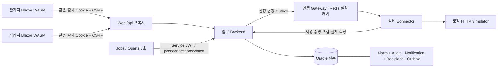
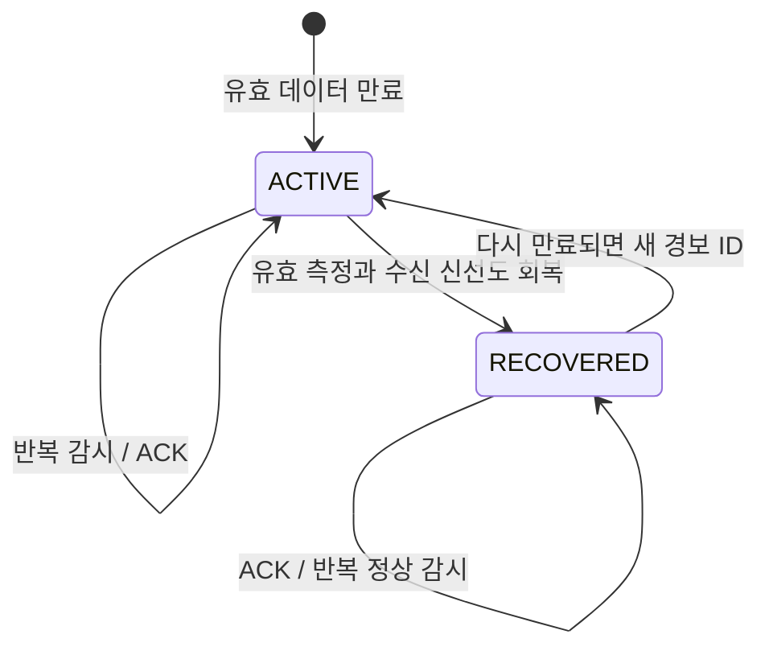

# FactoryMES — COMM_LOST 감시·경보·공통 알림함

작성: 2026-11-14, GPT 구현·통합 / Claude 화면·브라우저 구현 및 Backend 독립 검토.

## 1. 이번 단계의 업무 목적과 범위

설비 수집이 멈췄는데 화면에 마지막 정상 값만 남아 있으면 작업자는 실제 상태를 오해한다. 기존 실제 Mock 수집 흐름에 시간 기반 통신 감시를 붙였다. 관리자가 설비 연결의 COMM_LOST 규칙을 등록하면 Quartz가 감시하고, 통신이 오래 끊기면 ACTIVE 경보와 개인 알림을 만든다. 담당 작업자는 알림함에서 경보를 열어 확인(ACK)할 수 있다. 유효 데이터가 다시 들어오면 RECOVERED로 바뀌지만 종결되지는 않는다.

이번 구현은 COMM_LOST 규칙 등록/등급·사용 여부 수정, 경보 조회·ACK, 본인 알림함 조회·읽음, 내부 감시 API와 Quartz다. HIGH 임계치/히스테리시스, 조치 등록·종결·강제종결, 외부 이메일/채팅, Kafka, AI는 구현하지 않았다. 기존 관리자 실적 정정과 작업자 역분개 흐름은 그대로 사용한다. 98개 설계 API 전체가 구현됐다는 의미는 아니다.

## 2. 서비스 책임과 구성



Jobs는 Oracle에 직접 접속하지 않는다. 스케줄과 요청 실행만 맡고, 신선도 판단·잠금·권한·알림 수신자 결정은 Backend에 모았다. 기존 Gateway는 연결 설정/수집 경로를 계속 담당한다. 경보 감시는 설비 연결 설정의 Redis 캐시를 읽어서 판단하지 않는다. 판단 원본은 수집 저장 트랜잭션이 갱신한 Oracle의 마지막 유효 시각이다.

## 3. 고민한 대안과 선택 이유

| 고민 | 선택 | 이유·대가 |
|---|---|---|
| 데이터 수신 때만 경보 판단 vs 주기 감시 | Quartz 주기 감시 | 데이터가 아예 안 오는 상황을 수신 콜백만으로 발견할 수 없다. 최대 한 주기 정도 감지 지연이 생긴다. |
| DB 변경 감시/CDC vs 애플리케이션 배치 | 기존 Quartz 활용 | 시간 경과 자체가 조건이므로 DB 변경이 없어도 판정해야 한다. CDC·브로커 추가 없이 로컬에서 재현 가능하다. |
| Jobs에서 SQL 직접 변경 vs 내부 API | Backend 내부 API | 도메인 규칙과 트랜잭션을 한 곳에 두고 향후 Jobs를 별도 서버로 옮겨도 규칙이 갈라지지 않는다. |
| heartbeat vs 마지막 유효 측정 | 측정·수신 시각 모두 확인 | 프로세스가 살아 있어도 값이 오래됐거나 불량 데이터만 들어오면 정상 통신으로 오인하면 안 된다. |
| 알림함을 Kafka 이후에만 생성 vs 같은 트랜잭션 | DB 알림함과 Outbox 동시 저장 | 로컬 시연에서도 즉시 알림함을 사용할 수 있다. Kafka는 향후 이벤트 전달용으로 추가할 수 있다. |
| 알림 읽음 = 경보 확인 | 별도 상태 | 개인의 알림 읽음과 업무상 최초 ACK는 의미·소유자가 다르다. 읽었다고 경보를 처리한 것으로 보지 않는다. |
| 끄면 자동 복구 | 상태 유지·감시 제외 | 수집 중지/규칙 중지는 정상 측정 복구의 증거가 아니다. 기존 ACTIVE가 남을 수 있으며 후속 조치/강제종결 흐름이 필요하다. |
| 경보 강제 생성 테스트 API | 실제 수집 간격을 조절한 시연 | 운영 API에 시험용 우회 경로를 추가하지 않고 실제 Quartz·Connector 경로를 검증한다. |

수집 간격보다 staleSec을 짧게 설정하는 것은 현재 허용한다. 검증은 60초 수집·2초 만료로 끊김을 결정적으로 만든다. 실운영 설정에서 이 조합은 정상 폴링 중에도 경보를 만들므로 관리자가 주기·네트워크 지연을 고려해 staleSec을 충분히 크게 정해야 한다. 이번 단계에는 설정 경고 UI나 별도 예외 정책을 추가하지 않았다.

## 4. 상태·시각 판단

감시는 설정의 staleSec으로 cutoff = 현재 UTC - staleSec을 계산한다.

- LastValidSampleAtUtc와 LastValidReceivedAtUtc가 모두 cutoff 이상이면 fresh다.
- fresh가 아니고 ActivatedAtUtc도 cutoff 이하이면 overdue다. 최초 유효 측정이 없어도 활성화 후 유예가 지나면 경보를 만든다.
- 대상이 disabled/deleted, 규칙이 disabled, SuppressUntilUtc가 미래, ActivatedAtUtc가 없으면 상태 변경 없이 건너뛴다.
- overdue + 해당 규칙의 ACTIVE 없음 → 새 ACTIVE 경보.
- fresh + ACTIVE 있음 → 같은 경보를 RECOVERED로 전환.
- 반복 overdue 또는 반복 fresh는 새 이벤트/알림을 만들지 않는다.

설정 변경/재활성화 시 기존 연결 서비스가 ActivatedAtUtc를 갱신하므로 새 활성화 유예를 적용한다. 수집 heartbeat나 RETRYING 보고는 LastValidSample/Received를 갱신하지 않는다. 기존 수집 구현에서 GOOD·현재 설정·더 새로운 측정만 이 시각을 전진시킨다.



마지막 화살표는 기존 경보를 다시 ACTIVE로 덮는 의미가 아니다. 이전 RECOVERED 이력을 남기고 새 에피소드를 생성한다. ACK는 상태와 별개인 최초 확인자·시각이다. RECOVERED가 자동 CLOSED로 바뀌지 않는다. 마감·조치 조건 없이 종결하는 편법을 넣지 않았다.

## 5. DB 관계와 트랜잭션

기존 31개 테이블·53개 FK를 그대로 사용한다. 스키마 생성/초기화/마이그레이션 없이 AlarmRule, Alarm, Notification, NotificationRecipient, OutboxEvent, AuditEvent를 실제 업무에 연결했다.

- AlarmRule: COMM_LOST는 TargetId당 1건. 중지 규칙도 같은 대상의 다른 규칙으로 중복 생성하지 않는다. 등급·사용 여부만 수정하고 설비/대상/종류는 바꾸지 않는다.
- Alarm: 생성 당시 RuleVersion·RuleSnapshot·Severity를 보존한다. 이후 규칙 수정이나 복구가 발생해도 생성 당시 증거를 바꾸지 않는다.
- UQ_ALRM_ACTIVE: 규칙당 ACTIVE 최대 1건. RECOVERED 이력은 여러 개 가능하다.
- Notification.EventId: 원인이 된 alarm.changed 이벤트 ID의 고유 키다.
- NotificationRecipient: NotificationId + UserId 복합 키. 읽음은 수신자별 최초 ReadAtUtc다.
- Outbox: alarm.changed와 notification.created를 별도 이벤트로 저장한다. 알림 수신자 목록은 생성 시점에 확정한다.

규칙별 한 트랜잭션에서 대상 → 규칙 → ACTIVE 경보 순서로 행 잠금을 잡는다. 판정 후 Alarm 저장 → alarm.changed/Audit 추가 → Notification/Recipient/notification.created 저장 → 커밋한다. 도중 실패하면 모두 롤백하므로 경보만 있고 알림이 없는 부분 저장을 막는다. 트랜잭션 중 HTTP를 호출하지 않는다.

ACK는 Alarm 행만 잠근다. expectedVersion이 다르면 409, 범위 밖이면 404, CLOSED면 409다. 최초 ACK만 수정하고 이후 현재 버전으로 ACK하면 읽기 전용 응답을 준다. 같은 시점의 최초 ACK 경쟁도 행 잠금과 버전으로 제어한다. 알림 읽음은 ReadAtUtc IS NULL 조건의 단일 UPDATE여서 반복 호출이 최초 시각을 덮어쓰지 않는다.

## 6. 권한과 화면

| 기능 | 관리자 | 작업자 |
|---|---|---|
| 규칙 등록/단건조회/수정 | 허용 | 403 |
| 규칙 목록 | 전체 | 현재 담당 작업 설비 |
| 경보 조회·ACK | 전체 | 현재 담당 설비 또는 본인 중지 이력에 명시 연결된 경보 |
| 알림함 조회·읽음 | 본인 수신분 | 본인 수신분 |
| 내부 감시 | 사용자 Cookie 불가 | 사용자 Cookie 불가 |

현재 담당 작업은 RELEASED/RUNNING/PAUSED/SUBMITTED다. DRAFT/CANCELLED/CLOSED 이력만으로 해당 설비의 모든 과거 경보를 공개하지 않는다. 본인 WorkPause.AlarmId 링크가 있으면 그 명시 경보를 볼 수 있다. 알림함은 수신 당시 기록을 보존하므로 배정이 바뀐 뒤에도 받은 알림은 남지만, 관련 경보 링크는 다시 현재 경보 접근 권한을 검사한다.

발생·복구 알림 수신자는 활성 관리자 전원 + 해당 설비 현재 담당인 활성 작업자다. 중복 역할/여러 작업으로 같은 사용자가 두 번 수신하지 않는다. 다른 사용자의 읽음·전체 수신자 목록은 응답에 포함하지 않는다.

- /alarms: 관리자 규칙 폼, 경보 상태 필터·더 보기, 최신 상세 조회, 최초 ACK. 작업자는 규칙 폼이 없다.
- /inbox: 본인 알림·미읽음 필터·더 보기·읽음 표시·관련 경보 링크.
- /orders: 두 화면으로 이동하는 메뉴를 추가했다.
- 두 페이지 모두 별도 Client 프로젝트의 페이지별 InteractiveWebAssembly(prerender:false)다. 브라우저는 같은 출처 /api를 호출하고 기존 Cookie+CSRF를 쓴다. 로그인 session.js는 바꾸지 않았다.

409 재조회가 실패하면 변경 버튼을 막고 수동 최신 조회를 제공한다. 규칙 수정 충돌 때 사용자 입력을 보존하고 서버 원본/새 버전을 보여줘 비교 후 직접 재저장하게 한다. 재조회 catch 안의 예외도 처리해 Blazor 미처리 예외를 방지했다. 통신 실패·5xx는 자동 변경 재전송하지 않는다.

## 7. 구현 API

기존 contracts/v1.1 규격의 부분 구현이다. 숫자 식별자는 문자열, 날짜는 UTC ISO 8601이다. 목록은 limit 기본50/최대100과 nextCursor를 사용한다. 상세 계약은 shared/FactoryMES.Contracts/Alarms.cs를 따른다.

| 메서드 | 경로 | 요청/응답 |
|---|---|---|
| GET | /api/v1/alarm-rules | RuleView 페이지, 선택 equipmentId |
| GET | /api/v1/alarm-rules/{ruleId} | 관리자 RuleView |
| POST | /api/v1/alarm-rules | RuleWrite → 201 RuleView |
| PUT | /api/v1/alarm-rules/{ruleId} | RuleUpdate(expectedVersion) → RuleView |
| GET | /api/v1/alarms | AlarmView 페이지, 선택 equipmentId/status |
| GET | /api/v1/alarms/{alarmId} | AlarmView |
| POST | /api/v1/alarms/{alarmId}/ack | Command(expectedVersion) → AlarmView |
| GET | /api/v1/inbox | NotificationView 페이지, 선택 unreadOnly |
| PUT | /api/v1/inbox/{notificationId}/read | 빈 객체 → accepted/correlationId |
| POST | /internal/v1/jobs/connections/watch | {limit:1..100} → examined/opened/recovered/unchanged/checkedAt |

공개 API는 기존 공통 그룹의 Cookie·역할·HTTPS·출처·CSRF·예외 필터를 사용한다. 내부 감시는 client_id=jobs-worker와 jobs:connections:watch scope를 모두 요구한다. 진단용 verification 서비스 토큰은 403이다. Web이 /internal을 프록시하지 않아 브라우저 출처의 내부 경로는 404다.

## 8. 이벤트와 전송 보장 범위

alarm.changed envelope: eventId(UUID), type=mes.alarm.changed.v1, schemaVersion=1, source=mes.backend, occurredAt, correlationId, data.

data는 alarmId/equipmentId/ruleId/version/change/status/severity다. change는 이번 단계에서 OPENED/RECOVERED/ACKNOWLEDGED를 생성한다. Outbox aggregate는 ALARM과 경보 ID/버전이다.

notification.created는 별도 이벤트 ID를 가지며 causationId로 alarm.changed를 연결한다. data에 notificationId/title/body/recipientIds/alarmId와 nullable orderId/analysisResultId가 있다. 수신자는 이벤트당 최대100명씩 나눈다. 본문·제목은 화면에서 텍스트로 이스케이프한다.

DB 내부의 원자성과 에피소드 중복 방지는 구현했다. Kafka로 전달한 것, 외부 메일·채팅을 발송한 것, end-to-end exactly-once는 보장하지 않는다. 현재 ConfigurationPublisher는 설정 변경 타입만 전달하므로 새 경보·알림 Outbox는 PENDING으로 보존된다. 알림함은 같은 트랜잭션으로 이미 생성돼 조회 가능하다. 향후 브로커/외부 전달기를 추가하면 EventId 기반 소비 멱등성·재시도·실패 보관이 필요하다.

## 9. 배치 운영과 한계

Quartz ConnectionWatchJob은 5초 간격, DisallowConcurrentExecution으로 같은 JobKey 겹침을 막는다. Backend singleton gate는 수동/Quartz 동시 호출과 순회 커서를 직렬화한다. 규칙 ID를 커서로 이어 보고 끝에서 처음으로 돌아가므로 limit 때문에 처음 100건만 계속 검사하는 일을 막는다. 규칙별 Oracle 잠금과 활성 고유 키가 별도 서버 호출에서도 같은 에피소드의 경쟁을 막는다.

한 번에 최대100건을 순차 처리한다. 100건 이하에서는 보통 다음 5초 트리거에 감지하지만, 다수 규칙에서는 순환 횟수·DB 지연만큼 늦어진다. 대용량 성능·Quartz 클러스터 영속 스케줄·다중 Connector leader/claim은 아직 검증하지 않았다. 앱 재시작 시 커서는 처음으로 돌아가며 기존 DB 경보를 재사용한다. 서비스 장애 기간의 정확한 만료 순간이 아니라 재개 후 판정 시각이 OpenedAt이다.

## 10. 실제 시연·검증 방법

기본 접속은 http<LOCAL_PATH> 기존 개발 관리자/portal 계정을 사용한다. 별도 유료 키가 필요 없다.

1. 관리자 기준정보에서 고유 설비를 만들고 portal 담당 MANUAL 작업을 발행한다.
2. 설비 연결을 로컬 Simulator 승인 URL로 등록한다. 평소에는 수집1초·stale20초처럼 여유를 둔다.
3. /alarms에서 해당 연결의 COMM_LOST 규칙을 만든다.
4. 끊김 재현은 그 고유 대상만 수집60초·stale2초로 설정한다. 첫 데이터 이후 다음 데이터 전에 Quartz가 ACTIVE와 알림을 만든다. 다른 서비스 중지나 DB 조작은 없다.
5. portal /inbox → 관련 경보 → ACK. ACK 뒤에도 알림은 미읽음이다. 읽음 표시를 따로 누른다.
6. 관리자 연결을 수집1초·stale20초로 바꾸면 실제 새 측정 후 Quartz가 RECOVERED와 복구 알림을 만든다.
7. 시연 종료 시 해당 대상/규칙만 중지하고 이력은 보존한다.

```powershell
docker compose -f deploy/compose.yaml -f deploy/compose.alarms-verification.yaml run --rm tooling verify-alarms
Set-Location tests/browser
node verify-alarms-inbox.cjs
```

검증용 Compose override는 Tooling에 jobs-worker 자격을 명시적으로 잠시 추가한다. 일반 Tooling에는 그 권한을 넣지 않는다. 비밀 파일·쿠키·토큰은 보고서에 남기지 않는다. 테스트는 자체 고유 설비/연결/규칙/작업만 바꾸고 마지막에 연결/규칙 중지와 미착수 작업 취소를 수행한다. 검증 fixture 이력과 알림은 삭제하지 않는다.

## 11. 검증 결과와 협업 이력

- 전체 Release 빌드: 경고0/오류0.
- 새 Oracle/API 48개: 실제 수집·Quartz OPENED/RECOVERED, snapshot/version, 작업자 범위404, 규칙403, CSRF, 서비스권한, 멱등 ACK/읽음, 중복감시, 알림 격리, 상태/페이지 검증 PASS.
- Claude: 새 Blazor 두 페이지·브라우저 검증 구현, 임시 사본 빌드0/0, Backend 잠금·원자성·권한 읽기 전용 검토 결함 없음.
- GPT 통합 검토: 409 catch 재조회 실패/규칙 새 버전 반영 문제를 요청했고 Claude가 보완했다. 최종 브라우저·기존 회귀 결과는 아래 확정표와 같다.

결과 파일: verification-results/FactoryMES-alarms-api-verification.json, FactoryMES-browser-alarms-inbox-verification.json. 첫 API 검증은 48개 PASS 후 자체 fixture를 정리했다. 아직 수행하지 않은 장애/대용량/분산 시험을 완료로 표시하지 않는다.

## 12. 코드 읽는 순서

1. shared/FactoryMES.Contracts/Alarms.cs — 외부/내부 DTO.
2. services/mes-backend/Features/Alarms/AlarmEndpoints.cs — 권한과 API.
3. AlarmService.cs — 규칙·조회 범위·ACK.
4. AlarmService.Watch.cs, ConnectionWatchCoordinator.cs — 감시 판단·잠금·이벤트·수신자.
5. Features/Notifications/InboxService.cs — 알림함 생성·조회·최초 읽음.
6. services/jobs-worker/ConnectionWatchJob.cs, Program.cs — Quartz와 Service JWT 호출.
7. services/web-client/Pages/Alarms.razor, Inbox.razor — Claude 화면.
8. tools/FactoryMES.Tooling/AlarmVerification.cs, tests/browser/verify-alarms-inbox.cjs — 실제 업무·권한·Quartz 검증.

다음 기능 후보는 HIGH 경보·조치/정상종결/강제종결, 경보 목록 자동 갱신, Outbox 전달기·메일/무료 채팅 Mock, 영속 재전송, 통계·Mock AI다. 사용자 다음 요청에서 범위를 정한다.

## 13. 최종 통합 확정 결과

| 검증 | 최종 통과 | 실행 주체 |
|---|---:|---|
| 새 Oracle/API·실제 Quartz | 48 | GPT |
| 새 경보·알림함 브라우저 | 13 | Claude 최종, GPT 기본11 선행 |
| 기존 MANUAL 업무 브라우저 | 12 | GPT |
| 기존 작업지시 Oracle/API | 44 | GPT |
| 기존 인증·모델·내부 경계 | 35 | GPT |
| 기존 Redis/실제 수집 API | 41 | GPT |
| 합계(최종 항목 기준, 이전11 재합산 안 함) | 193 | GPT 통합 |

Claude 최종13은 기본11 흐름에 실제 규칙 버전 충돌과 최신 GET 1회500 주입, 변경 차단·입력 보존·수동 재조회·새 버전 검토 후 저장을 포함한다. 서버를 중지하지 않고 해당 fixture 브라우저 경로만 가로챘다. runtimeErrors0, SKIP0. 최종 검증 주체는 Claude이며 GPT가 공유 완료 기록·JSON·화면 캡처를 확인했다. 이미 성공한 같은 시나리오를 GPT가 다시 반복하지 않았다. 공통 이미지 빌드·Compose 적용은 모두 GPT가 했다.

전체 최종 Release 빌드는 경고0/오류0, Docker9개 healthy다. 로그인 session.js SHA256은 d0148270cd0107270701837b4c902683d5eb3c75182eca932e74c522378804ad로 이전과 같다. 계정/비밀번호 초기화, 스키마 재생성, 유료API, 외부실발송은 하지 않았다. 코드 가독성 포맷은 새 파일에만 적용했고 토큰 동일 검사를 통과했다.

시험 경보21/22/23과 알림/이력은 보존되고 자체 시험 연결·규칙은 중지, 미착수 지시는 취소됐다. 기존 데이터를 삭제하지 않았다. 경보·알림 신규 Outbox는 PENDING 보존이며 아직 외부 소비자는 없다.

캡처: verification-results/FactoryMES-alarms-screen.png, FactoryMES-inbox-screen.png. 공유폴더와 작업공간 outputs에 상세 문서·검증목록·결과6개·캡처2개 사본을 남겼다. 작업 중 판단과 검토 요청/수락/완료는 2026-11-14.md 16:22 이후에 누적했다.
