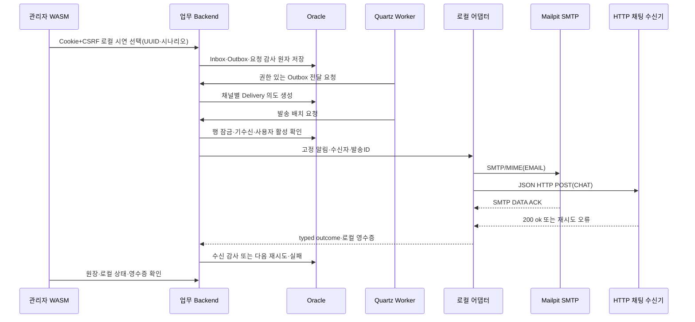

# 이메일·채팅 알림 어댑터: 비교와 로컬 검증

## 문제와 이번 범위

기존 Outbox 전달기와 Mock 공급자는 이벤트·수신자·채널·재시도 원장을 검증했다. 그러나 메서드가 성공을 반환하는 것만으로 SMTP MIME이 맞는지, HTTP 서버가 실제 요청을 수신하는지 증명하지는 못했다. 이번 단계에서는 원장을 유지하며 실제 통신 어댑터를 붙인다. 외부 이메일 주소·Webhook URL·키를 입력하지 않고 로컬 수신 서버에서만 확인한다.

사용자의 확정 조건은 무료로 쓸 수 있는 방식 비교, 유료 호출·실제 외부 발송 없는 로컬 검증, Claude와 파일 분담, 비교·설계·구현·검증 상세 기록이다. 따라서 실제 Gmail/Slack 계정을 생성하거나 메시지를 보내지 않는다. 무료 모델 단계와 마찬가지로 오픈소스 사용과 PC 저장·전력 비용이 없다는 말은 구분한다.

## 무엇을 왜 비교했는가

| 비교 질문 | 대안 | 판단 |
|---|---|---|
| SMTP 프로토콜 자체를 검증해야 하는가 | 순수Mock / 실제SMTP capture | Mock을 유지하고 capture 경로를 추가해 둘을 구분 |
| C# MIME·SMTP를 어디까지 직접 구현할 것인가 | System.Net.Mail / MailKit / 자체socket | MailKit의 MIME·비동기·취소·SMTP오류 표현을 사용, SMTP 자체를 다시 만들지 않음 |
| 이메일 비용은 어디서 생기는가 | 로컬수신함 / 기존SMTP계정 / 발송업체HTTP API | 로컬Mailpit은 외부계정·유료발송API 없이 실제SMTP를 받음. 외부계정의무료범위는 별도확인 |
| 채팅서버까지 운영해야 하는가 | Slack무료플랜 / Zulip자체호스팅 / Rocket.Chat Community | 이번 목표는 메시지어댑터이므로 전체채팅서버 설치·계정·백업을 늘리지 않음 |
| 업무용 HTTP 형식을 무엇으로 할 것인가 | 공급자고유 REST API / Incoming Webhook | 간단한 Slack Incoming Webhook JSON과200/ok·HTTP오류를 먼저 구현 |
| 실제외부발송 없이 무엇을 증명할 수 있는가 | 가짜HttpHandler / 실제로컬HTTP수신기 | 둘다사용하되 독립계약시험과 실제네트워크수신 증거를 분리 |
| 중복을 어디까지 막을 수 있는가 | DB원장 / 수신측idempotency / SMTP Message-ID | DB중복과 외부부작용의정확히1회를 다르게 설명 |

### 이메일 선택

MailKit은 MIT 라이선스의 .NET SMTP/MIME 구현이다.4.16.0을 재현 버전으로 고정했고 최신 버전이라고 주장하지 않는다. MimeKit으로 UTF-8 제목과 text/plain 본문을 만들고 MailKit 비동기 연결·전송·취소를 사용한다. 자체socket 구현은 SMTP 상태기계·MIME·연결 종료·TLS 책임까지 늘리므로 실제 업무 어댑터 범위를 벗어난다. System.Net.Mail을 사용할 수도 있지만 이번에는 MailKit의 명시적인 SMTP 예외와 비동기 흐름을 선택했다.

Mailpit은 실제SMTP를 수신해 메시지를 저장하고 조회API를 제공한다. v1.34.0을 고정하고 영속 SQLite 파일을 별도 볼륨에 둔다. SMTP relay/forward 설정을 넣지 않는다. 정상 capture 망은internal이고 SMTP1025/UI8025를 호스트에 publish하지 않는다. 버전 확인 기능도 끄므로 사용자가 보내는 본문이 외부로 나갈 필요가 없다.

SMTP는 전송 프로토콜이지 무료 발송 서비스 계약이 아니다. 회사나 개인의 SMTP 계정을 실제로 연결하려면 인증/OAuth·TLS·발송 제한·조직 정책을 별도 확인해야 한다. 이번에는 그러한 계정에 연결하지 않는다. Mailpit 수신 성공도 인터넷 수신자 배달·스팸 분류·수신자 열람을 증명하지 않는다.

### 채팅 선택

Slack은 무료 워크스페이스와 Incoming Webhook을 제공하지만 무제한 저장/앱 설치라는 뜻은 아니다. 공식 무료플랜 설명의 앱10개 제한과 이력보관 조건, Webhook의429/Retry-After와오류를 확인했다. Webhook URL은 비밀이므로 향후 실제 연동에서는 로그나 공개설정에 넣지 않아야 한다. 이번에는 그 URL을 발급하거나 외부에 요청하지 않는다.

Zulip 자체호스팅은 전체 채팅 기능을 무료 오픈소스로 운영할 수 있는 대안이다. 다만 사용자·서버·업데이트·백업 책임이 추가되며 조직별 모바일 푸시 무료범위도 별도다. Rocket.Chat도 Community/Starter와 유료제품을 구분해야 하므로 ‘모든 업무 기능·운영지원이 무제한 무료’로 기록하지 않는다. 두 제품을 성능이 낮아 제외한 것은 아니며 이번에 실제 설치/동일조건 성능비교를 하지 않았다.

현재 선택은 **Slack Incoming Webhook 형태의 HTTP 어댑터 + 독립 로컬 수신기**다. 실제 수신기는 요청 형식·성공·429·400·503·재전송을 재현한다. Slack 서버를 설치했거나 실제 Slack 호환 인증을 통과한 검증이 아니다. 수신기의중복억제헤더는 프로젝트 고유 기능이며 Slack이 해당헤더로중복을막아준다고주장하지 않는다.

## 책임과 실제 데이터 흐름

기존 자동 업무 알림은 Mock 라우팅을 유지한다. 관리자 로컬시연이 같은 Inbox→Outbox→Delivery 경로에서 실제 통신 공급자를 선택한다. 이번에 실제 수신자 주소 설정·전역 라우팅 전환을 추가했다고 주장하지 않는다. 이를 분리한 이유는 기존 경보가 갑자기 다른 목적지로 보내지거나 회귀 시 실제 발송을 시도하지 않도록 하기 위해서다.

새 테이블 대신 Delivery의 DestinationKey/TargetRef와 AuditEvent 영수증을 활용한다. local.email.user.ID/local.chat.user.ID와canonical loca<LOCAL_PATH> 경로만 허용한다. 이 문자열에서 접속 주소를 만들지 않고 mailpit:1025와chat-receiver:8080의상수만사용한다. 주소·URL·키입력란을 만들지 않는다.

## 전달 상태를 구분한 이유

Outbox DELIVERED는 발송 의도를 채널별원장으로 인계한 뜻이다. SMTP/채팅 최종 수신이나 외부배달을 뜻하지 않는다. 기존 Delivery상태 제약은PENDING/SENT/FAILED다. 로컬 capture ACK를 외부SENT로기록하지 않고 PENDING/SentAtnull을유지하며 delivery.local.accepted 감사와 별도 로컬 상태API로수신확인을표시한다. 이 영수증이있는행은 다시처리하지않는다. 기존 Mock의 receipt·조회·수동재시도도 그대로 유지한다.

## 실패·시간·중복의 설계

- SMTP4xx/연결/timeout은일시재시도,5xx·인증요구·잘못된목적지는영구거절이다. DATA성공후QUIT만실패하면수신성공을취소하지않는다.
- HTTP200본문ok를1KiB상한으로확인한다.429·5xx·연결·timeout은재시도,그외4xx/redirect는거절한다. 리디렉션·시스템프록시는끄고고정내부주소만호출한다.
- 공급자내부추가retry없이원장이최대3회와5/10초대기를관리한다. 로컬429의2..30초Retry-After는같은예산안에서반영한다. 수동재시도는관리자권한·CSRF·사유·현재버전을확인하고기존attempt누적을지운것처럼보이지않게별도round를기록한다.
- 한통신2초/배치local최대2건,Quartz내부호출20초로네트워크대기를제한한다. 현재행잠금은짧은통신중유지하는단순한방법이다. 실제고지연외부서비스로확장할때는claim/lease와완료저장을나누는검토가필요하다.
- 안정Message-ID와DeliveryID는대조근거다. SMTP서버는같은Message-ID를받아도중복저장할수있다. 수신ACK직후DBcommit실패는재전송중복가능하다. 현재원장의중복저장방지와외부수신정확히1회를같은주장으로쓰지않는다.
- 로컬HTTP수신기는DeliveryID+MessageHash+본문bytehash가같으면기존기록에ACK,다르면409다. JSON저널원자교체가성공한뒤메모리를갱신해디스크실패후거짓ACK를막는다. 단일프로세스/단일볼륨검증이며다중노드합의·전원차단fsync보장은아니다.

## 로그와 분업

Debug는검증·분기·통신단계,Information은발송ID·채널·시도·결과·소요시간,Warning은거절·비정상·재시도코드를기록한다. 제목/본문·실주소·키·Webhook URL·전체SMTP/HTTP응답은로그에넣지않는다. 소스의한국어주석은목적/어디서받아어떻게처리하는지를설명한다.

Claude는chat-receiver·Deliveries화면·브라우저검증을구현한다. GPT는Backend원장/공유계약/공급자/독립검증/Compose·패키지/통합을나눈다. 파일소유권·공통빌드단독담당을공유규격으로정하고부분반환후병렬진행한다. 실제결과는아래에확인한것만추가한다.

## 실제 구현·검증 결과

2026-11-18 최종 **334개 검사 PASS**다. 반복 실행·실패한 부분통과·이전 AI392/Modbus422는 합산하지 않았다. 아래는 검사 프로그램이 보고한 단언 수이며 xUnit/MSTest test case 수와 다르다.

| 범위 | PASS | 검증한 경계 |
|---|---:|---|
|공급자독립계약 |60 |실제Provider+가짜HTTP,MailKit loopback SMTP오류→동일분류함수 |
|수신기독립계약 |74 |실제loopbackKestrel·32KiB·잘못된형식·동시20중복·저널재로딩·디스크실패·5000상한 |
|실제SMTP/HTTP업무통합 |61 |Cookie/CSRF/권한·Inbox→Outbox→Delivery→Mailpit/채팅수신·Oracle·재시도 |
|새로컬화면 |10 |영수증팝업·429자동복구·400수동재시도·5033회상한·390px·콘솔오류0 |
|기존Mock발송API |66 |기존시나리오·비활성수신자·URL거절·채널별원장·수동/자동재시도 |
|기존Outbox재시도API |42 |버전/해시·멱등·독성/소진이벤트·불변payload·정상작업진행 |
|기존Mock발송화면 |9 |기존시연·팝업·권한·재시도·모바일 |
|고정셸화면 |12 |동일문서메뉴전환·직접URL/새로고침·키보드팝업·고정헤더푸터·권한·모바일 |

신규205+기존회귀129=334다. 전체13개솔루션프로젝트Release는0경고0오류이며 이번 독립검증용2프로젝트는 별도다. 최종13서비스가모두healthy다. 기존Oracle32테이블/56FK구조를활용해이번DDL/migration0,계정·원장·볼륨초기화0이다.

실제통합은Mailpit의메시지목록/원문/디코딩내용을독립조회해UTF-8제목·본문·안정Message-ID·X-FactoryMES-Delivery-Id·.invalid수신자를대조했다. 채팅은다른프로세스의수신기에서실제text/messageHash/시도기록을조회했다. 실제SMTP와HTTP수신을동일프로세스의성공메서드반환값으로만판정하지않았다.

429첫실패는동일DeliveryID로2회차수신됐고로컬수신기기록은1건이다.400은자동재시도없이1회FAILED,503은3회후중단했다. 관리자수동재시도는같은ID에서새3회round로최대누적6회까지확인했다. 기존SMTP성공을다시보내지않고기존accepted감사도중복생성하지않았다. 수신성공은PENDING/SentAtnull로남고별도LOCAL영수증에서확인했다.

Backend/Worker/수신기와Mailpit을배포한뒤실제Oracle·SMTP·HTTP를검증했고,수신기소스별도loopback시험은기록파일을새host로재로딩해같은수신ID를보존하는것까지확인했다. Docker재기동마다외부SMTP서비스배달을인증한시험은아니다.

재현: tools/stack.ps1 Start/Stop/Status는세Compose파일로13서비스를같이관리하고볼륨을보존한다. tools/verify-delivery-adapters.ps1 Verify/Browser/Provider/Receiver가각경계를실행한다. 최초모델설치가필요하면기존로컬AI Setup을먼저사용한다. 이단계검증은AI추론을호출하지않는다.

증거: verification-results/delivery-adapters-summary-2026-11-18.json, delivery-provider-contracts.json, delivery-capture-contracts.json, delivery-adapters-verification.json, FactoryMES-browser-delivery-adapters-verification.json,회귀log,health/isolationJSON. 화면캡처 FactoryMES-delivery-adapters-receipt.png / FactoryMES-delivery-adapters-screen.png.

## 공식 근거

- [MailKit4.16.0·MIT](http<LOCAL_PATH>)
- [MailKit SMTP 비동기·예외 원문](http<LOCAL_PATH>)
- [Mailpit Docker](http<LOCAL_PATH>)
- [Mailpit1.34.0 릴리스](http<LOCAL_PATH>)
- [Mailpit API](http<LOCAL_PATH>)
- [Mailpit relay는별도설정](http<LOCAL_PATH>)
- [Mailpit 저장·버전확인 옵션](http<LOCAL_PATH>)
- [Slack Incoming Webhooks·200ok/오류](http<LOCAL_PATH>)
- [Slack 무료 플랜 제한](http<LOCAL_PATH>)
- [Slack429·Retry-After](http<LOCAL_PATH>)
- [Zulip 자체호스팅·무료/모바일알림범위](http<LOCAL_PATH>)
- [Rocket.Chat Community 범위](http<LOCAL_PATH>)

## 검토·실패를 통해 수정한 부분

Claude는원장/Provider/목적지/Compose를읽기전용독립검토했다. 고정목적지·실발송차단·민감로그·Mock호환의핵심결함은없었고네가지를권고했다. 로컬3번째이후를break하던것을continue로바꿔조회범위안의뒤쪽Mock을계속처리했다. 누락된공급자예외는호출자취소를제외하고안전한LOCAL_PROVIDER_ERROR/REJECTED로기록해같은행의무한롤백을막았다. escape후6000자초과도네트워크전LOCAL_CONTENT_LIMIT로거절한다. SMTP중복한계와짧은행잠금선택은앞절에명시했다.

JSON저널은처음메모리를먼저바꾸던코드를디스크원자교체성공후변경하도록보완했다. 디스크실패후재전송이메모리의미저장기록때문에거짓ACK를받는경우를막기위해서다. 독립시험은이경우500/메모리0/조회404/재전송도500을검증했다.

통합첫실패는빈ID응답을422로기대한시험오류였다. 기존Parse규칙의400에맞췄다. 이후‘행조회→수신상태조회’사이에원장이커밋되면ACCEPTED인데옛행의Attempts0/1을검사하는경합이새·기존시험모두에있었다. 수신확인뒤원장을재조회하고완료대기조건에횟수·상태·오류해제를같이확인했다. 실패상태도두요청의시점차가있으므로정착된FAILED를기다린다.

제품화면도같은경합이있었다. ACK와옛오류/재시도/0회를함께표시하지않도록최신행을다시읽는다. 비수신상태(대기·실패·재시도)는버튼의Version과같은원장스냅샷에서표시하고ACK만영수증으로판정한다. API계약을크게늘리지않고화면의표시·행위기준을맞춘선택이다.

첫기존Mock회귀와Web재배포를겹친것은GPT실행실수로연결거절을만들었다. 이후서비스배포를끝낸뒤재실행했다. 고정셸의직접URL시험도SSR제목이WASM활성메뉴초기화보다먼저보이는시점을읽어실패했다. 기존조건을완화하지않고활성메뉴·aria-current준비를명시적으로기다리게고쳐12검사를통과했다. 실패한부분횟수는최종수치에더하지않았다.

## 검증하지 않은 범위·후속 판단

실제Slack/Gmail/회사SMTP연동·외부TLS/OAuth·DNS/SPF/DKIM/DMARC·스팸/반송·실제수신자열람·모바일채팅푸시·설비별수신자설정은검증하지않았다. 로컬서버에서성공했다고실제Slack인증이나인터넷배달을완료했다고쓰지않는다.

현재고정내부목적지·인증없음·평문SMTP는capture전용이다. 실제목적지설정/비밀저장·TLS를붙일때별도어댑터정책을정해야한다. 정상업무이벤트의Mock기본라우팅은유지했고관리자선택로컬시연만실제capture공급자를사용한다.

Mailpit은최대5000메시지보관후오래된capture를정리할수있고,채팅수신기는5000기록상한에서507로거절한다. Oracle업무원장/감사는삭제하지않는다. 현재JSON저널은단일프로세스시연용이며고처리량·다중노드·전원차단내구성보장은별도설계다. 외부서비스로확장할때긴네트워크대기와DB행잠금을분리하는claim/lease,수신자별목적지·속도제한·비밀관리·SMTP중복정책도다시검토한다.
