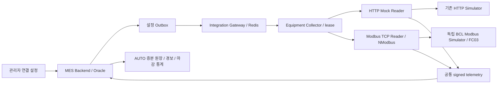

# 설비 통신을 HTTP Mock에서 Modbus TCP로 확장한 과정

작성: 2026-11-17. 상태: 구현·검증 완료. 실제 PLC 하드웨어와 OPC UA 지원 완료를 뜻하지 않는다.

## 개요: 왜 통신 방식을 다시 검토했는가

FactoryMES는 관리자 화면에서 연결 정보를 등록하면 Oracle 원본 설정이 Outbox를 거쳐
Integration Gateway의 Redis에 반영되고, 설비 Connector가 주기적으로 값을 읽는 구조였다.
이 단계까지는 HTTP Mock 설비가 JSON으로 누적 생산량·온도·운전 상태를 내려주었다.
로그인부터 경보·AUTO 생산실적·마감 통계까지 흐름은 검증했지만, 설비의 통신 주소와
자료형을 해석하고 실제 산업 통신 오류를 다루는 부분은 설명하기 어려웠다.

이번 목표는 PLC를 구매하거나 통신 화면만 추가하는 것이 아니었다. 무료 로컬 환경에서
실제 산업 프로토콜의 요청·응답을 수행하고, 받은 값을 기존 생산 실적까지 연결하는 것이었다.
특히 연결이 끊겼을 때 어떤 값을 저장하지 않아야 하는지, 누적 카운터를 어떻게 정수로 보존하는지,
기존 로그인·수집 증명·중복 처리·경보·마감 규칙을 어디까지 재사용할지 결정해야 했다.

사용자가 공유한 [기존 포트폴리오 서술 예](http<LOCAL_PATH>)를
읽고, 배경→대안에서 걸린 지점→변경 범위와 위험→선택→검증→후속 조건 순으로 정리했다.
그 사례의 구현 내용을 이번 MES의 성과로 옮기지 않았으며 Notion 페이지를 수정/발행하지 않았다.

## 무엇을 왜 비교했는가

후보는 Modbus TCP와 OPC UA였다. 둘 다 C#에서 사용할 수 있으므로 언어만으로 선택할 이유는 없었다.
두 방식을 단순히 ‘오래됨/최신’으로 나누면 이번 요구에서 실제로 필요한 판단이 빠진다.
따라서 아래 질문을 먼저 만들고, 각 질문이 요구하는 구현과 검증 비용을 비교했다.

| 비교 질문 | 이번 프로젝트에서 이 질문이 필요한 이유 |
|---|---|
| 장치가 값을 어떤 주소/타입으로 표현하는가? | 카운터와 온도를 원장에 넣기 전 잘못된 값 변환을 차단해야 한다. |
| 현재 필요한 데이터가 무엇인가? | 누적 카운터와 온도에 비해 더 큰 정보 모델을 먼저 도입할 필요가 있는지 판단한다. |
| 읽는 주체와 전송 주기는 누가 관리하는가? | 기존 Connector polling과 미확인 배치 재전송을 얼마나 바꿔야 하는지 확인한다. |
| 값의 시간·품질을 어디까지 신뢰할 수 있는가? | 신선도·HIGH 유지시간·AUTO 기준값을 잘못 설명하지 않기 위해서다. |
| 통신 장애 후 어떤 상태를 복구해야 하는가? | socket뿐 아니라 session·subscription·queue 복구까지 범위에 들어오는지 확인한다. |
| 장치 인증과 암호화는 어떻게 마련되는가? | 웹 로그인/JWT가 장치 통신의 보안까지 해결한다고 오해하지 않기 위해서다. |
| 무료로 재현 가능한가? | 개인 포트폴리오이므로 장비·상용 SDK·유료 서버가 필수여서는 안 된다. |
| 기존 서비스의 변경 범위가 어디까지인가? | 도메인·Gateway·DB·UI까지 동시 변경하면 원인 분리와 검증이 어려워진다. |
| 실제로 무엇을 시연하고 증명할 수 있는가? | 통신 성공 한 줄보다 입력 오류·단절·변환·업무 결과를 설명할 근거가 필요하다. |

## 공식 자료에서 확인한 사실과 프로젝트 판단

Modbus는 function code 기반 요청/응답과 레지스터를 제공한다. FC03은 holding register 읽기이며,
문서상의 40001 같은 참조 표기와 wire상의 0기반 주소를 혼동하지 않아야 한다.
한 번의 FC03 읽기 상한은 125 registers다. TCP 전송에서는 MBAP가 요청 식별 등의 역할을 한다.
[Modbus application specification](http<LOCAL_PATH>),
[Modbus TCP implementation guide](http<LOCAL_PATH>).

OPC UA는 주소 공간의 Node와 관계·자료형으로 장치 의미를 표현하고,
MonitoredItem/Subscription으로 변경 알림을 전달할 수 있다. 이 장점은 단순 숫자 수집을 넘어
설비 모델을 탐색하고 다양한 제조사 장치의 의미를 관리할 때 더 중요해진다.
[OPC UA AddressSpace와 모델](http<LOCAL_PATH>),
[Subscription services](http<LOCAL_PATH>).

아래 표의 기술적 출발점은 위 규격이지만, ‘이번 변경이 커진다/다음으로 미룬다’는 평가는
FactoryMES의 현재 구조와 범위에 대한 구현자의 판단이다. 보편적 성능 순위나 시장 점유율 주장이 아니다.

| 항목 | Modbus TCP를 적용하면 | OPC UA를 적용하면 | 이번 판단 |
|---|---|---|---|
| 값 식별 | unit·function·address와 현장 register map 필요 | Namespace/NodeId와 Node 탐색/모델 계약 필요 | 주소/형 변환을 명시적으로 시연한다. |
| 의미/단위 | 애플리케이션 매핑으로 부여 | 정보 모델에서 의미를 표현할 수 있음 | 기존 MetricCode/Unit 매핑을 재사용한다. |
| 수집 | FC03 주기 읽기로 현재 polling에 맞음 | Read도 가능하고 구독 방식도 가능 | polling 변경을 제한한다. UA가 구독만 지원한다는 뜻은 아니다. |
| 시간/품질 | 기본 register에는 범용 source timestamp/quality가 없음 | DataValue 시간/StatusCode를 다룰 수 있음 | 수집 시각·통신 성공과 장치 자체 정상 상태를 구분한다. |
| 장애 | 연결/응답/형식/timeout과 재시도 제어 | 해당 구성에 따라 session·subscription·재알림 복구도 필요 | 먼저 bounded socket과 공통 업무 배치를 검증한다. |
| 확장성 | register map 관리 부담이 증가 | 풍부한 모델·탐색/이벤트 통합에 유리 | 실제 UA 모델 요구가 생길 때 도입을 재평가한다. |
| C# 생태계 | NModbus 오픈소스 client 사용 가능 | OPC Foundation .NET stack 사용 가능 | 돈 때문에 UA를 제외한 것이 아니다. |
| 시연 근거 | 실제 bytes/word order·단절·카운터 원장 연결 | 모델·인증서·구독 복구까지 보여줄 수 있음 | 현재 준비된 MES 업무와 끝까지 연결할 수 있는 범위를 먼저 택한다. |

### 보안도 별도로 비교했다

일반 Modbus TCP에 웹 로그인 같은 장치 인증을 기대하면 안 된다. 반면 Modbus Security는
별도 TLS/인증서 구성을 제공하며 통상적인 평문 Modbus TCP와 구분해야 한다.
OPC UA도 보안 기능이 있다는 사실만으로 모든 배포가 안전해지는 것은 아니고,
선택한 정책과 신뢰 목록·인증서 수명 관리가 실제 구성에 들어가야 한다.
[Modbus Security 규격 안내](http<LOCAL_PATH>),
[OPC UA Security model](http<LOCAL_PATH>).

이번 구현은 평문 Modbus TCP이며 TLS variant를 구현하지 않았다. 따라서 로컬 Docker internal
simulation 망에서만 사용하고 TCP1502를 호스트/외부에 publish하지 않는다. Backend와 Connector는
고정 simulator host/port/unit 형식을 각각 검증한다. 이는 배포 범위를 제한한 것이며
실제 PLC 인증·현장 망분리·인증서 운영을 완료했다는 의미가 아니다.

### 비용과 라이선스를 비교한 이유

무료로 진행한다는 요구 때문에 ‘OPC UA는 유료라서 안 된다’고 결론 내릴 수는 없었다.
실제 선택한 NModbus3.0.83의 프로젝트 라이선스는 MIT이며, 조사 시점 OPC Foundation .NET
저장소의 master도 OPC Foundation MIT 라이선스를 안내한다. 상용 제품/다른 버전의 조건은 별도다.
[NModbus](http<LOCAL_PATH>),
[NModbus3.0.83 package](http<LOCAL_PATH>),
[UA .NET stack license](http<LOCAL_PATH>).

이번에는 SDK 라이선스 비용보다 필요한 검증 범위와 변경 계층 수를 판단 근거로 사용했다.
공식 NuGet 패키지를 버전 고정하고 lock file을 갱신하며, 유료 toolkit/클라우드 서비스는 구매하지 않는다.
라이선스 표시는 배포 시 함께 관리해야 하며, 무료 패키지가 운영 보증이나 장비 인증을 뜻하지 않는다.

## 대안에서 걸렸던 지점과 선택

HTTP Mock만 유지하는 대안은 기존 기능과 가장 잘 맞지만 산업 프로토콜을 직접 다뤘다는 근거가
남지 않는다. 반대로 Modbus와 OPC UA를 동시에 도입하면 실패한 수집이 프로토콜·매핑·DB·업무 중
어디에서 생겼는지 분리하기 어렵고 각 프로토콜의 핵심 운영 문제를 얕게 다룰 가능성이 있었다.

OPC UA를 먼저 도입하는 방법도 가능했다. 다만 이번 데이터 요구는 이미 표준 metric으로 정의된
누적 카운터와 온도이고, 장치 모델 탐색·이벤트·인증서 운영을 요구하는 실제 대상이 없었다.
이 상황에서 UA 모델과 session/subscription 관리까지 넓히기보다, 숫자 해석 오류가 AUTO 원장에
어떤 영향을 주는지 검증하는 쪽이 지금의 MES 기능과 연결된다고 판단했다.

그래서 **Modbus TCP FC03 읽기 어댑터를 먼저 구현**하고, 프로토콜마다 바뀌는 읽기/해석과
이미 검증한 인증 배치/재전송/업무 처리를 분리했다. OPC UA 구현을 꺼진 선택지로 보여주거나
빈 OPC UA 클래스를 만들어 지원한다고 표시하지 않았다. 필요 조건이 생기면 같은 읽기 경계부터
확장하되, 구독 방식의 수명과 flow control은 별도 설계해야 한다.

## 기존 구조를 어디까지 바꿨는가

Gateway 안에 Modbus socket을 넣지 않았다. Gateway는 설정과 수집 허가를 중계하고,
Connector의 Reader가 장치 통신을 수행한다. 이렇게 해야 프로토콜 장애와 업무 인증/저장을
분리해서 볼 수 있고, 장치 연결 수가 늘 때 Connector를 따로 다룰 수 있다.
이 구조만으로 운영 MSA 분산 보장이나 무제한 병렬 수집이 확보되는 것은 아니다.

IEquipmentReader의 입력은 확정된 EquipmentResolvedConfig, 출력은 획득 시각과 표준 지표다.
HTTP/Modbus 두 구현이 있어 공통 인터페이스를 사용했다. Collector는 기존 lease·설정 hash·획득
시각·event ID·미확인 배치 재전송·ACK 검증을 소유한다. Backend는 Oracle 저장·중복·AUTO·경보를
소유한다. 새 TCP 설정을 저장하기 위해 테이블을 복제하지 않고 기존 protocol/endpoint/source_path를
사용한다. ConnectorType은 equipment-http와 equipment-modbus-tcp를 명확히 구분한다.

## 왜 설정 테이블을 하나 더 만들지 않았는가

unit ID·function·register 주소를 별도 열/테이블로 정규화하면 항목별 제약이 명확해지는 장점이 있다.
프로토콜별 JSON 설정을 두면 확장하기 편하지만 스키마 버전·필드 검증·과거 설정 재해석 책임이 생긴다.
기존 endpoint/source_path를 재사용하면 현재 HTTP 설정과 같은 저장/버전/Outbox 경로를 유지할 수 있다.
이번은 FC03과 소수 자료형만 지원하므로 마지막 방법을 택하고, parser와 타입 일치 검증을 공통화했다.

`modbus.tc<LOCAL_PATH>`은 이 프로젝트의 설정 표현이다. Modbus wire에서 URL을 보내는 것이 아니며,
실제 통신은 host/port/unit을 추출한 뒤 MBAP와 FC03 binary 요청으로 수행한다.
‘Modbus의 공식 URL 표준’이라고 설명하지 않는다. 장래 UA NodeId나 복잡한 장비 설정이 추가되면
기존200자 source_path에 모든 것을 억지로 넣기보다 typed 설정·버전·필드 길이를 다시 검토한다.
현재의 재사용은 DB migration을 무조건 피한다는 원칙이 아니라 이번 범위에서 변경을 제한한 선택이다.

## 왜 주소/형식을 이 정도로 제한했는가

endpoint는 `modbus.tc<LOCAL_PATH>` 형식으로 고정하고 unit은1..247이다.
이는 이번 제품 정책이며 Modbus의 모든 장치가 이 범위/포트를 쓴다는 뜻은 아니다.
같은 canonical endpoint를 다른 설비에 중복 연결하는 것은 PRODUCT 참조 잠금 안에서 막는다.
단순 문자열 변형으로 중복 검사를 피하지 못하도록 주소를 canonical 형식으로 제한했다.

SourcePath는 `holding:0:UINT32:ABCD`처럼 wire address·자료형·순서를 모두 쓰게 했다.
‘40001이면 알아서0으로 바꿔준다’는 방식은 장비 문서가 다른 표기 체계를 쓸 때 조용히 잘못된
주소를 읽을 수 있어서 채택하지 않았다. 0기반 주소라는 설명을 UI와 문서에 함께 둔다.
16bit는 AB/BA, 32bit는 ABCD/CDAB/BADC/DCBA를 지원한다. 음수·unsigned 상한·IEEE754
유한값을 구분하고 NaN/Infinity를 수치 원장으로 보내지 않는다.

활성 태그들의 최소 주소부터 마지막 word까지 하나의 FC03 block으로 읽으며 span125를 넘으면
설정을 거절한다. 여러 요청을 자동 분할하는 대안은 떨어진 주소를 편하게 읽을 수 있지만,
카운터 high/low word와 다른 태그의 읽기 시점이 섞일 수 있어 이번 범위에서는 사용하지 않았다.
한 FC03 자체가 실제 PLC의 scan-cycle 원자성을 항상 보장하지는 않는다. 실제 장치의 latch/동시
갱신 규격은 별도 확인해야 하며 로컬 simulator는 한 elapsed snapshot으로 응답을 만든다.

NUMBER는 scale/offset 후 소수6자리로 맞춘다. COUNTER는 unsigned 정수 자료형·scale1/offset0를 설정 저장부터 요구하고, 수집 때도 비음수
정수를 다시 검사한다. 영구적으로 읽기 실패할 설정을 미리 막고 AUTO의 EA 규칙도 유지한다. 정수 카운터를
FLOAT32로 받으면 정밀도 손실이 조용히 생산량으로 바뀔 수 있어 허용하지 않는다.

## timeout과 재시도는 왜 기존 polling과 분리했는가

NModbus 자체 재전송과 Collector 재시도가 겹치면 한 번의 polling이 예상보다 오래 걸릴 수 있다.
특히 busy 응답 재시도가 무제한이 되는 기본 동작은 제한해야 했다. Retries=0과
SlaveBusyUsesRetryCount=true를 명시하고, connect/read를 전체 timeout 안에서 수행한다.
HTTP의 deadline은 Collector가, Modbus의 connect/read 전체 deadline은 Reader가 소유한다.
중첩된 deadline이 timeout을 일반 취소로 잘못 분류하지 않도록 했다.
CancellationToken이 취소되면 실제 TcpClient를 닫고 pending read task도 관찰한다.
WaitAsync만 먼저 끝내고 뒤에서 통신이 계속되는 구조를 피한다.

한 polling의 일부 태그만 성공했을 때 부분 GOOD를 저장하지 않고 전체 실패로 처리한다.
성공한 값은 기존 표준 이벤트로 한 번 만들고, Backend ACK가 불명확하면 같은 이벤트를 재전송한다.
장치 읽기 재시도와 ‘이미 읽은 값의 저장 재전송’은 다른 문제로 다룬다.
이 원칙은 실제 wire 실패 시험과 기존 HTTP 회귀를 각각 수행해 확인한다.

## 라이브러리 선택 후에도 응답 검사를 확인한 이유

처음 독립 TCP peer 시험73개는 정상 분할 수신·transaction/unit 불일치·Modbus 예외·끊긴 응답·
timeout/취소와 값 변환을 확인했다. 하지만 그 결과로 모든 header 오류를 거절한다고 말할 수는
없었다. 그래서 MBAP protocol ID와 선언 length를 다르게 보낸 응답을 추가로 만들었다.

NModbus3.0.83의 실제 DLL은 protocol ID=1인 응답과 선언 payload 안에 불필요한1byte가 붙은
응답에서 값을 반환했다. 반면 byteCount 불일치와 FC04 응답은 거절했다.
[패키지 commit의 transport 소스](http<LOCAL_PATH>)를
읽고 실제 fake peer probe로 확인한 결과이며, 모든 버전/사용법에 대한 취약점 선언은 아니다.

대안은 패키지를 바꾸거나 client를 전부 직접 만드는 것이었다. 다만 주소/정수 변환 문제를 풀기 위해
요청 생성과 프로토콜 전체까지 다시 소유하면 이번 범위가 커진다. 따라서 이번에 지원하는 FC03의
응답 framing만 검사하는 작은 StrictModbusTcpTransport를 두었다. protocol0·length3..253을
먼저 검사하고, FC03의 실제 byteCount/전체 길이를 요청 register 개수와 일치시킨다.
예외 응답 길이도 검증한다. 이후 객체 생성과 transaction/unit/function 대조는 NModbus를 재사용한다.

검사를 추가하기 전 잘못 수용했던 응답이 거절되고 정상 분할 수신은 유지되는지 재실행했다.
추가 응답6종과 설정 단계 COUNTER 변환 거절을 포함한 최종93개 시험은 별도 보고서로 남겼다.
‘라이브러리 사용’ 자체보다 어떤 신뢰 경계를 확인하고 보강했는지를 설명할 근거가 되었다.

## 값의 출처와 한계

이번 simulator는 로컬 프로그램이지만 통신은 JSON 대체 호출이 아니라 실제 TCP/MBAP/FC03이다.
NModbus client와 같은 구현체를 simulator에 재사용하지 않고 BCL server를 별도로 두어,
양쪽이 같은 라이브러리의 해석에만 맞춰지는 위험을 줄였다. 이것은 표준 인증을 대체하지 않는다.

레지스터0..1은 unit별 누적 카운터,2는0.1℃ 단위 signed 온도,3은운전 상태 코드,
4..5는FLOAT32 123.5,6..7은0x12345678,8은signed -123이다. 상태 코드3은 숫자 태그로
읽을 수 있지만 이번 기본 수집과 Runtime.OperatingState 문자열 변환에는 사용하지 않는다. 카운터는 읽을 때마다가 아니라
프로세스 경과 시간으로 증가한다. 장치를 다시 시작하면 raw가 낮아질 수 있고 기존 AUTO의
리셋 확인 흐름이 처리한다. 강제 reset용 업무 API를 추가하지 않는다.

Modbus 값에는 PLC 원천 timestamp가 없으므로 SampledAt은 Connector 읽기 완료 UTC다.
GOOD는 이번 통신/변환을 통과했다는 의미이며 장치 자체 정상·공정 값의 물리적 정확도 보증이 아니다.
통신은 계속되지만 register가 멈춘 경우를 COMM_LOST가 잡는다고 주장하지 않는다.
카운터 wrap도 장치 규격을 모르는 상태에서 추정하지 않고 기존 감소/재기준 절차를 사용한다.

## 검증 결과와 남긴 증거

최종 통합 보고서는 `verification-results/modbus-summary-2026-11-17.json`이다.
다음 **422개 통합 단언이 통과**했다. 단위 테스트 수가 아니며 HTTP 상태·업무 결과·동일 원장 확인을
포함한다. 최초 실패·같은 시험의 재실행·이전 AUTO 단계768개는 합산하지 않았다.

| 검증 | 통과 | 실제로 확인한 내용 |
|---|---:|---|
| 프로토콜/형 변환 | 93 | 독립 raw TCP peer, signed/unsigned/float·byte/word, malformed MBAP, 분할/끊김/timeout/취소, 설정 경계 |
| 실제 수집/장애/AUTO/통계 | 65 | NModbus→독립BCL simulator→Oracle8지표, 설정/권한/unit중복, stop/restart/reset/rebase, 실적/마감/일별 통계 |
| Modbus 브라우저 | 12 | 실제 폼 등록·5태그 수집·프로토콜별 입력 보존·v2 배율/과거v1 유지·unit중복 원인/입력 보존·AUTO마감 |
| 기존 HTTP/API | 227 | HTTP수집41·기존AUTO88·HIGH50·통신경보48 |
| 기존 HTTP/브라우저 | 25 | HTTP설비설정12·기존AUTO화면13 |

Windows native와 최종 Linux 컨테이너에서 wire 시험을 수행했다. 임시 사본 결과만으로 완료 처리하지
않고 실제 배포 이미지에서 확인했다. 전체12프로젝트 Release 경고0/오류0,10개 상시 서비스 healthy,
기존32테이블/56FK와 계정을 보존했다. DB migration/초기화는 이번에 하지 않았다.

실제 장애 시험에서는 simulator 컨테이너를 정지해 RETRYING과 새 GOOD 미생성을 확인하고,
재기동 뒤 CONNECTED·counter 감소/Invalid·Version 상승·사유 있는 rebase·새 기준/생산 재개를
확인했다. 최종 실행의 마감 결과는 총8·불량1이며 원장과 KST 통계가 일치했다.
이는 실행 시간에 따라 달라질 수 있는 관측값이고 시험은 원장·구간별 raw 증가분을 대조한다.
Simulator는 finally에서 복구하며10개 서비스가 healthy인 것을 재확인했다.

주요 증거는 `modbus-protocol-verification.json`, `modbus-collection-verification.json`,
`FactoryMES-browser-modbus-collection-verification.json`, `modbus-regression-summary.json`과
`FactoryMES-modbus-collection.png`다. API 시험의 직접 DB 준비는 고유 품목/라인/설비뿐이며
작업지시·계측·생산 원장은 실제 API/Collector 경로로 생성했다. 이력은 지우지 않고 연결을 중지했다.

### 구현/검증 중 수정한 지점

- Tooling에 Backend/Connector 두 호스트를 참조하면서 publish appsettings 충돌이 발생했다.
  오류 검사를 끄지 않고 Tooling에만 호스트 설정 파일의 publish 제외 Target을 적용했다.
  실제 서비스의 설정은 유지하고 native publish와 Docker publish를 모두 확인했다.
- 실제 reset 장애를 추가한 뒤 시험에 남아 있던 ‘중단 없는 end-start’ 단언이 실패했다.
  기능은 원장을 보존했으며 시험을 ‘리셋 전 원장 + 재기준 이후 증가분’ 대조로 고쳐65개를 재실행했다.
- 브라우저는 label 앞 공백 때문에 소스 주소 탐색이 실패했다. 코드가 포함된 tag 행 안에서
  부분 일치로 찾도록 수정하고 실제 재조회·배율 수정·v2 수집까지 확인했다.
- Claude의 독립 검토에서 영구 실패할 COUNTER 소수 배율을 등록 시 막고, Modbus timeout의
  소유자를 Reader 하나로 한정했다. 모든409를 버전 충돌로만 보이던 안내에 서버 원인도 표시했다.
  최종 재검토에서 새 기능 결함은 없었고 문서 수치/미검증 범위 지적도 반영했다.

재현은 `tools/verify-modbus.ps1`의 Protocol/Collection/Browser/Fault 모드로 분리했다.
Fault는 로컬 Modbus simulator를 잠시 멈추므로 일반 조회용 실행과 구분했다. 무료 공식 패키지와
로컬 이미지 외 유료 호출·외부 발송·실제 PLC 제어는 없다.

## 어떤 조건이면 OPC UA를 다음 단계로 선택할 것인가

실제 장치가 UA endpoint를 제공하고 Node 모델을 탐색해야 하거나, 공급업체 간 설비 모델의
의미를 공유해야 하거나, source timestamp/StatusCode·구독 이벤트가 요구된다면 다시 비교한다.
그때는 Namespace/NodeId 안정성, sampling/publishing/queue 설정, 단절 후 republish와 중복,
인증서 trust/만료·폐기, 장치 서버 제품과 실제 보안 정책을 검증해야 한다.
현재 IEquipmentReader는 polling의 한 번 읽기 계약이다. UA Read에는 연결할 수 있어도
장기 Subscription을 이 메서드에 억지로 감싸지 않고 session manager·event 흐름을 별도로 설계한다.
기존 metric 계약만으로 그 모든 의미가 보존된다고 가정하지 않는다.

이번 결론은 ‘OPC UA를 할 수 없어서 제외’도 ‘Modbus가 더 빠르고 저렴해서 항상 유리’도 아니다.
현재 요구에서 운영 경계가 명확하고 실제 업무까지 검증 가능한 범위를 먼저 완성한 선택이다.

## 운영과 재현 시 남은 범위

비활성 target도 unit과 설비의 기존 연결을 보존한다. 다른 설비로 재배정하는 업무 절차는 이번에
만들지 않았다. 같은 설비가 같은 unit을 참조하는 것은 허용하지만 다른 설비의 재등록은 막는다.
검증은 고유 fixture와 남은 unit을 사용하므로 보관된 fixture가247개 unit을 모두 쓰면 테스트 설비
재사용/정리 정책이 필요하다. 임의로 과거 이력을 지우거나 unit을 강탈하지 않는다.

Modbus Runtime.OperatingState 문자열은 이번에 만들지 않았다. 숫자 상태 register를 수집하는 것과
제조 설비의 상태 코드 의미를 RUNNING/STOPPED로 해석하는 것은 별도 계약이다.
실제 장치에서는 이를 register map과 함께 정의해야 한다.

실제 PLC 하드웨어, 인증서/TLS variant, OPC UA, 다중 노드·고부하, 장시간 장치 펌웨어별 상호운용은
검증한 것으로 적지 않는다. Modbus 대상의 COMM_LOST/HIGH 발생→복구→조치→종결 전체는
이번에 별도로 재시연하지 않았으며 HIGH/경보 회귀는 기존 HTTP 자료로 확인했다.
로컬 시뮬레이터와 실제 TCP가 만들어 준 근거의 범위를 분리한다.
