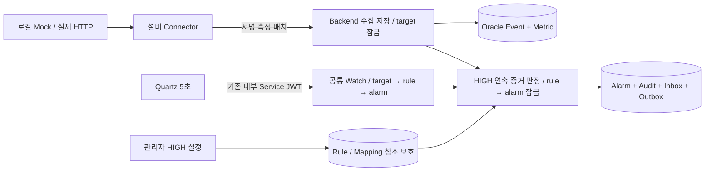

# FactoryMES — HIGH 임계치 경보·제조 업무 화면 정리

2026-11-14. GPT: 규격·판정/수집/참조보호·Oracle 검증·배포·통합 기록. Claude: HIGH 관리자 설정·공통 콘솔 디자인·브라우저/모바일 검증·독립 읽기 검토.

## 1. 사용자 요구와 범위

통신이 살아 있어도 온도 같은 측정값이 위험 범위에 머물 수 있다. 기존 COMM_LOST·ACK·조치·종결·알림함에 HIGH를 추가했다. 관리자가 실제 저장된 수치 매핑을 선택하고 발생/복구 임계값과 각각의 유지시간을 설정하면, 실제 Mock 수집값으로 발생과 복구를 판정한다. 같은 요청에서 프론트 화면도 업무 포트폴리오에 보여 줄 수 있도록 공통 색상·타이포·표·버튼·상태 배지를 정리했다.

기존 RuleWrite/RuleUpdate/RuleView와 31테이블·53FK를 그대로 사용한다. 새 유료 라이브러리·외부 폰트·AI 호출·메시지 실발송·새 DDL·API키는 없다. LOW/RATE/이상탐지·자동 설비 제어·실제 PLC 프로토콜은 이번 범위에 없다. HIGH는 경보 종류이며 심각도(INFO/WARN/CRITICAL)와 별개다.

## 2. 규격과 사용자 흐름

- HIGH는 같은 연결·설비에 속한 사용 중인 NUMBER/COUNTER 매핑을 지정한다. STATE 매핑은 거절한다.
- triggerHigh와 clearBelow는 정수12자리·소수6자리 범위의 canonical 소수 문자열이다. clearBelow < triggerHigh가 필수다.
- holdSec와 clearHoldSec는 각각 0~3600초다. 0은 최신 정상 측정1건으로 판단한다.
- 값 ≥ triggerHigh를 holdSec 동안 연속 측정하면 ACTIVE를 만든다.
- ACTIVE에서 값 ≤ clearBelow를 clearHoldSec 동안 연속 측정하면 같은 경보를 RECOVERED로 바꾼다.
- 두 임계값 사이에서는 현재 상태를 유지하고 해당 발생/복구 연속 구간은 끊는다. 이 간격이 경계 부근의 잦은 열림/닫힘을 줄이는 히스테리시스다.
- 복구해도 ACK·조치 완료·CLOSED를 자동으로 만들지 않는다. 기존 작업자 범위와 관리자 정상/강제 종결 조건을 그대로 사용한다.

예: 온도 발생26.0℃/복구25.8℃, 각각2초 유지. 26.0 이상이 연속2초이면 발생하고, 25.9는 복구 조건이 아니다. 25.8 이하가 연속2초 쌓이면 복구한다. 서버 시간이2초 지났다는 이유로 같은 캐시 값1건을 계속 본 것을 연속 측정으로 계산하지 않는다.

관리자는 /alarms의 연결 → 경보 종류 HIGH → 수치 매핑 → 발생/복구 임계값 → 유지 초 → 등급·사용 순서로 입력한다. 기존 통신 끊김 규칙은 종류 COMM_LOST, 수치 필드 모두 null을 유지한다. HIGH는 같은 연결에 여러 규칙을 만들 수 있다(기존 DDL은 COMM_LOST만 연결당1건을 제한). HIGH 생성의 불확실한5xx 응답을 자동 재전송하지 않고 목록을 확인하게 한다.

## 3. 대안 비교와 선택 이유

| 고민 | 선택 | 이유·대가 |
|---|---|---|
| 임계값 한 개로 발생/복구 | 두 임계값과 별도 hold | 노이즈로 경계에서 반복 전환되는 것을 줄이고 제조 현장의 복구 기준을 별도로 설명할 수 있다. |
| 메모리 타이머 | Oracle 측정 이력으로 연속 구간 복원 | 재시작 때 증거가 사라지지 않고 여러 평가 경로가 같은 근거를 읽는다. 반복 이력 조회 비용은 늘어난다. |
| 새 판정 상태 테이블 | 기존 TelemetryMetric/Event 사용 | 현재31테이블을 바꾸지 않고 측정 증거와 판정을 연결한다. 대량 처리에서는 전용 상태/체크포인트가 더 효율적일 수 있다. |
| Quartz5초만 판정 | 수집 저장 직후 + Quartz 보조 재평가 | 2초 유지 후 배치 사이에서 끝난 짧은 초과도 수집 건마다 평가해 놓치지 않게 한다. 수집 트랜잭션에 판정 비용이 들어간다. |
| 배치 끝에서1회 판정 | 배치 안의 새 측정마다 판정 | 한 배치 안에서 열리고 복구된 에피소드를 마지막 값으로 덮어 놓치는 일을 줄인다. 다만 최신 근거가 이미 stale인 과거 재전송은 경보를 뒤늦게 생성하지 않는다. |
| 수집과 판정 트랜잭션 분리 | 이번에는 한 트랜잭션 | 측정·경보·알림·이벤트를 일관되게 저장한다. 판정 예외가 생기면 측정도 롤백되는 결합을 감수한다. |
| BAD를 제외한 좋은 값만 조회 | BAD/UNCERTAIN도 연속 구간에 포함 | 불량 측정 사이를 건너뛰어 정상 연속 측정으로 오인하지 않는다. |
| 마지막 GOOD 캐시만 판정 | 원본 이력의 최신 품질·시각 검사 | 최근 BAD나 오래된 측정을 숨기고 캐시만으로 복구시키지 않는다. |
| ACTIVE 중 임계값 수정 | ACTIVE 없음일 때 조건 변경 | 이미 발생한 사건의 의미를 새 기준으로 바꾸지 않는다. 등급·사용 변경은 허용하지만 기존 snapshot은 보존한다. |
| 소스 배율/단위 변경 허용 | 사용 중인 HIGH 근거 매핑 보호 | 같은 숫자를 다른 단위/배율로 해석해 가짜 복구를 만드는 것을 막는다. |

초안에서는 기존 Quartz만 재사용하려 했으나, 주기보다 짧은 유효 초과를 놓칠 수 있어 배포 전에 수집 직후 평가를 추가했다. 기존 수집 트랜잭션 안에서 같은 DbContext/판정 함수를 호출하므로 새로운 서비스·엔드포인트·브로커가 필요하지 않다.

## 4. 판정 근거와 안전한 실패



각 규칙의 현재 ConfigVersion 측정만 읽는다. 시작점은 규칙 수정 시각, 연결 활성화 시각, 억제 종료 시각(있으면), ACTIVE 생성 시각(복구 평가 시), now-hold-stale 중 가장 늦은 시각이다. 그 이전 값을 새 정의의 증거로 재사용하지 않는다.

최신 측정의 SampledAt과 ReceivedAt이 모두 staleSec 안에 있어야 한다. 미래2초를 넘는 측정은 거절한다. 최신부터 역순으로 GOOD·숫자·현재 조건을 만족하고, 샘플 사이 간격이 staleSec 이하인 구간을 찾는다. 최신과 시작 측정 시각의 차가 hold 이상일 때만 전환한다. BAD/UNCERTAIN/null·조건 이탈·시각 역전·수집 공백은 연속 구간을 끊는다. 시간 경과나 heartbeat는 증거를 늘리지 않는다.

조회는 최대10001행까지 읽고10000행을 넘으면 상태를 바꾸지 않는다. 근거 부족을 정상 복구로 해석하지 않는 보수 정책이다. 현재 Mock의1초 주기·hold 최대3600·stale 최대3600이면 보통 범위 안이지만, 내부 입력 폭주·고주파 장비에는 별도 증분 판정/집계와 부하 검증이 필요하다. 제한 초과 경보나 별도 운영 지표까지 이번에 추가하지 않았다.

서버 시각과 설비 측정 시각을 함께 사용하므로 시계 동기화가 전제다. Mock은 같은 호스트 시계를 쓴다. 실제 PLC/원격 수집 도입 시 NTP·허용 지연·측정 기준시각 정책을 따로 정해야 한다. 등급·사용 여부만 수정해도 Rule.UpdatedAt이 바뀌어 연속 근거를 다시 쌓는다. 수집주기/stale 변경도 ConfigVersion을 바꾸므로 새 설정의 증거부터 시작한다. 이로 인해 복구가 늦어질 수 있지만 과거 근거를 재해석하지 않는 쪽을 택했다.

## 5. 트랜잭션·버전·중복·참조 보호

수집은 기존 TargetAsync FOR UPDATE 뒤 새 Event/Metric을 저장하고 HIGH 규칙을 ID순서로 잠근다. 이후 ACTIVE Alarm을 잠가 발생/복구를 결정한다. Quartz도 target→rule→alarm 순서라 같은 에피소드를 이중 생성하지 않는다. 규칙당 ACTIVE1건 DB 고유 키도 유지한다.

수집·경보·감사·개인 알림함·Outbox는 같은 트랜잭션이다. exact duplicate 이벤트는 기존 DUPLICATE 경로에서 읽기 전용으로 끝나 HIGH를 다시 실행하지 않는다. 감사 principal은 수집 경로 equipment-connector, 배치 경로 jobs-worker로 구분한다. HTTP를 트랜잭션 안에서 호출하지 않는다.

판정 오류가 나면 해당 측정 배치도 롤백되고 Connector는 기존 같은 이벤트를 재전송한다. 이는 조용히 판정을 유실시키지 않는 대신 수집 가용성과 결합되는 한계다. 판정 예외를 무조건 삼켜 정상 ACK를 보내는 방식은 택하지 않았다. 향후 수집량이 커지면 durable telemetry 이벤트/평가 체크포인트로 트랜잭션을 나누고 소비자 멱등성을 보장하는 대안을 검토한다. 현재 Connector의 메모리 재전송 창·영속 spool 미구현 한계도 그대로다.

RuleUpdate는 expectedVersion을 확인한다. target/equipment/kind는 기존처럼 불변이다. HIGH mapping/trigger/clear/hold 변경은 ACTIVE가 있으면409, 없으면 허용한다. 기존 경보의 RuleVersion/RuleSnapshot/Severity/TriggerValue/TriggerSampleAt은 보존한다. mapping은 같은 target의 enabled NUMBER/COUNTER여야 한다.

연결 설정 변경 때 enabled HIGH 또는 ACTIVE 경보에 쓰인 매핑은 누락·중지·경로/단위/데이터형식/배율/오프셋 변경을409로 거절한다. 먼저 규칙 중지와 경보 처리를 해야 한다. 대상 연결 자체의 수집 중지는 가능하며, 이를 HIGH 복구로 위조하지 않는다.

Claude 독립 검토에서 보호 매핑에 여러 입력이 동시에 대응하면 SingleOrDefault가500을 낼 수 있음을 발견했다. 후보 목록의 개수를 먼저 검사해422로 거절하도록 고치고 부정 입력을 검증에 추가했다. 정상 UI에서 만들기 어려운 입력도 API 경계에서 처리한다.

## 6. API·이벤트·알림·조회 권한

새 공개 경로는 만들지 않았다. 기존 /api/v1/alarm-rules POST/PUT/GET과 Rule DTO의 HIGH 필드를 활성화했다. 공통 Cookie+HTTPS+출처+CSRF와 ADMIN 설정 정책을 유지한다. 작업자는 기존 담당 설비/명시 중지 이력 범위의 경보를 조회·ACK하고 조치를 남길 수 있다.

발생/복구는 기존 mes.alarm.changed.v1 OPENED/RECOVERED다. HIGH snapshot에는 target/equipment/mapping/metricCode/unit/kind/severity/ruleVersion/configVersion/발생·복구 임계·유지초를 저장한다. TriggerValue와 TriggerSampleAt도 DB에 남긴다. canonical AlarmView에는 이 필드가 없어 이번 UI에 임의 확장하지 않았다. 표시와 원본 검증은 규칙 목록·Oracle 증거를 기준으로 구분한다.

알림 제목은 HIGH 발생 '측정값 상한 초과', 복구 '측정값 정상 복귀'로 통신 끊김과 구분한다. 활성 관리자·해당 설비 현재 담당 작업자에게 생성 시점 수신자를 확정한다. 알림 읽음과 ACK는 별개다. 새 Outbox는 PENDING 보존이며 Kafka/외부 이메일/채팅 전달기를 구현한 것은 아니다.

## 7. 화면 디자인과 검토

frontend-design 스킬의 계획→초안 검토→구현→실제 화면 확인 순서를 적용했다. 제조 업무는 눈에 띄는 광고용 hero보다 상태·입력·조치의 읽는 순서가 중요해, 임의 KPI나 가짜 차트 대신 경보 목록→선택 상세/조치→규칙 설정의 우선순위로 정리했다.

- Navy #142D46 헤더, Cool #F1F5F9 바탕, Ink #20334A 본문, Teal #087E8B 작업 강조, Amber #A15C00 주의, Red #B4233A 위험.
- 로컬 맑은 고딕/Apple SD Gothic Neo와 시스템 대체 폰트. 외부 폰트 로드·새 UI 패키지 없음.
- 헤더는 서비스/화면 이름·현재 사용자·메뉴, 콘텐츠는 좌정렬. 흰 표면·작은 모서리·행 구분과 여백으로 묶고 그림자/그라데이션 장식은 줄였다.
- 경보 상태·등급은 색과 글자를 함께 표시한다. 빨강 ACTIVE/CRITICAL, 청록 복구, 중립 종결. 숫자는 tabular-nums로 비교하기 쉽게 한다.
- 등록/저장 버튼은 청록 채움, 기타는 테두리. 키보드 focus-visible, 비활성, 감소 모션을 처리했다.
- 좁은 화면에서 입력은 전폭, 표는 section 내부에서만 가로로 움직여 본문 전체 가로 넘침을 막는다.

새 factorymes.css를 App.razor에 연결하고 기존 scoped CSS는 화면 고유 규칙만 남겨 우선순위 충돌을 줄였다. 로그인 Home의 별도 다크 스타일도 같은 토큰으로 맞췄다. session.js·기존 DOM ID/hidden·로그인 방식은 유지한다. Orders/Inbox/MasterData/EquipmentConnections와 조치·초안·역분개 컴포넌트의 스타일을 같은 기준으로 정리했다.

HIGH 폼은 실제 저장된 연결의 수치 매핑만 고르게 하고, 임계/유지 입력은 공통 CollectionFormat.TryDecimal로 Backend와 정렬했다. 기존 정규식은 앞자리0·유니코드 숫자를 허용할 여지가 있어 통합 검토에서 공통 함수로 바꿨다. 기존 라벨·버튼·CSS 클래스와 처리 상태 DOM을 보존해 회귀 검증을 이어갔다. 409는 원본/버전을 새로 읽고 사용자 입력을 유지하며, 조회 실패는 변경을 막고 수동 재시도를 제공한다.

## 8. 실제 Mock 시연과 검증 구분

Simulator의 기존 실제 HTTP 응답은 온도=25+(counter%30)/10이다. 새 설비는25.1부터 올라27.9 뒤25.0으로 돌아간다. poll1초/stale20초, 발생26.0/복구25.8·각각2초로 등록하면 상승 구간에 발생하고 낮아진 연속 구간에 복구한다. 원 서버의 값이나 DB를 강제로 바꾸는 시험 API를 추가하지 않았다.

초안25.5/25.3 조합은 복구 유지 조건의 창이 Quartz 주기보다 짧을 수 있어26.0/25.8로 넓혔다. 수집 직후 평가도 추가했지만 재현 가능한 넓은 창을 유지했다. 보통35초 전후 복구하며 네트워크·수집 지연에 따라 늘어날 수 있다.

- Tooling verify-high-alarms: 순수 판정 경계16개와 실제 Oracle/API·Mock 수집의 발생/복구, 설정·권한·스냅숏·알림·참조보호를 구분해 검사한다. 합계를 모두 실제 장비 시험이라고 표현하지 않는다.
- 브라우저 verify-high-alarms.cjs: UI 설정/잘못된 복구값 거절/ACTIVE 조건 변경409/실제 복구·작업자 알림 링크/ACK/조치 진입을 확인한다. 데스크톱 경보·알림·작업지시와390px 업무폰의 레이아웃·메뉴/필터도 본다.
- 회귀: 실제 수집 API, COMM_LOST, 경보 조치·알림 UI, MANUAL 업무, 기준정보/초안, 제출 전 역분개, 주문 API·인증을 변경 범위에 맞춰 한 묶음으로 실행한다.

자체 고유 fixture만 만들고, 끝나면 규칙·연결 중지와 미착수 작업 취소로 정리한다. 과거 데이터·계정·암호·DB 볼륨은 지우거나 초기화하지 않는다. 경보·알림·감사·측정 이력은 보존한다.

```powershell
docker compose -f deploy/compose.yaml run --rm tooling verify-high-alarms
Set-Location tests/browser
node verify-high-alarms.cjs
```

## 9. 코드·협업·한계

읽는 순서: AlarmService.cs의 HIGH 검증/수정 → HighThresholdEvidence.cs의 순수 연속 판정 → AlarmService.High.cs의 SQL 근거·snapshot → CollectionService.Telemetry.cs의 수집 직후 연결 → Watch.cs의 보조 재평가 → CollectionService.cs의 매핑 보호 → Alarms.razor 관리자 폼 → factorymes.css/각 scoped CSS → HighAlarmVerification.cs/verify-high-alarms.cjs.

공유 규격 FactoryMES-HIGH-UI개선-동시구현분담-v1.md와 오늘18:58 이후 요청/수락/완료 기록으로 파일을 나눴다. GPT가 Backend와 공통 배포, Claude가 UI와 읽기 전용 독립 검토를 맡았다. 스냅숏 표시 필드 미확장, mapping ID 없는 항목 제외, 기존 테스트 라벨 보존을 확인했다.

운영 한계는 이력 조회 비용과 target 잠금 시간, 평가 오류와 수집 롤백의 결합,10000행 상한, 시계 동기화, 단일 Connector/메모리 재전송, 부하·분산 검증 미수행이다. 디자인 개선은 업무 콘솔의 첫 정리이며 전체 ERP/차트 대시보드를 구현한 의미는 아니다. 실제 실행 결과·화면 검토·수정 사항은 아래에 확정한다.

## 10. 개발 중 확인·수정 기록

Claude 독립 검토의 모호한 매핑 입력500은 후보 수를 검사하는422로 보완했다. UI 소수 정규식의 서버 형식 차이도 공통 함수로 정렬했다. 추가 판정 경계16개와 API 부정 입력은 각각 알고리즘과 실제 HTTP 경계를 확인한다.

최종 줄바꿈 정리 도구가 긴 주석의 두 번째 줄에서 주석 기호를 잃어 배포 전 컴파일이 한 번 실패했다. 해당 주석을 바로잡고 도구가 주석 줄을 자르지 않게 한 뒤 전체 Release0/0을 재확인했다. 이 실패는 Docker 이미지 빌드/서비스 적용 전에 멈췄으며 운영 데이터/실행 서비스에 영향을 주지 않았다. 이전 상태에서 통과한 빌드와 포맷 후 빌드를 구분해 확인해야 한다는 점을 기록한다.

## 11. 최종 검증·화면 검토 확정

| 검증 항목 | 통과 | 실행 |
|---|---:|---|
| HIGH 판정16 + 실제 Oracle/API·Mock34 | 50 | GPT |
| HIGH 실제 설정·발생/복구·데스크톱/모바일 | 10 | GPT |
| 기존 실제 수집·서명·재전송 | 41 | GPT |
| 기존 COMM_LOST·알림·권한 | 48 | GPT |
| 기존 경보·알림함 브라우저 | 13 | GPT |
| 기존 조치·정상/강제종결 브라우저 | 13 | GPT |
| MANUAL 업무 브라우저·최종 테마 | 12 | GPT |
| 기준정보·초안 브라우저 | 12 | GPT |
| 제출 전 역분개·기존 관리자 정정 | 7 | GPT |
| MANUAL Oracle/API | 44 | GPT |
| 인증·31모델/53FK·내부 경계 | 35 | GPT |
| 합계(최종 항목 기준) | 285 | GPT 통합 |

HIGH50 중16은 순수 판정 경계,34는 실제 Oracle/HTTPS/Mock 수집 통합 항목이다. 새 브라우저는 계획11이 아닌 실제10개이며 runtimeErrors0/SKIP0다. 실제 온도 순환에 의한 ACTIVE/RECOVERED·임계 변경409·작업자 수신/ACK·390px 메뉴/필터를 확인했다. 테스트 실행 주체는 GPT이며 Claude는 UI/테스트 작성, Backend/캡처 읽기 전용 독립 검토를 맡았다.

기존 workflow는 옛 scoped main 폭1100px를 고정 검사해 새 디자인1180px에서 중단됐다. 실제 기능 결함이 아니라 시험 기대가 낡은 것이어서, 공통 stylesheet 실제 로드·유효본문폭·헤더배경 검사로 바꾸고 남은 업무 회귀만 이어갔다. 통과한 HIGH/수집/COMM/조치 시험은 반복하지 않았다. 초기 컴파일 주석 오류와 이 시험 기대 정렬을 모두 날짜 기록에 구분했다.

GPT와 Claude가 실제 PNG/JSON을 검토했다. 경보 상태는 색과 글자로 읽히고, 모바일 본문 가로 넘침0을 확인했다. 캡처 검토에서 규칙 표의 짧은 한글 열이 글자 단위로 끊기는 것을 발견해 nowrap으로 다듬었다. 작업지시 메뉴도 경보/알림처럼 header nav로 옮기고, 작업 상태 배지를 추가했다. RUNNING 정상 진행은 청록, PAUSED는 Amber, 나머지는 차분한 색을 사용한다. 문구·href·역할 조건과 업무 폼/처리 상태는 유지했다.

마지막3점은 Web만 재배포하고 MANUAL 브라우저12와 읽기 전용 실제 viewport 캡처를 확인했다. 캡처 도구는 업무 fixture/측정/설정을 쓰지 않는다(세션 로그인과 화면 조회만). 헤더·규칙 표·작업지시의 Desktop1360×900/Phone390×844를 저장했다. 새 HIGH/API/기존 회귀는 같은 Backend에서 통과한 결과이며, 마지막 Web 수정은 메뉴·표·배지에만 한정됐다. 같은 시험을 여러 번 실행한 횟수를 합산하지 않았다.

전체 Release 경고0/오류0, 마지막 Web publish/적용 성공,9개 healthy. session.js SHA256은 d0148270cd0107270701837b4c902683d5eb3c75182eca932e74c522378804ad로 이전과 같다. DDL/canonical 계약 원본·계정암호·DB 볼륨 초기화 없음, 유료/실발송0. 이전 실패 fixture의 ACTIVE 이력은 중지가 복구가 아니므로 삭제/자동종결하지 않았다.

접근성은 상태의 글자 병행·focus-visible·감소 모션·색상 토큰을 구현했고 화면을 확인한 수준이다. 정식 WCAG/스크린리더/키보드 전수 감사는 수행하지 않았다. scaffold-verification.json에 남아 있는 business APIs not yet implemented는 기존 인증검증기의 오래된 scope 설명이며 최신 업무 구현 상태는 본 문서와 별도 업무 결과를 기준으로 읽는다.

공유폴더·outputs에 상세보고서, 결과JSON11개·health·검증목록·화면8개를 남겼다. 전체 프로젝트는 외부 전달·AI·영속 재전송 등이 후속이라 진행중이며, 이번 요청 HIGH/화면 개선 범위는 완료했다.
