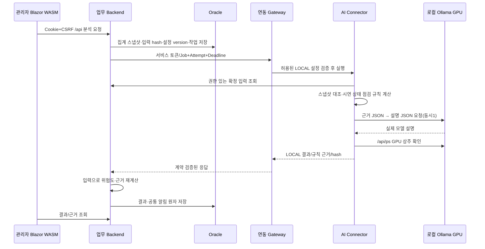

# 로컬 AI와 유지보전 분석: 비교·설계·구현 기록

## 출발점과 성공 기준

기존 AI 흐름은 Oracle 집계 스냅샷 → 업무 작업 원장 → Gateway → AI Connector → 결과 검증·저장·알림이었다. Mock은 이 구조를 검증하지만 실제 모델 추론은 하지 않았다. 이번 목표는 이 구조를 보존하고 집의 GTX1660Ti에서 실제 모델을 실행하는 것이다. API 키·유료 API·외부 실제 발송은 사용하지 않는다. 모델 다운로드에는 인터넷과 저장 공간이 필요하며 실행에는 PC 전력이 사용된다.

실행 전 nvidia-smi에서 GTX1660Ti, VRAM6144MiB/여유5038MiB, 드라이버560.94를 확인했다. 설치되지 않은 런타임을 이미 있다고 가정하거나 CPU 응답만 보고 GPU 성공이라고 기록하지 않는다. 성공 기준은 실제 모델 응답, GPU 상주 확인, 인증된 업무 API 전체 경로, Oracle 결과·공통 알림, 기존 Mock 호환이다.

## 무엇을 왜 비교했는가

| 질문 | Ollama | llama.cpp 직접 실행 | ML.NET·통계 모델 | 이번 판단 |
|---|---|---|---|---|
| 6GB GPU에서 시작 가능한가 | 작은 GGUF 양자화 모델과 GPU offload | 같은 계열 모델을 세밀하게 제어 | 작은 수치 모델은 CPU도 충분 | 큰 언어 모델보다1.5B Q4부터 실제 측정 |
| C# 업무 서비스에 어떻게 연결하는가 | 별도 HTTP 런타임 | llama-server HTTP, 실행 옵션 직접 관리 | .NET 안에 직접 통합 가능 | 기존 provider 경계와 HTTP 연동을 재사용 |
| 배포·재현 책임은 무엇인가 | 이미지·모델 볼륨·태그 관리 | CUDA 빌드/바이너리·GGUF·chat template 관리 | 학습 데이터·특성·모델 버전 관리 | 현재 혼자 운영하는 포폴은 Ollama로 설치 단계를 줄임 |
| 고장 예측 근거가 있는가 | LLM이라는 이유로 확보되지 않음 | 동일 | 학습·검증 데이터가 있다면 수치 예측에 적합 | 고장 라벨 없는 시뮬레이터로 고장 확률/RUL을 주장하지 않음 |
| 무료인가 | 로컬 오픈 모델은 API 과금 없음 | 로컬 추론 API 과금 없음 | 오픈소스 .NET 프레임워크 | 소프트웨어/모델 라이선스와 API 과금을 구분 |
| 현재 선택의 포기 비용은 무엇인가 | 런타임 고유 API 사용 | 세밀한 CUDA·메모리 제어 가능 | 문장 설명에는 별도 모델 필요 | IAnalysisProvider 뒤에 감춰 교체 범위를 Connector로 제한 |

Ollama는 설치·모델 관리·구조화 응답을 제공하고 llama.cpp는 실행 옵션과 빌드 선택을 직접 다룰 때 장점이 있다. 둘의 추론 품질을 실제 동일 조건 벤치마크한 것은 아니다. 이번 선택은 최고 성능이라는 결론이 아니라 제한된 메모리와 기존 HTTP 서비스 구조에 맞춘 운영 선택이다. ML.NET을 성능이 낮아 배제한 것도 아니다. 앞으로 실제 고장 라벨·정상 이력이 확보되면 수치 모델을 별도 비교하는 것이 적절하다.

## 모델과 실행 범위를 선택한 이유

Qwen2.5:1.5b는 공개 모델 카드 기준1.54B/Q4_K_M/약986MB이며 해당1.5B 모델은 Apache2.0이다. 한국어와 JSON 설명을 작은 모델에서 시험한다.7B를 VRAM 전체에 무리하게 올리거나 큰 context를 유지하는 대신 context2048/token192/동시1/온도0부터 시작한다. 실제 출력 품질과 소요 시간은 아래 검증 절의 관측값으로만 판단한다. temperature0도 비트 단위 재현성을 보장한다는 뜻은 아니다.

런타임은 ollama/ollama:0.11.11로 고정해 이번 검증 환경을 재현한다. 최신 버전이라는 의미는 아니다. 드라이버560.94 환경에서 GPU 실행이 되는지 실제 시험하고 이미지 digest와 모델 digest를 증거로 남긴다. 버전 교체 시 동일 계약·GPU 시험을 다시 실행한다.

## LLM 설명과 유지보전 판단을 분리한 이유

첫 버전의 유지보전 분석은 **현재 상태 점검**이다. 기존 집계에는 지표별 최소·최대·평균·마지막값과 관측 비율, 정지 시간, 경보 건수가 있다. 이 정보만으로 미래 고장 시점이나 잔여 수명을 계산하지 않는다. 분 단위 회귀·예측 오차·실제 고장 라벨을 검증하지 않았으므로 예지보전 예측 완료라고 쓰지 않는다.

공유 MaintenanceRules는 확정 스냅샷으로 demo-temperature-v1을 계산한다. 관측비율0.5이상/표본2이상/유일한 TEMPERATURE 섭씨 지표라는 조건을 충족해야 마지막 온도30미만LOW/30이상MEDIUM/35이상HIGH를 반환한다. 온도 지표 자체도 GOOD표본2이상/분별관측비율0.5이상/마지막측정이구간끝2분이내여야 한다. 근거가 부족하면UNKNOWN이다. 이30/35는 시연값이며 제조사 정비 한계나 현장의 보편 기준이 아니다. 정지 시간과 경보는 근거로 표시하지만 임의 가중치로 고장 확률을 만들지 않는다.

AI에는 이 판정과 근거를 전달하고 JSON summary 설명만 받는다. 위험도·원장·업무 상태를 모델 문장으로 변경하지 않는다. Backend가 동일 스냅샷으로 판정을 다시 계산하고 반환된 위험도와 구조화 근거를 대조한다. 결과는 Accepted=false로 저장하며 점검·정비는 사람이 결정한다. 모델 설명은 화면에서도 검토가 필요한 참고 자료로 표시한다.

## 서비스 경계와 데이터 흐름

기존 AI 설정 테이블의 LOCAL/provider/model/approved endpoint/timeout을 활용하며 새 테이블을 요구하지 않는다. LOCAL 대상은 고정 모델·고정 내부 주소만 허용하고 API 키 입력을 추가하지 않는다. CLOUD는 계속 차단한다. 기존 Mock 등록 요청은 ProviderKind 생략 시 MOCK으로 동작한다. LOCAL 입력만 지표별 Observation(표본·관측비율·마지막시각)을 더하고, 기존 Mock의 SchemaVersion1 내용과 hash를 바꾸지 않고 Evidence의 선택 Maintenance=null은 직렬화에서 제외해 과거 결과와 호환한다.

## 네트워크·장애·운영 선택

정상 추론망 inference는 internal이며 호스트11434를 공개하지 않는다. AI Connector만 app/inference 두 망에 참여한다. Ollama에는 DB 인증·업무 서비스 키를 마운트하지 않는다. 모델 최초 설치 override만 별도 model-download 외부망을 추가하고 설치 직후 정상 override로 재생성해 외부망을 제거한다. 모델은 별도 named volume에 보존한다.

모델 서버에 요청이 실패하거나 GPU가 확인되지 않으면 성공/Mock 결과로 바꾸지 않는다. 응답 byte수/JSON 형태/모델명/완료 이유/설명 길이를 제한한다. 동시 요청1의 대기 시간도 deadline에 포함하고 일시 장애는 기존 작업 재시도 정책과 연결한다. 디버그에는 처리 단계, 정보에는 job/model/risk/시간, 경고에는 안전한 실패 코드만 남긴다. 쿠키·키·원문 입력·전체 모델 응답은 기록하지 않는다.

기존 예약 대상 선택의 Mock 우선순위는 유지한다. LOCAL 등록 하나로 과거 모든 설비의 예약 분석을 GPU에 쏟아 넣지 않기 위해 이번 실제 시연은 관리자의 LOCAL 요청부터 검증한다. LOCAL만 등록된 경우의 예약 가능 여부와 정확한 제한은 구현/검증 결과에 기록한다.

## 실제 구현·검증 결과

2026-11-17 착수, 자정을 넘겨2026-11-18 완료했다. 최종 **392개 검사 PASS**, 실패0이다. 같은 시험의 반복·부분통과·이전 Modbus422/AUTO768은 더하지 않았다. 표의 수는 검증 프로그램이 보고한 단언 수이며 테스트 프레임워크의 test case 수와 다르다.

| 범위 | PASS | 실제 실행 범위 |
|---|---:|---|
| Provider 계약 | 44 | 실제 소스+가짜HTTP, 네트워크/GPU 없음 |
| Gateway 계약 | 102 | 실제 규칙 소스, 네트워크/GPU 없음 |
| LOCAL 업무·장애 | 73 | 실제HTTP수집·GPU·Oracle·Inbox·모델서버중지/복구 |
| LOCAL 화면 | 7 | 등록·HIGH/UNKNOWN/무자료·390px·콘솔오류0 |
| 기존 Mock API | 58 | 인증·작업·해시·중복·Mock 결과 |
|24시간 집계 | 25 |86,400표본/172,800수치행·Oracle 집계 |
|예약 순환 | 27 |20개 초과 대상의 실제 순환·재실행 |
|예약 복구·재시도 | 33 |Gateway중단·Backend재기동·3시도상한·영구오류 |
|기존 분석 화면 | 11 |Mock 요청/재전송/상세/권한 |
|고정 화면 셸 | 12 |동일문서전환·헤더/푸터·권한·모바일 |

전체12개 솔루션 프로젝트 Release 빌드는0경고0오류다. 별도 계약 검증용2프로젝트는 솔루션 서비스 수에 더하지 않는다. 정상 실행은 기존10서비스+Ollama1개이며 최종11개healthy를 확인했다. 새DB migration/DDL/볼륨·계정 초기화는 없다.

실제 LOCAL HIGH는 HTTP 시뮬레이터의 온도 태그에 시험용 offset20°C를 명시 설정해 만들었다. 원시 계측을 DB에 직접 넣어 실제 수집이라고 주장하지 않았다. 최종 snapshot은3표본/coverage0.5이며 온도 지표 자체의 표본·관측·UTC최신성도 저장했다. 같은 실제 표본을6분창으로 넓힌 coverage0.166667은 모델이 설명을 만들되 규칙은UNKNOWN으로 보류했다. 무자료 구간은INSUFFICIENT_DATA/결과0으로 모델 호출 전에 멈췄다.

실제 서버 중지는 실패 후Attempt2 자동 성공을 만들었고, snapshot identity/hash/payload는 그대로였다. 성공 결과·알림은각1개다. 이는 **최종 저장의 중복 방지**이며 네트워크 응답을 잃은 상황에서 모델 연산까지 정확히 한 번이라는 보장은 아니다. 재시도로 같은 입력의 모델 연산이 반복될 수 있다.

최종 Connector 로그의 처리 시간은 HIGH4672ms/UNKNOWN1454ms/재기동후HIGH4321ms다. 모델 로딩·HTTP·GPU상태 확인을 포함한 Connector 관측이며 순수 토큰 생성 속도가 아니다. HIGH API 대기11.679초에는 Quartz 대기·polling도 포함된다. GPU resident1,628,682,752bytes, ollama ps100%GPU/context2048/1.6GB, 호스트 전체1979MiB를 별도 기록했다. 최초CLI실행1.9GB/전체2154MiB와 실행 옵션이 다르므로 하나의 고정 메모리 요구량으로 일반화하지 않는다.

최종 한국어 프롬프트의 실제 결과를 브라우저 캡처에서 한글로 확인했다. 정확한 근거는 구조화 규칙 영역에 표시하고 생성 설명은 계속 비신뢰 참고로 표시한다. 생성 문장의 사실성·언어 품질을 보장하는 자동 평가를 완료한 것은 아니다.

증거: verification-results/local-ai-summary-2026-11-18.json 및 표의 상세 JSON/log. 캡처 FactoryMES-analyses-local-screen.png / FactoryMES-analyses-local-unknown.png. 재현 tools/verify-local-ai.ps1 Setup/Start/Verify/Provider/Gateway/Fault/Browser, Fault 구현 tools/verify-local-ai-fault.ps1.

예약 복구 회귀를 일반 실행 목록으로 호출한 첫 시도는 제어기 ACK를 받지 못해65초 후 시간 초과했다. 제품 오류로 처리하지 않았고 전용 VerifyRecovery 제어기로 실제 중지·복구를 실행해33개를 통과했다. 실패한 부분5개는 합산하지 않았다. 기존 회귀의 구형 Compose 호출은 local-ai를 선언하지 않아 orphan 경고를 출력했지만 컨테이너·볼륨 삭제를 하지 않았고 최종11서비스 상태를 재확인했다.

## 공식 자료

- [Ollama GPU 지원 조건](http<LOCAL_PATH>): 드라이버·장치 지원을 확인하는 출발점. 문서만으로 이 PC GPU 성공을 확정하지 않았다.
- [Ollama Docker 실행](http<LOCAL_PATH>): GPU 컨테이너 배포 방식.
- [Qwen2.5 1.5B 모델 정보](http<LOCAL_PATH>): 모델 규모·양자화·라이선스.
- [고정 런타임 릴리스](http<LOCAL_PATH>): 이번 재현 버전.
- [llama.cpp 공식 Docker 문서](http<LOCAL_PATH>): 직접 실행 대안.
- [ML.NET 공식 개요](http<LOCAL_PATH>): .NET 수치 모델 대안.

### 구현 중 검토로 바뀐 판단

처음에는 전체 집계 coverage와 samplecount만으로 온도 판정을 허용했다. 독립 검토에서 카운터가 정상이어도 온도만 한 번 측정된 상태를 구분하지 못한다는 문제가 나왔다. 문서에 한계로만 남기는 대신 Oracle 기존 분별 집계의 value_count·bucket수·last_at을 지표별로 추가 반환했다. 새 데이터 원본 테이블이나 원시24시간 전체 로딩은 필요 없다.

LOCAL의 AnalysisMetric.Observation만 선택 항목으로 추가하고 Mock에서는null직렬화제외한다. 온도 자체 GOOD2표본/분coverage0.5/구간끝2분내최신성까지 확인하므로 과거의 충분한 카운터 자료가 온도의 부족한 근거를 가리지 않는다. 최신성은 현재시각이 아니라 분석 구간끝을 기준으로 하므로 과거 구간을 재검토해도 판정 근거가 바뀌지 않는다. 온도센서의 정확성이나 영점 교정 자체를 보장하는 검증은 아니다.

경보 규칙 테이블의 현재 설정을 판정 시마다 다시 조회하는 대안도 있다. 그러나 과거 스냅샷에 고정되지 않은 현재값으로 재계산하면 오래된 결과의 의미가 달라질 수 있다. 이번에는 명명한 시연 정책을 확정하고 정책 버전·근거를 Evidence에 보존한다. 설비별 정비 기준을 지원할 때는 등록·승인한 기준 자체도 설정 버전/스냅샷에 넣는 방향으로 확장한다. 이번 버전은 이 설비별 기준 편집을 구현했다고 주장하지 않는다.

### 독립 검토·장애 검증에서 확인한 점

Claude가 Backend·Contracts·Connector·Compose를 읽기 전용으로 독립 검토했다. 원문/키 로그·Mock 대체·온도 품질·결과 결합·중복 저장의 핵심 결함은 없었고 네 가지 보완을 제안했다. 상위 취소는 Connector에서 CALLER_CANCELED/Warning으로 분류하고, Backend HTTP128초 → Gateway125초 → Connector120초, 원장 실행창130초로 여유를 나눴다. Worker는 앞선 Mock 작업까지 포함하는 배치 응답을 최대200초 기다린다. 일반 내부 HTTP와 Mock은5초를 유지한다.

GPU 자동 검사는 /api/ps에서 고정 모델의 size_vram>0 상주를 요구한다. 이는 일부 GPU offload도 허용하며100%GPU를 매번 보장하는 검사는 아니다. 이PC에서 ollama ps가100%GPU를 표시한 별도 관측 증거를 보관한다. 문서의 실제 관측과 코드의 허용 조건을 구분한다.

LOCAL 시간 초과/일시 연결 장애도 기존 최대3시도 정책을 사용한다. 최악에는120초 추론을3번 시도할 수 있고 backoff/큐 대기는 별도다. 모델을 임의로 바꾸거나 Mock으로 성공을 위장하지 않는다. 관리자 취소·일별GPU예산·사용자별분배·다중GPU부하는 이번 범위가 아니다.

실제 모델 서버 stop → transient 실패·영구Queued retry(다음Attempt2) → 결과/Mock없음 → 서버restart → 자동재시도성공 → 원래snapshot/hash/원문불변 → 결과·알림각1건을 확인했다. 실패한 시도의 호출은 남지만 성공 결과를 두 번 만들지 않았다. portable tools/verify-local-ai-fault.ps1은 finally에서 모델 서버를 정상 복구하고 DB·모델 볼륨을 삭제하지 않는다.

첫 실제 모델 설명이 중국어로 출력돼 화면 캡처에서 발견했다. 고정 규칙과 위험도는 맞았지만 한국어 운영 화면의 설명 품질은 별도 문제였다. 프롬프트를 한국어로 바꾸고 한글1문장/한자·중국어금지/근거없는수치·고장시점금지와 형식 예시를 넣었다. 규칙 문장으로 결과를 대체하지 않았으며 최종 실제 모델 출력을 다시 확인했고 화면 캡처에 한글 설명을 보존했다. 작은 모델이 항상 정확한 한국어·사실성·정비 유용성을 보장한다는 의미는 아니다.

## 남은 범위와 검증하지 않은 것

학습된 고장 확률·잔여수명·미래 시점 예측, 실제 설비 고장 라벨 검증, 설비별 정비 기준 편집·승인, LLM 품질 정량 평가, 다중GPU/다중Connector 전역큐·부하 시험은 하지 않았다. 기본 예약은Mock우선이며 LOCAL은 등록 이후 완전한 일별창 fallback이 가능하다. 이번 실제 GPU 증거는 관리자 수동 분석·장애 재시도이며 LOCAL일별스케줄을 하루 넘게 운전한 시험은 아니다. 수동 완료는 요청자 Inbox로 보내고 Actor없는 예약LOCAL의 별도 수신자 정책은 후속이다.

GPU 사용이 무료 API라는 의미이지 전력·장비 비용이 없다는 뜻은 아니다. 실제 클라우드AI·이메일/채팅 실발송·실제PLC 제어는0이다. 현재분석 결과의 권고는 사람이 검토하며 제어·정비 작업을 자동 실행하지 않는다.
