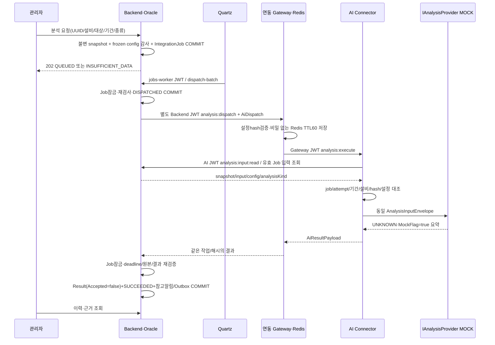

# 불변 입력·Gateway·공통 제공자 기반 Mock AI 분석 (2026-11-16)

## 범위
관리자는 /analyses에서 Mock AI 대상을 등록하고 설비·UTC 기간·분석 종류를 선택한다.
Backend가 Oracle 수집 이력의 고정 스냅숏과 요청 작업을 만들고 Quartz가 Gateway와
AI Connector를 거쳐 로컬 Mock 제공자를 실행한다. 이력에서 입력 해시·coverage·요약을 본다.
LOCAL/CLOUD는 같은 제공자 인터페이스를 위한 비활성 어댑터 자리만 두며 실제 호출하지 않는다.
GPU 서버/1660Ti 모델·클라우드 키·유료 서비스 설치 또는 과금은 이번 범위에 없다.

## 비교와 선택
- Backend 직접 AI 호출은 업무와 모델별 의존성이 섞이므로 별도 Gateway/Connector로 분리한다.
- Python 모델 서버를 바로 만들기보다 기존 C# Connector 안에 IAnalysisProvider를 둔다.
  향후 로컬 모델의 HTTP 어댑터나 클라우드 어댑터가 같은 입력/출력으로 교체된다.
  Python이 필요하면 모델 실행 서버만 별도로 붙일 수 있다.
- 브라우저에서 외부 AI로 직접 호출하지 않는다. 키·URL·추론 권한은 사용자 입력이 아니다.
- 모델이 DB를 자유롭게 조회하지 않도록 Backend가 승인한 입력 스냅숏만 전달한다.
- 기존 canonical /ai/jobs의202 비동기 Ack 전체를 구현한 것처럼 표시하지 않는다.
  별도 로컬 /internal/v1/ai/mock-executions는 동기200 결과이며, 사용자 업무는 DB Job+Quartz로 비동기다.
- 일별 생산 집계는 마감 KPI이고 AI 입력은 설비 상태 자료다. 생산 합계를 센서 최솟값/평균처럼
  꾸며 넣지 않는다. 공통 시간대/원장 기반이지만 지표의 의미는 구분한다.

## 흐름

네트워크 호출은 Oracle 행 잠금·트랜잭션 밖에서 수행한다. Gateway는 사용자 URL로 접속하지
않고 고정 내부 서비스 주소만 사용한다. Redis는 검증한 설정의 단기 캐시이며 Oracle이나
작업의 frozen config를 대체하지 않는다. 비밀 값은 캐시에 저장하지 않는다.

## 입력 규칙
- 2000년 이후 UTC, 과거 시각, 1분~24시간, 소수6자리 이하. end는 제외 경계다.
- GOOD 숫자 메트릭 최대10000행, 최대50종류. 초과하면 기간 축소를 요청하고 조용히 잘라 분석하지 않는다.
- 같은 metricCode의 단위가 다르면 거절한다. 저장된 정규화 수치의 min/max/mean/last를 계산한다.
- sampleCount는 GOOD 숫자 자료가 있는 고유 TelemetryEvent 수다.
- coverage는 요청 시작 기준1분 버킷 중 관측된 버킷 수/요청 분 버킷 수다(최대1).
  설비 가동률·통신 SLA·모델 신뢰도·실제 예측 정확도를 뜻하지 않는다.
- SampleCount<2 또는 coverage<0.1이면 INSUFFICIENT_DATA, 결과·유지보전 경보를 만들지 않는다.
- 중지 시간은 기간에 겹친 WorkPause의 합집합 초로 계산해 중첩 이중 계산을 막는다.
- alarmCount는 기간 안에 발생한 경보 수다. 현재 ACTIVE 건수와 다르다.
- AnalysisSnapshot에 원본 JSON·inputHash·period·equipment·coverage·InputVersion1을 저장한다.
  이후 새 수집이 들어와도 기존 스냅숏은 바뀌지 않는다.

## 권한·해시·시간 제한
공개 옵션/등록/요청/이력은 ADMIN Cookie+CSRF다. 작업자는 메뉴가 없고 API403이다.
요청자의 역할 헤더를 신뢰하지 않으며 actor는 검증된 세션에서 결정한다.
Backend→Gateway 토큰은 기존 설정 전달용과 분리해 analysis:dispatch만 발급한다.
Gateway→Connector는 integration-gateway/analysis:execute, Connector→Backend는
ai-connector/analysis:input:read를 요구한다. Web은 internal 경로를 프록시하지 않는다.

Queue 때 저장한 설정을 감사 Detail에 고정한다. 현재 활성/버전/해시가 바뀌면 실행을 거절한다.
Connector는 Backend가 DISPATCHED/attempt/deadline을 확인한 입력만 받는다. input/config hash,
설비·기간·coverage를 대조하고 Backend도 결과를 다시 검증한다. 완료 시각은 UTC6이며 Job 생성
이후·deadline이내여야 한다. 대기/실행 deadline은30초, 내부HTTP는5초 상한이다.
프로세스가 DISPATCHED 뒤 죽으면 Quartz가 만료를 TIMED_OUT으로 남긴다. 임의 자동 재호출로
외부 중복 실행을 만드는 방식은 택하지 않았다. 취소/재시도 API는 이번 범위 밖이다.

## Mock 의미와 알림
MOCK/mock-trend-v1은 관측 숫자를 요약할 뿐 실제 모델 추론을 하지 않는다. Risk UNKNOWN,
MockFlag=true, Accepted=false를 고정한다. SUCCEEDED는 기술적 파이프라인 성공이다.
실제 유지보전 예측 성공이나 위험 없음(LOW)을 뜻하지 않는다. 완료 참고 알림은 요청자에게
한 번 저장하고 AnalysisResultId와 연결한다. 기존 알림 Outbox/EMAIL·CHAT Mock 전달기를 이용한다.
Mock으로 실제 유지보전 Alarm 또는 긴급 경보를 자동 생성하지 않는다.

## 스케줄
수동 요청은5초 dispatch Quartz가 처리한다. 정기 요청은 매일02:00KST(17:00UTC)에 실행한다.
서비스의 최근02시 종료/이전24시간 창을 고정하고 대상·설비·창으로 결정적인 UUID를 만들어
같은 스케줄 재호출이 중복 요청을 만들지 않게 한다. 첫 활성 Mock 대상과 최근 창의 최대20설비가
로컬 구현 범위다. 실제02시까지 기다리는 시험 대신 권한 있는 내부 scheduled 호출로 검증한다.
24시간 고주파 자료가10000행을 넘으면 예약 분석도 거절될 수 있다. 대형 시계열은 DB 사전 집계/
다운샘플링과 커버리지 정책을 별도로 설계해야 한다. 제한으로 자료를 조용히 버리지 않는다.

## API
- GET /api/v1/analysis-options: 서버UTC와 등록 대상(최대100)을 제공한다.
- POST /api/v1/ai-targets: targetId/displayName으로 MOCK만 명시 등록한다.
- POST /api/v1/analyses: requestId/equipmentId/targetId/periodStart/periodEnd/analysisKind →202 Job.
- GET /api/v1/analyses 및 /{jobId}: Job·snapshot descriptor·결과·근거를 조회한다.
- POST /internal/v1/analyses/dispatch-batch, /scheduled: jobs-worker+analysis:request.
- GET /internal/v1/analysis-inputs/{jobId}?attempt=1: 유효 실행에 바인딩된 입력만 AI Connector에 제공.
- Gateway/Connector POST /internal/v1/ai/mock-executions: 별도 동기 Mock 보완 경로.

요청은 actor+UUID+operation으로 멱등이다. 같은 정규화 의도는 같은 Job, 다른 내용409다.
기존31테이블·FK·canonical계약 원본은 보존한다. 추가 API/동기Mock 방식은 본 문서로 구분한다.

## 협업·검증
GPT는 Contracts/Backend/Foundation/Jobs/Oracle검증/공통배포·문서, Claude는 AI Connector/
Gateway 해당파일·Analyses 화면/브라우저시험을 담당한다. 서로의 소유 파일을 동시에 고치지 않는다.
실제 Oracle/API58항목 통과. 브라우저 통합 검증도 완료했고 최종 결과는 아래에 기록한다.

### 실제 통합에서 보완한 내용
- 옵션 조회의 부정 Boolean 조건이 Oracle 리터럴 생성에서 Int32→Boolean 예외를 냈다. 기존 프로젝트 방식인 EF.Parameter(false) 비교로 수정했다.
- 예약 자료가10000행 상한을 넘으면 조용히 건너뛰지 않고 snapshot 없는 FAILED Job과 analysis.scheduled.rejected 감사를 보존한다. 동일 스케줄 재호출은 같은 실패 Job을 재사용한다.
- 대상을 끈 뒤 같은 UUID를 재전송해도 원래 Job을 반환하도록 기존 요청 조회를 활성 검사보다 먼저 수행한다.
- ErrorCode와 같은 설명을 중복 반환하지 않고 Error=null로 구분한다.
- 시험용 Simulator URL의 설비 코드가 고유 Equipment.Code와 달라422였던 fixture를 수정했다. 실제 서버의 승인 URL 검사는 완화하지 않았다.
- 실제 Simulator 자료의 성공 분석과 별도로, 직접 Oracle10001행 fixture로 상한 거절/예약 실패 보존을 검사했다. 직접 자료를 실제 PLC 수집으로 부풀리지 않는다.
- 향후 실제 LOCAL/CLOUD를 연결할 때는 공통 인터페이스뿐 아니라 허용 정책·주소·자격 증명·결과 채택 검증도 함께 확장해야 한다. 현재는 의도적으로 Mock만 통과한다.

## 최종 검증·배포
실제 Oracle/API **58항목**, 브라우저 **10항목** PASS. 전체11프로젝트 Release0경고/0오류,
Gateway·AI Connector·Backend·Jobs·Web Docker 적용 및 최종9healthy 확인.
원본: analyses-verification.json / FactoryMES-browser-analyses-verification.json,
화면: FactoryMES-analyses-screen.png. 기존 전달 API66/UI9와 경보·업무·인증 회귀도 통과했다.

실제 통합 발견/수정(완료):
- Claude 안전 확인 단계 지연으로 소유 파일 변경이 멈췄다. 사용자는 기존 분담 유지/Claude 합류를 선택했고,
  17:17 완료 후 통합했다. 서로의 파일을 임의로 덮어쓰지 않았다.
- Operation은 AI_ANALYZE, AnalysisKind는 별도 값으로 정리했다. Redis 저장 후 deadline 재검사로
  음수 CancelAfter를 막았다. POST 접수 결과를 먼저 화면에 보관하고 목록 실패를 접수 실패로 오인하지 않게 했다.
- datetime-local의 분/초/공백 표현을 InvariantCulture로 파싱한다. 서버 UTC 경계는 유지한다.
- 브라우저 fixture의 설비/AI 대상 코드 공간 중복409는 별도 aiKey로 수정했다.
- 시험이 GUID 작업 번호를 숫자만 추출하던 문제는 POST 응답에서 jobId를 받도록 수정했다.
  HTTP Problem을 완료 작업으로 오인하지 않도록 상태 코드와 results 배열을 확인한다.
- 반복된 미완료 시험을 성공 검증 수에 합산하지 않았다. 클라우드/로컬 실제 모델 추론·GPU 사용은 없다.

한계: 입력10000행/50종류·1분버킷coverage는 운영 SLA/모델 정확도가 아니다. 예약24시간 고주파 자료는
상한 실패를 Job/감사로 남긴다. 대용량 DB 사전 집계/다운샘플링은 후속이다. 단일 우선 Mock 대상/최대20설비,
30초 deadline·10건 배치, 목록의 작업별 추가 조회(N+1), 취소/재시도 미구현을 생산 완성으로 주장하지 않는다.

## 2026-11-16 후속 변경
원시 10,000행 제한은 Oracle 요청 시 1분 사전 집계로 대체했다. 기존 기록은 당시 설계 이력이다. 현재 계산·제한·검증은 [시계열 사전 집계](analysis-timeseries-preaggregation.md)를 따른다.
