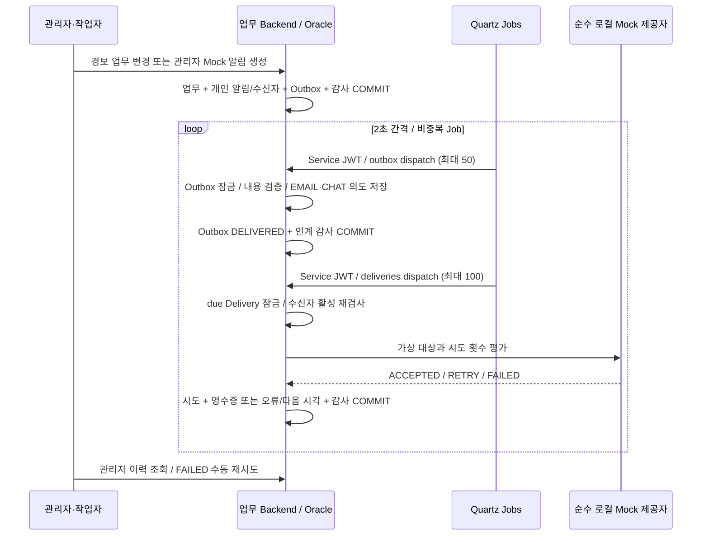

# Outbox 전달기·이메일/채팅 Mock 발송

작성: 2026-11-15, GPT. 구현 분담·검토: Claude. 실제 검증 결과는 문서 마지막에 기록한다.

## 목표와 이번 범위

경보 발생·복구·종결 때 이미 저장하던 Oracle Outbox를 실제로 소비하고, 개인 알림의
수신자마다 EMAIL·CHAT 발송 의도를 만든다. Quartz가 자동으로 처리하며 관리자는
`/deliveries`에서 발송 이력·Mock 수신 내용·실패 원인·재시도를 확인한다.
로그인한 관리자 본인만 대상으로 하는 독립 시연 알림도 제공한다.

외부 메일 서버, 채팅 웹훅, 유료 API, AI 키는 전혀 필요하지 않다. SMTP/HTTP 발송 코드는
등록하지 않는다. Mock 제공자는 문자열 검증과 수신 영수증 생성만 수행하는 로컬 C# 코드다.
기존 Oracle 31테이블·53FK를 재사용하며 DB 초기화·마이그레이션·계정 초기화는 하지 않는다.

## 비교와 선택 근거

| 대안 | 이번 선택과 이유 |
|---|---|
| 요청 중 이메일/채팅 직접 호출 | 업무 저장과 외부 장애를 분리하려고 사용하지 않음 |
| DB 변경 감시/CDC | Oracle 추가 권한·로그 설정 없이 기존 트랜잭셔널 Outbox를 이용 |
| Kafka 추가 | 개인 로컬 시연의 운영 비용과 서비스 수를 줄이기 위해 보류 |
| Quartz가 DB 직접 갱신 | DB 소유권을 Backend에 유지하고 Jobs는 내부 API 호출만 담당 |
| 성공 Mock을 SENT로 저장 | 기존 `externalDeliveryEnabled=false` 계약과 충돌하므로 금지 |
| 별도 MOCK_SENT 상태/테이블 추가 | 현재 계약을 유지하고 기존 감사 테이블에 Mock 영수증 저장 |
| 실제 주소를 보관한 가짜 발송 | `moc<LOCAL_PATH>`만 허용해 실발송 경로 자체가 없음 |

Outbox를 단순히 읽고 완료 표시하는 데서 끝내지 않는다. 알림 이벤트는 발송 의도를
같은 트랜잭션에 저장한 뒤 인계 완료로 바꾼다. 경보 변경 이벤트는 원본 경보와 버전을
검증하고 로컬 인계 감사를 남긴다. 이미 만들어진 개인 알림을 다시 만들지 않는다.
따라서 `Outbox.DELIVERED`는 로컬 소비자의 책임 인계이고, 외부 발송 완료가 아니다.

## 서비스 구성과 처리 흐름



기존 설정 전달기(ConfigurationPublisher)는 설정 이벤트만 담당한다. 이번 전달기는
`mes.alarm.changed.v1`, `mes.notification.created.v1`만 소비한다. 미지원 AI 등 이벤트를
성공으로 가장하지 않고 원래 상태로 둔다. Redis는 설비 설정 캐시이며 발송 원장이 아니다.

Jobs는 2초마다 Outbox → Delivery 순서로 호출한다. 한 Job의 중첩은 Quartz
DisallowConcurrentExecution, Backend의 두 dispatch 동시 실행은 단일 Semaphore로 제한한다.
다른 Backend 인스턴스와의 충돌에는 Oracle 행 잠금과 재검사를 사용한다.

## 저장과 중복 방지

- 업무/알림 생성 트랜잭션에 NOTIFICATION·NOTIFICATION_RECIPIENT·OUTBOX_EVENT를 함께 저장한다.
- Outbox는 `FOR UPDATE SKIP LOCKED` 후 due 여부를 다시 검사한다.
- notification 행을 잠근 뒤 수신자 스냅숏·제목·본문·이벤트 ID/타입/버전을 확인한다.
- 수신자별 EMAIL·CHAT 두 DELIVERY를 만들며 기존 `(notification, recipient, channel)` UQ를 유지한다.
- 동일 알림의 중복 이벤트도 새 발송 의도를 만들지 않는다.
- 각 Delivery 행 잠금 뒤 수신 영수증 존재 여부를 다시 확인한다.
- Mock 수신 내용은 AUDIT_EVENT의 `delivery.mock.accepted` Detail JSON으로 영속 저장한다.
- 영수증은 수신 ID, 채널, 가상 대상, 제목/본문 스냅숏, SHA-256, 수신 시각을 포함한다.
- 영수증이 있으면 자동 처리 대상에서 제외해 성공 Mock이 계속 반복되지 않게 한다.

성공 Mock의 실제 발송 상태는 **PENDING**, sentAt은 **null**이다. 별도 Mock 조회 결과는
ACCEPTED다. UI에서 이 두 의미를 다른 열에 보여 준다. 실제 Delivery dispatch의 delivered
카운트는 항상 0이다. Outbox dispatch의 delivered는 로컬 인계 건수다.

행 잠금/영수증 확인은 현재의 로컬 Mock 처리에서 중복을 막는다. 외부 발송의 exactly-once를
보장한다는 뜻은 아니다. 실제 제공자를 넣으면 제공자 멱등 키·응답 미확인 조정·네트워크 호출
중 DB 잠금 해제/lease 정책을 별도로 설계해야 한다.

## 실패 처리와 재시도

| 시나리오 | 동작 |
|---|---|
| SUCCESS | 첫 시도에 Mock 수신 영수증 저장 |
| FAIL_ONCE | 첫 시도 FAILED, 관리자 재시도 뒤 두 번째 시도 수신 |
| TRANSIENT_ONCE | 첫 시도 PENDING/5초 뒤 예약, 두 번째 시도 자동 수신 |
| ALWAYS_FAIL | 5초·10초 backoff 후 회차 3회에서 FAILED |

수동 재시도는 관리자만, FAILED만, 사유 1~1000자 및 expectedVersion이 필요하다.
서버는 공백만 있는 사유를 거절하고 입력 원문 길이를 제한한 뒤 trim해 감사에 저장한다.
Attempts는 초기화하지 않는다. 재시도 감사에 attemptBase를 남겨 새 회차에 최대 3회의
자동 시도만 허용한다. 따라서 누적 3회 실패 → 수동 접수 → 누적 6회 실패를 확인할 수 있다.
동시 재시도는 행 잠금·버전 비교로 하나만 성공하고 나머지는409다.

수신 직전 비활성 계정은 RECIPIENT_INACTIVE, mock 외 대상은 MOCK_TARGET_REJECTED다.
오류는 정해진 코드만 저장하며 예외 메시지·주소·토큰을 로그에 남기지 않는다.

Outbox 소비 중 실패하면 부분 생성 의도를 rollback하고, 별도 트랜잭션에서 실패 횟수를
저장한다. 5초·10초 뒤 재시도하고 3회면 최종 FAILED/nextAttemptAt=null로 종료한다.
한 잘못된 이벤트가 뒤의 정상 이벤트를 막지 않는다. 관리자 Outbox 수동 재처리는 이번
범위에 없으며 이력 조회만 제공한다.

## 인증과 API

공개 API는 기존 Cookie+CSRF, ADMIN 정책을 사용한다. 작업자/익명은 발송 대상·내용·이력을
조회할 수 없다. 내부 API는 jobs-worker client_id와 해당 scope를 모두 검사하고 Web에서
프록시하지 않는다. 공개 이력은 TargetRef나 원본 이벤트 payload를 노출하지 않는다.

| API | 요청·응답 |
|---|---|
| GET /api/v1/deliveries | limit1..100, cursor, status, channel, notificationId → items/nextCursor |
| POST /api/v1/deliveries/{id}/retry | expectedVersion, reason → 최신 DeliveryView |
| GET /api/v1/delivery-mock-statuses | deliveryIds 쉼표 구분1..100 → Mock 결과 배열 |
| GET /api/v1/deliveries/{id}/mock-receipt | 영수증, 아직 없으면404 |
| POST /api/v1/mock-notifications | clientRequestId UUID, scenario → notificationId/clientRequestId |
| GET /api/v1/outbox-events | limit/cursor/status → 안전한 인계 기록 |
| POST /internal/v1/jobs/outbox/dispatch-batch | jobs:outbox:dispatch, limit1..100 |
| POST /internal/v1/jobs/deliveries/dispatch-batch | jobs:deliveries:dispatch, limit1..100 |

Mock 생성은 최초201, 같은 사용자·UUID·시나리오 재전송200/동일 알림, 다른 내용409다.
사용자 행 잠금으로 같은 사용자의 동시 생성도 직렬화한다. 수신자는 요청자가 지정하지
못하며 현재 관리자 본인이다. 다른 사용자를 대상으로 하는 일반 발송 API가 아니다.
ID는 JSON 문자열, 날짜는 UTC ISO8601, 화면은 KST다. canonical contracts/v1.1의98개
operation 원본은 변경하지 않고 이번 추가 화면용 API는 로컬 보완 문서로 구분한다.

## 관리자 화면과 협업 분담

Claude: Deliveries.razor/CSS, 공통 메뉴, Mock 브라우저 시험. 별도로 사용자가 Claude에
직접 요청한 현황판·로그아웃·편집/상세 모달 UI도 함께 통합했다.
GPT: Backend/공통 DTO/Jobs/Tooling 검증, Compose 검증 override, 공통 빌드·배포·문서.
Claude가 Backend를 읽기 전용으로 독립 검토하고, 이전 시험의 UI 기대를 소유권 이전 후
수정했다. 세부 수락/완료는 공유 날짜 기록에 보존한다.

화면은 실제 발송 꺼짐 배너, 상태/채널/알림 ID 필터, 커서 더 보기, Mock 결과 일괄 조회,
실패 재시도 사유 모달, 수신 내용 모달, Outbox 인계 표를 제공한다. 내용은 Blazor가
이스케이프한다. 409는 최신 버전을 다시 읽고 사유를 유지하며, 조회 실패하면 재시도
전송을 막는다. 네트워크 오류의 Mock 생성은 같은 UUID로만 재전송하고 자동 재발송하지 않는다.

병행 UI: 로그인 뒤 홈이 실제 API 기반3칸 현황판이다. 업무 페이지 공통 머리띠는 역할별
메뉴와 한 번의 로그아웃을 제공한다. 경보 상세/규칙·기준정보 편집·설비 연결은 모달로
바뀌었다. Cookie/CSRF/서비스 인증 경계는 유지하지만 session.js 자체는 이 의도로 변경됐다.

## 시연·재개

1. `http<LOCAL_PATH>`에 admin으로 로그인하고 발송 이력을 연다.
2. SUCCESS 시연 알림을 만들고 잠시 뒤 목록을 새로 읽는다.
3. EMAIL·CHAT 두 행의 PENDING/Mock 수신 완료와 수신 내용을 확인한다.
4. FAIL_ONCE를 만들고 FAILED 행에서 사유를 입력해 재시도한다.
5. 시도2/Mock 수신 완료, sentAt 비어 있음과 Outbox DELIVERED를 확인한다.
6. TRANSIENT_ONCE/ALWAYS_FAIL은 자동 backoff와 최종 FAILED를 시연한다.
7. portal은 발송 메뉴가 없고 직접 API 호출도403이다. 본인 알림함은 계속 사용할 수 있다.

Compose stop/start는 기존 데이터·영수증을 보존한다. 새 프로세스도 Oracle에서 due 항목을
조회하므로 메모리 큐만으로 발송을 관리하지 않는다. Quartz 스케줄은 메모리 기반이지만
업무 원장과 다음 시도 시각은 DB에 있다.

검증 명령(프로젝트 루트):

```powershell
docker compose -f deploy/compose.yaml -f deploy/compose.deliveries-verification.yaml run --rm tooling verify-deliveries
Set-Location tests/browser
node verify-deliveries.cjs
```

검증은 고유 알림과 격리된 비활성 수신자/거절 대상/잘못된 이벤트 fixture만 만들고 기록을
남긴다. 기존 사용자 비활성화, 실제 주소 전송, 볼륨 삭제는 없다.

## 한계와 후속

- 채널 선호/구독·템플릿·예약·실제 주소/비밀 관리·무료 채팅 공급자 선택은 후속이다.
- 미지원 이벤트는 PENDING으로 남으며 최종 FAILED Outbox의 운영 재처리 기능은 없다.
- 로컬2초 폴링이며 대규모 처리량·다중 노드 부하·분산 장애 시험은 하지 않았다.
- 감사 JSON 기반 영수증은 현재 규모에 맞춘 선택이다. 처리량이 커지면 전용 receipt/attempt
  테이블·인덱스·보존/정리 정책을 검토한다. DB 직접 위변조에 대한 중복 영수증 방어는 별도다.
- 업무 경보 수신자 모두에 두 채널 의도가 생기므로 시험을 반복하면 DELIVERY/AUDIT가 증가한다.
- 실제 외부 호출이 없다는 검증은 제공자 코드의 네트워크 의존성 부재·가상 대상 거절·
  실제 상태 불변을 함께 확인한 것이며 네트워크 패킷 캡처를 수행했다는 뜻은 아니다.

## 이번 검증 결과

2026-11-15 최종 완료. **227개 검증 항목 PASS**, 전체11프로젝트 Release 빌드 오류0·경고0,
Compose9개 서비스 모두 healthy. 항목 수는 독립 단위 테스트 수가 아닌 각 시험의 assertion 합계다.

| 구분 | 통과 |
|---|---:|
| Outbox·Mock Oracle/API | 66 |
| 발송 이력 브라우저 | 9 |
| 경보·알림함 브라우저 | 13 |
| 경보 조치 브라우저 | 13 |
| 작업지시 브라우저 | 12 |
| MANUAL Oracle/API | 44 |
| 인증·매핑 Oracle/API | 35 |
| 설비 수집 브라우저 | 12 |
| 기준정보·초안 브라우저 | 12 |
| HIGH·현황판 브라우저 | 11 |

새 API 시험66개는 실제 HTTPS·Cookie/CSRF·내부 JWT·Oracle 트랜잭션·Quartz로 실행했다.
최종 발송 UI9개는 버전 숫자 렌더 회귀를 포함한다. 경보·수집 시험도 실제 Simulator HTTP
수집으로 판정/상태/화면을 확인했다. 이전 HIGH Oracle50개 등 이번에 실행하지 않은 시험을
이번 합계에 더하지 않았다. 모든 부하/실장비/실제 제공자 시험을 완료했다는 뜻이 아니다.

진행 중 발견·해결:
- 첫 API 실행은 Web 배포와 겹쳐 연결 거절로 중단됐다. 배포 완료 후66개를 재실행해 통과했다.
- 실제 화면 캡처에서 Razor `v@delivery.Version`이 원문으로 나오는 결함을 찾아 Claude가
  명시적 식으로 수정했다. 설비 표의 같은 패턴도 수정했다. 최종 Web 재배포 후 발송 UI9개
  재실행으로 확인했고 다른 성공 시험을 불필요하게 반복하지 않았다.
- 이전 경보 시험의 Outbox 영구 PENDING 단언은 PENDING/DELIVERED 허용으로 정렬했다.
  FAILED는 여전히 실패로 잡는다. 이 두 Oracle 모드 전체는 이번에 재실행하지 않았고
  수정 소스는 전체 Release 빌드로 확인했다. 현재 Tooling 이미지의 그 두 기존 시험 코드는
  다음 Tooling 이미지 빌드 때 반영된다(실행 서비스 동작에는 영향 없음).
- Claude는 Backend를 읽기 전용 검토해 차단 결함 없음을 기록했다. UI 결함은 이후 실제
  캡처에서 확인한 별도 발견으로 기록했다. 정상 DB 경로 밖의 중복 감사 손상은 미검증이다.

산출물: verification-results/outbox-mock-phase-summary.json, deliveries-verification.json,
FactoryMES-browser-deliveries-verification.json, deliveries-health.json,
FactoryMES-deliveries-screen.png. 공유 폴더에도 주요 JSON과 화면 사본을 남겼다.
기존 scaffold 보고서의 scope 문자열은 초기 골격 시절 문구가 남아 있다. 이35항목의 범위는
인증/타입매핑이며 전체 업무 미구현이라는 현재 프로젝트 상태를 뜻하지 않는다.

최종 Web은 현황판·메뉴·로그아웃·모달·발송 이력·버전 표기 수정을 모두 포함한다.
Backend/Jobs도 배포 완료다. 시험 이력은 남겨 두었고 이번 기능 작업은 끝났다.


### 요청·응답 예시

관리자 Mock 생성(기존 CSRF 헤더 필요):

```json
{
  "clientRequestId": "cd43bbaa-cc12-4cd0-bbab-013a24b7ef62",
  "scenario": "FAIL_ONCE"
}
```

응답201 또는 동일 요청200:

```json
{
  "notificationId": "66",
  "clientRequestId": "cd43bbaa-cc12-4cd0-bbab-013a24b7ef62"
}
```

관리자 재시도 요청:

```json
{
  "expectedVersion": 2,
  "reason": "Mock 실패 원인 확인 후 재시도"
}
```

발송 이력의 한 행(식별자·시각은 예시):

```json
{
  "deliveryId": "179",
  "notificationId": "66",
  "recipientId": "1",
  "channel": "EMAIL",
  "destinationKey": "mock.email.user.1",
  "status": "PENDING",
  "attempts": 2,
  "nextAttemptAt": null,
  "sentAt": null,
  "lastError": null,
  "version": 4
}
```

같은 행의 별도 Mock 결과:

```json
{
  "deliveryId": "179",
  "outcome": "ACCEPTED",
  "receiptId": "mock:43cf5b4a-cc1d-424f-a620-13c2d04478aa",
  "acceptedAt": "2026-11-14T15:18:26Z"
}
```

오류 응답은 기존 Problem 형식(code/correlationId)을 따른다. 400은 목록 크기,
401은 미인증,403은 권한/CSRF,404는 미생성 영수증/없는 대상,409는 상태·버전·멱등 충돌,
422는 지원하지 않는 필터/시나리오·잘못된 사유다. 내부 dispatch는 기존 `{ "limit": 50 }`
형식과 examined/delivered/retryPending/failed 응답을 사용한다.
