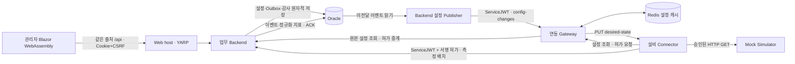

# Redis 설정 관리와 Mock 설비 수집 — 포트폴리오 설계·구현 기록

작업 시작: 2026-11-13(KST). 검증·문서 마무리: 2026-11-14(KST).
실제 프로젝트: `<LOCAL_PATH>`. 본 단계는 C#을 처음 학습하는 사용자가 코드와 선택 근거를 함께 설명할 수 있도록 정리했다.

## 1. 해결하려던 문제와 이번 완료 범위

이전에는 게이트웨이의 Redis 준비 상태 확인, 설비 커넥터의 상태 API, 정적인 Mock 응답만 있었다. 관리자가 설비 연결을 등록해도 수집이 시작되지 않았다. 이번에는 다음 흐름을 실제 컨테이너 간 HTTP와 Oracle 저장으로 연결했다.

1. 관리자가 웹 화면에서 설비·승인 URL·주기·타임아웃·태그 매핑을 입력한다.
2. Backend가 Oracle에 원본 설정과 변경 이벤트를 함께 저장한다.
3. Gateway가 Redis 캐시를 갱신하고 Connector에 희망 설정을 적용한다.
4. Connector가 Gateway에서 설정을 조회하고, 원본 설정에 근거한 서명 수집 허가를 받는다.
5. Mock 설비를 실제 HTTP로 읽고 수치를 정규화한다.
6. Backend가 서비스 인증·서명·대상·설정·수치를 검사한 뒤 이벤트와 지표를 원자적으로 저장한다.
7. 관리자는 적용 버전·연결 상태·측정/수신 시각·저장 지표를 확인하고, 설정 수정·중지·재개를 한다.

오늘 범위는 여기까지다. 임의 외부 PLC, Modbus/OPC UA/제조사 프로토콜, PLC 쓰기 명령, Kafka 알림, 경보 발송, AI 예측, 업무 통계 배치, AUTO 생산실적 반영은 구현했다고 주장하지 않는다. `staleSec`는 설정에 저장하지만 COMM_LOST 경보 판단·발송은 다음 단계다.

## 2. 실제 아키텍처와 서비스 경계



서비스 폴더만 나눈 한 프로세스가 아니다. Web, Backend, Gateway, EquipmentConnector, AiConnector, Jobs, Simulator는 각기 별도 .NET host와 Docker 컨테이너다. Oracle·Redis를 합쳐 정상 서비스 컨테이너는9개이며 Tooling은 명시적으로 실행할 때만 생성되는 일회성 컨테이너다. 물리 컴퓨터는 하나지만 프로세스·네트워크·인증·장애 경계는 분리된다.

| 구성 | 책임 | 의도적으로 맡기지 않은 것 |
|---|---|---|
| Web | 정적 로그인, 페이지별 WebAssembly, 동일출처 /api 프록시 | DB·Redis 직접 접근, 서비스 secret을 브라우저에 전달 |
| 업무 Backend | 권한·CSRF, 원본 설정, 버전, 감사/Outbox, 서명 허가, 검증·저장 | 실제 설비 HTTP 호출, Redis 소유 |
| 연동 Gateway | 설정 캐시·복구, 최신 설정 적용 중계, 허가 요청 중계 | Oracle 직접 접근, 임의 설비 URL 호출, 자체 수집권한 생성 |
| 설비 Connector | 주기별 실제 Mock 조회, 타입/단위 변환, 이벤트 생성·재전송·상태 보고 | DB·Redis 직접 접근, 사용자 권한 판정, 생산실적 자동 가산 |
| Simulator | 설비 코드별 증가 카운터·온도·운전상태·실제 샘플 시각 | 실제 공장 장비라는 주장 |
| Oracle | 설정 원본·원장·지표·실행 상태·감사·전달 상태 | 고빈도 캐시 역할 |
| Redis | Gateway 소유의 재생성 가능한 비밀 없는 설정 복사본 | 영구 설정 원본, 장기 인증/서명 토큰 보관 |

Web의 YARP와 연동 Gateway는 역할이 다르다. 앞의 YARP는 동일출처 웹 API 프록시이고, 연동 Gateway는 설정과 허가를 중계하는 업무용 ASP.NET Core API다. 이번에 연동 Gateway를 단순 범용 프록시로 바꾼 것은 아니다.

설정·제어 흐름은 Backend→Gateway→Connector다. 측정값은 기존 v1.1 계약대로 Connector→Backend 수집 전용 API로 보낸다. 모든 측정 데이터를 Gateway에서 다시 프록시하면 홉과 병목이 늘어나므로 설정/권한 제어와 측정 데이터 경로를 분리했다. Connector가 Oracle에 직접 쓰는 것은 아니며 Backend 검증을 반드시 통과한다.

## 3. 선택지 비교와 채택 이유

| 고민 | 비교한 방식 | 이번 선택·이유 | 한계·확장 조건 |
|---|---|---|---|
| 설정 원본 | Redis만 저장 / Oracle 원본+Redis 캐시 | Oracle 원본. 이력·제약·권한·감사와 트랜잭션으로 묶을 수 있음 | 캐시 미스 시 Backend 조회 비용 |
| 캐시 소유 | Backend 직접 Redis 쓰기 / Gateway만 소유 | Gateway만 소유. Backend가 저장·연동 상태에 과하게 결합되지 않음 | 즉시 일관성 대신 적용 버전으로 상태 확인 |
| 설정 전달 | DB 저장 후 한 번 HTTP / Redis PubSub / Outbox / Kafka | 기존 Oracle Outbox. DB commit과 전달 사이 장애를 복구하고 추가 브로커 운영을 피함 | 단일 Publisher 전제. Kafka·분산 claim은 후속 |
| 설정 조회 | 매 폴링 DB 조회 / TTL 캐시 | 설정60초·목록5초 캐시. 미스는 원본에서 복구 | Redis 장애 때 새 설정 조회/수집은 실패 후 재시도 |
| 중지 안전성 | 캐시의 enabled만 신뢰 / 짧은 원본 확인 허가 | 매 수집 직전 원본 버전·활성 상태·해시를 확인한15초 서명 허가 | 즉시 취소 가능한 분산 영구 lease가 아님 |
| 수집 실행 | 브라우저 타이머 / 예약 배치 / 상시 worker | Connector BackgroundService. 브라우저를 닫아도 동작하는 지속 I/O | 현재 단일 worker가 대상을 순차 처리, 느린 다수 대상에는 병렬 제한 필요 |
| 반복 업무·통계 | 같은 수집 루프 / Quartz | 향후 업무 예약·통계는 Jobs/Quartz, 이번 지속 수집·Outbox I/O와 분리 | 이번에 업무 통계 Quartz 배치를 완료한 것은 아님 |
| 중복 방지 | 네트워크 exactly-once 가정 / 불변 이벤트+ACK·멱등 저장 | eventId와 스트림/순번, 내용 해시로 중복 판정 | 전송 자체는 at-least-once 시도, 영구 무손실 아님 |
| 재전송 버퍼 | 없음 / 메모리 / 디스크 spool·Kafka | 대상당 미확인 배치1개 메모리 유지 | 프로세스 종료 때 미확인 배치 소실 가능. 영속 spool 후속 |
| 외부 URL | 자유 URL / 승인 범위 | 내부 Simulator의 정해진 경로만 허용, redirect 금지 | 실제 PLC·외부 API는 승인 정책·credentialRef를 별도 구현해야 함 |
| 구현 언어 | Python/Java 추가 / 기존 C# 유지 | 이미 있는 .NET host·계약·JWT·DI 재사용. 이번 단계에 별도 언어 운영 부담을 추가하지 않음 | AI 모델 실행 언어·서버 결정은 별도 문제 |

선택은 개인 포트폴리오 규모의 운영 가능성과 설명 가능성을 우선했다. 고가용성·분산 리더 선출·수만 설비 성능을 입증한 설계는 아니다.

## 4. 설정 등록·수정 트랜잭션

관리자 API는 기존 Cookie와 CSRF 검증을 그대로 사용한다. WORKER와 익명 요청은 차단한다. API targetId는 사람이 정하는 target_code 문자열이며 Oracle의 숫자 identity target_id와 구분한다.

원본 저장 단계:

1. EQUIPMENT/equipment-http 유형, 활성 라인·설비, Mock URL과 선택 설비 코드 일치 여부를 검사한다.
2. 주기1000~60000ms, 타임아웃100~10000ms(주기 이하), staleSec1~3600, 지표·변환 값을 검사한다.
3. 기존 기준정보 변경과 같은 PRODUCT 테이블 공유 참조 잠금을 잡아 설비 비활성화와 등록이 엇갈리지 않게 한다.
4. 수정 시 target 행 잠금과 expectedVersion/expectedConfigVersion을 모두 검사한다. 작업 중 AUTO 설정 변경은 차단한다.
5. Target·Connection·Mapping을 저장하고 configVersion을 한 번 증가시킨다.
6. 생성된 mappingId를 포함한 설정 스냅샷을 compile하고 SHA-256 해시를 만든다.
7. config-changed Outbox와 감사 이벤트를 같은 Oracle 트랜잭션에 추가하고 commit한다.

DB 저장 성공은 수집 연결 성공이 아니다. UI는 원하는 configVersion과 실제 appliedConfigVersion, ConnectionState를 나눠 보여 준다. HTTP 저장 응답을 잃으면 자동 등록 재시도 대신 목록·상세 조회로 결과를 확인한다. 수정 충돌 시 입력을 보존하고 최신값을 다시 불러오도록 안내한다.

설정 매핑은 totalCount(INTEGER/COUNTER), temperature(DECIMAL/NUMBER), operatingState(STRING/STATE) 세 Mock 필드를 지원한다. 표현식·스크립트·임의 JSONPath 실행 엔진은 추가하지 않았다. 수치 변환은 `원본 × scale + offset`이다. 기존 mappingId·지표 코드 정체성은 유지하고, 생략된 과거 매핑은 삭제하지 않고 비활성화한다. 변환 정의가 바뀌면 이전 최신 수치를 비워 새 정의로 잘못 해석하지 않게 한다.

## 5. Outbox 전달과 재시작

ConfigurationPublisher는 Backend에서 돌아가는 설정 전용 BackgroundService다. 매 회차 async scope를 만들어 scoped DbContext를 사용한다. 장수 singleton에 DbContext를 직접 주입하지 않는다.

- 대상 이벤트: mes.integration.config.changed.v1만. 알림·AI 이벤트는 이번 Publisher가 처리하지 않는다.
- 상태: PENDING → DELIVERED, 실패 시 FAILED와 attempts/nextAttemptAt/error type 기록.
- 재시도 간격: attempts×2초, 최대30초.
- 한 회차 최대20개. Gateway의 적용 ACK를 받은 뒤에만 DELIVERED로 저장한다.
- Gateway가 성공한 직후 Backend가 종료돼도 DB에는 미전달 상태가 남으므로 같은 이벤트가 다시 전달될 수 있다.
- Gateway는 이벤트 스냅샷을 무조건 덮어쓰지 않고 원본 최신 설정을 다시 읽는다. 오래된 이벤트는 SUPERSEDED로 ACK할 수 있다.
- 설정 수신·캐시 적용과 실제 물리 연결 성공은 다른 개념이다.

네트워크 호출 동안 Oracle 행 잠금을 잡고 있지 않는다. 그러나 현재 Publisher는 Backend 인스턴스1개 전제이며 다중 인스턴스용 durable claim/분산 비중복 보장은 구현하지 않았다. Outbox를 썼다는 이유만으로 전체 경로 exactly-once를 주장하면 안 된다.

## 6. Redis 키·TTL·복구

| 키 | 값 | TTL |
|---|---|---:|
| factorymes:equipment:config:{targetId} | 비밀 없는 EquipmentResolvedConfig | 절대 만료60초 |
| factorymes:equipment:catalog | equipment-http 대상 코드 목록, 중지 대상 포함 | 절대 만료5초 |

설정 키와 목록 키는 별도 이름 공간이다. targetId가 catalog여도 충돌하지 않는다. 분산 캐시 API는 IDistributedCache를 사용하며 Connector가 Redis 네트워크에 직접 접근하지 않는다.

Gateway의 단일 SemaphoreSlim으로 캐시 미스와 변경 이벤트의 invalidate/read/write를 직렬화한다. 늦게 끝난 캐시 미스가 새 설정을 다시 옛 설정으로 덮어쓰는 경합을 줄인다. 현재 Gateway 인스턴스1개 전제이므로 이 gate를 Redis 분산 잠금처럼 설명하지 않는다.

키가 없으면 Backend의 원본 설정 API로 복구한다. JSON 손상·해시 불일치·캐시 내부 TargetId와 요청 대상의 불일치는 해당 키를 삭제하고 원본을 다시 읽는다. 목록 캐시의 JSON null도 원본에서 복구한다. Redis unavailable을 무시하고 임의로 enabled=true를 사용하는 fallback은 없다. 설정 데이터는 재생성 가능하므로 Redis 자체를 DB 원본처럼 백업해야만 복구되는 구조가 아니다.

실제 검증에서는 TTL59초를 관측했고, 고유 시험 대상 키만 DEL한 뒤 복구를 확인했다. 이어 해당 키의 RedisCache data 필드를 invalid-json으로 바꾸고 정상 설정 복구를 확인했다. 전체 Redis flush·기존 업무 키 삭제는 하지 않았다.

## 7. 두 종류의 인증과 수집 허가

| 종류 | 목적 | 수명·검사 | 저장 위치 |
|---|---|---|---|
| 사용자 Cookie+CSRF | 관리자 화면/API 권한 | 기존 admin/portal 정책 유지 | 기존 브라우저 세션 |
| ServiceJWT | 서비스 호출 주체 인증 | audience·client_id·scope·서명·만료 | 내부 클라이언트 메모리에서240초 재사용 |
| collectionAuthorization | 특정 설정의 측정 시점 허가 | target/instance/version/hash,15초 측정 창·60초 수신 유예 | 미확인 배치 메모리만. DB/Redis/이벤트에 저장 안 함 |

ServiceJWT와 수집 허가는 서로 대체할 수 없다. 올바른 수집 허가만 가진 익명 요청은401, 잘못된 서비스의 쓰기는403이다. 일반 웹 세션으로 내부 수집 API에 접근할 수도 없다.

Connector는 Gateway에 허가를 요청하고 Gateway는 Backend 원본을 확인하도록 중계한다. Gateway는 Redis의 enabled 값을 보고 새 권한을 자체 발행하지 않는다. Backend는 활성·삭제 여부, 최신 version/hash를 확인한 뒤 서명한다. 발급자는 mes-backend, 허가 audience는 mes-equipment-collection이다. 수집 API의 ServiceJWT audience mes-backend와 다르다.

이미 발급된 허가로 그 유효 측정 창에 취득한 데이터는 수신 유예 안에서 늦게 도착할 수 있다. 중지는 새 허가 발급을 막으며, 네트워크 안의 과거 측정값까지 즉시 없애는 강제 취소가 아니다. 장애 시험에서 DISCONNECTED 이후 새 이벤트가 늘지 않는 것은 확인했지만 이를 모든 분산 장애 상황의 즉시 정지 보장으로 확대하지 않는다.

로컬 service client secret과 RSA 키는 이전 초기화 단계에서 만든 내부 인증 자료다. 유료 AI API 키나 외부 서비스 과금 키가 아니다. 오늘 계정·암호를 재설정하지 않았고 유료 AI·실제 이메일/채팅 발송은0회다.

## 8. 수집 worker·이벤트·ACK

Connector의 InstanceId는 단일 Compose 인스턴스용 equipment-connector.local이다. 프로세스 시작마다 새 streamId를 생성하고 sequenceNo를 증가시켜 재시작 순번 충돌을 피한다. 여러 복제본을 같은 InstanceId로 운영하는 수평 확장은 이번 보장 범위가 아니다.

수집 루프는 due 시각이 된 대상만 읽는다. 설정 적용 버전이 바뀌면 다음 수집을 앞당긴다. 매 수집 직전 원본 기반 허가를 받고, 승인된 Simulator HTTP GET을 timeout 안에 실행한다. MockFlag·설비 코드·샘플 UTC 시각·허가 측정 창을 검사한다. 실제 Mock 응답은 증가 카운터, 변화하는 온도, RUNNING/IDLE와 취득 시각을 반환한다.

수집 데이터에는 eventId, occurredAt, target/equipment/instance/stream, sequenceNo, configVersion/hash, mappingId별 값·단위·품질이 담긴다. ID·순번·DECIMAL 값은 문자열로 전달해 브라우저의 정밀도 손실을 피하고, Oracle에는 NUMBER/TIMESTAMP로 저장한다. 숫자는 소수6자리·정의된 범위를 검증한다.

Backend는 최대1MiB·배치100이벤트·이벤트당50지표 범위에서 검증한다. 원본 설정 스냅샷·해시·서명 허가를 확인하고 대상 행 잠금 아래 배치 전체를 트랜잭션으로 처리한다. 앞 이벤트가 저장된 뒤 뒤 이벤트가 실패해도 전부 rollback한다. 이미 저장된 정확한 중복 확인과 새로운 데이터의 수집 권한 검사를 분리했으며, 새 이벤트는 반드시 유효한 허가를 검증한다. commit 전 성공 ACK를 보내지 않는다.

- 같은 대상/eventId + 같은 payload hash의 이미 저장된 이벤트: 새 서명 허가 검사 전에 기존 telemetryId로 DUPLICATE ACK. 원래 저장 시 검증을 마쳤고 새 데이터·최신값 갱신은 없다. 유효한 ServiceJWT는 항상 필요하다.
- 같은 eventId + 다른 내용:409.
- 같은 equipment/stream/sequence + 다른 eventId:409.
- event payload에는 수집 허가 토큰을 넣지 않는다.

Connector는 ACK 응답을 확인하지 못하면 원래 eventId/본문/설정/허가를 유지해 재전송한다. 대상당 미확인 배치1개와 서버가 준 LeaseResponse.ReceiveUntil을 함께 보관한다. 측정+75초로 근사하지 않고 실제 수신 마감까지 재전송하며, 그 뒤에는 버리고 오류 상태를 보고한다. 최초 응답과 재전송 응답 모두 이벤트 ID와 ACK outcome을 검사한다. 메모리 버퍼이므로 프로세스 강제 종료 시 미확인 데이터의 영속 보장은 없다. 운영 수준 무손실 요구에는 disk spool 또는 브로커가 추가로 필요하다.

## 9. Oracle 저장 모델과 최신값

| 테이블 | 이번 사용 |
|---|---|
| INTEGRATION_TARGET | target_code, equipment_id, enabled, config_version, version |
| EQUIPMENT_CONNECTION | 승인 URL, 주기/timeout/stale, 마지막 유효 측정·수신 시각 |
| EQUIPMENT_TAG_MAPPING | 원본 필드·타입·단위·scale/offset, mapping identity, 최신 수치/시각 |
| CONNECTOR_RUNTIME | instance별 적용 버전·연결/운전 상태·heartbeat·제한된 오류 코드 |
| TELEMETRY_EVENT | 불변 이벤트와 내용 해시, stream/sequence/configVersion, 측정·수신 시각 |
| TELEMETRY_METRIC | 이벤트별 수치 또는 문자열 값, mappingId, unit, quality |
| OUTBOX_EVENT | 설정 전달 상태·재시도 |
| AUDIT_EVENT | 누가 왜 어떤 설정 스냅샷을 저장했는지 |

기존31테이블·53FK DDL과 EF 모델은 유지했다. 태그 ID의 대상 범위는 애플리케이션에서도 검사한다. 새 CONFIG_REVISION/LEASE 테이블이나 임시 허가 영구 저장은 추가하지 않았다.

과거 데이터는 원장으로 저장하되 최신값은 GOOD 품질, 현재 설정 버전, 더 최신 occurredAt 조건을 만족할 때만 갱신한다. 늦게 수신한 과거 샘플이 최신 상태를 덮어쓰지 않게 했다. heartbeat는 last_valid_sample/received 시각을 갱신하지 않는다. HTTP200이나 heartbeat만으로 정상 측정이 복구됐다고 판단하면 안 된다.

Simulator 재시작 때 메모리 카운터가 다시 시작될 수 있다. 이번 단계는 원시 측정 이력을 저장하며 이를 MANUAL 작업 실적에 더하지 않는다. AUTO 카운터 reset/rollover 처리와 생산 스냅샷은 별도 단계다.

## 10. 관리자 화면과 API

주소: http<LOCAL_PATH> . 작업지시 상단의 설비 연결·수집 링크에서도 이동한다.

- 연결 ID/표시명·설비·Mock URL·주기·timeout·매핑 등록.
- 기존 설정 조회·수정과 변경 사유, 활성·중지 사유.
- 수집 중지/재개, 원하는 설정/적용 버전 비교.
- 최근20개 이벤트와 과거 커서 페이지, 지표·값·품질·측정/수신 시각.
- 3초 자동 상태 갱신. 과거 페이지를 더 보거나 연결 목록을 확장하면 자동 갱신을 꺼 읽는 중 목록이 초기화되지 않게 한다.
- 자동 상태 갱신이 편집 기준 버전을 바꾸지는 않는다. 최신 조회와 입력 덮어쓰기를 구분한다.

| API | 주체·의미 |
|---|---|
| GET/POST /api/v1/integration-targets | ADMIN 목록·등록 |
| GET /api/v1/integration-targets/{targetId} | ADMIN 설정·상태 상세 |
| PUT .../{targetId}/configuration | ADMIN 버전 검사·매핑/설정 수정 |
| PUT .../{targetId}/state | ADMIN 수집 활성/중지 |
| GET .../{targetId}/samples | ADMIN 저장 데이터 읽기, 이번 보조 API |
| GET /internal/v1/integration/targets 및 .../configuration | Gateway만 원본 조회 |
| POST /internal/v1/integration/leases/renew | Backend 원본 확인·서명 허가 발급 |
| GET /internal/v1/configurations 및 .../{targetId} | Connector의 Gateway 목록/캐시 조회 |
| POST /internal/v1/integration/config-changes | Backend 설정 이벤트→Gateway |
| PUT /internal/v1/equipment/{targetId}/desired-state | Gateway→Connector 설정 적용 |
| POST /internal/v1/telemetry/batches | Connector→Backend 검증·저장·ACK |
| POST /internal/v1/connector-status | Connector 상태 보고,200 accepted/correlationId ACK |

98개 canonical v1.1 계약 전체를 구현한 것은 아니다. 원본 JSON7개를 덮어쓰지 않고 이번 추가 목록/샘플 조회와 기존 service token 문서 공백은 docs/local-collection.openapi.json에 분리했다. 연결 테스트·AI 설정 등 미구현 계약은 완료로 표시하지 않는다.

## 11. 실제 실패와 수정: RSA 수명·서명 캐시

단발 저장은 성공했지만 같은 이벤트의 ACK 재전송이403이었고, 반복 허가 발급 로그에 RSAOpenSsl ObjectDisposedException이 나타났다.

원인: 허가 발급·검증에서 요청별 RSA 객체를 using으로 해제했는데, IdentityModel의 서명 provider 캐시가 같은 키에 대해 이전 RSA 객체를 다시 사용했다. RSA의 수명과 서명 provider의 수명이 달랐다.

비교한 수정:

- RSA를 장수 singleton으로 보관: 할당 비용이 줄지만 소유·동시성·키 교체 수명 설계가 추가됨.
- 전체 JWT 전역 서명 캐시 비활성화: 기존 장수 ServiceJWT 키까지 영향을 줌.
- 짧은 수명 수집 키에만 CryptoProviderFactory.CacheSignatureProviders=false: 이번 using 수명과 맞고 영향이 좁음.

세 번째를 서명과 검증 양쪽에 적용했다. 토큰 만료, 서명, 대상·인스턴스·버전·해시 검사는 완화하지 않았다. 이후 반복 서명3회, 정상 저장→동일 이벤트 재전송, 자동 커넥터 연속 수집을 다시 확인했다. 이 이슈는 라이브러리를 썼으니 인증이 자동으로 완성된다는 가정과 객체 소유 수명을 구분한 사례로 설명할 수 있다.

추가 정리: 기존 계약과 실제 경로를 대조해 desired-state를 PUT으로 맞추고 heartbeat를200 ACK로 정렬했다. Redis 목록/개별 설정 키도 분리해 예약 이름 충돌을 없앴다. NuGet 복원 중 네트워크 감사 조회 오류는 정상 네트워크 복원으로 해결했고 패키지 버전은 올리지 않았다.

## 12. 검증 결과와 주장 가능한 범위

| 구분 | 통과 |
|---|---:|
| 실제 Oracle·내부 JWT·서명·배치·자동 수집 |41|
| 실제 관리자 등록/매핑 변경/중지·재개/작업자 차단 브라우저 |12|
| Redis TTL·키 삭제 복구·손상 복구 |5|
| Simulator 실제 중지·RETRYING·데이터 미생성·재기동 복구·중지 정리 |5|
| 기존 인증·모델·수집 허가·내부 JWT |35|
| 기존 제출 전 역분개·관리자 정정/마감 API |59|
| 기존 일반 작업지시·실적 API |44|
| 기존 발행·실적·제출·마감 브라우저 |12|
| 합계(반복 회귀 시나리오 포함) |213|

전체 Release 빌드는 경고0·오류0. 정상 컨테이너9개. 공통 DDL/API 원본·로그인 session.js·개발 계정 암호를 보존했다. API 검증은 고유 대상/설비를 만들고 마지막에 중지했으며 원본 이력은 남겼다. 캐시 시험은 고유 대상 키만 건드렸고 Simulator는 다시 정상 기동했다.

실제 시험한 것: 배치 rollback·멱등 ACK·잘못된 서비스/허가/인스턴스 차단, 캐시 TTL/삭제/JSON 손상 복구, Mock 설비 중단·재기동, UI 실제 입력과 설정 v1/v2 이력 보존.

실제 시험하지 않은 것: 전체 Redis 장기 장애/재시작 내구성, Broker 장애, Backend 다중 인스턴스 경쟁, 수만 설비 부하, 프로세스 종료 시 영속 재전송. 코드상 재시도 경로와 실제 장애 시험을 혼동하지 않는다.

## 13. C# 학습 관점의 주요 파일

| 파일 | 읽을 때 볼 것 |
|---|---|
| shared/FactoryMES.Contracts/Collection.cs | record는 요청/응답·이벤트 데이터 모양, string ID/decimal, nullable/JSON 필드 |
| .../CollectionFormat.cs | 공통 JSON 정렬·해시·UTC·숫자/Mock URL 검사 |
| shared/FactoryMES.Foundation/InternalClient.cs | 고정 서비스 주소, HttpClientFactory, 토큰 메모리 캐시, 요청 method |
| .../CollectionProof.cs | 인증 토큰과 별개인 측정 시점 허가·RSA 수명 |
| Backend/Features/Collection/CollectionService.cs | EF Core 트랜잭션, 버전·참조 검사, 원본·Outbox·감사 |
| .../CollectionService.Telemetry.cs | 실제 서명 발급, 수집 검증·원자적 저장·최신값 |
| .../CollectionEndpoints.cs | Cookie 관리 API와 ServiceJWT 내부 API 정책 분리 |
| .../ConfigurationPublisher.cs | BackgroundService와 async scope·재시도 |
| integration-gateway/ConfigurationCache.cs | IDistributedCache, SemaphoreSlim, miss/invalidation 경합 |
| equipment-connector/EquipmentCollector.cs | 상시 수집 루프·타임아웃·정규화·원본 재전송 |
| simulators/equipment-simulator/Program.cs | 메모리 카운터·실제 Mock HTTP 샘플 |
| web-client/Pages/EquipmentConnections.razor | 페이지별 WebAssembly·자동 상태 갱신·편집 버전 |
| Tooling/CollectionVerification.cs | 공개/내부 권한·원장 검증의 고유 fixture |

record의 with 표현식은 원본을 바꾸는 대신 일부 필드가 다른 새 데이터를 만들 때 썼다. BackgroundService는 앱이 살아 있는 동안 도는 작업이며, 업무 예약 배치와 같은 개념은 아니다. DbContext는 HTTP 또는 명시적 scope의 짧은 수명으로 썼다. IDistributedCache는 .NET 인터페이스이고 그 실제 저장소가 Redis다.

## 14. 시연·재개 절차

1. Docker Desktop과 현재 Compose를 기동한다: `docker compose -f deploy/compose.yaml up -d --wait`.
2. http<LOCAL_PATH> 에서 admin 로그인→설비 연결·수집.
3. 기존 시험 대상을 조회·수정하고 활성·중지 사유를 입력해 수집 재개한다. 시험 대상은 종료 시 중지 상태로 남겼다.
4. 새 등록이라면 기준정보에서 URI에 쓸 수 있는 영문/숫자 코드의 설비를 먼저 만든다. URL은 선택 시 로컬 Mock 경로로 채워진다.
5. 적용 버전과 CONNECTED, 증가하는 TOTAL_COUNT·온도·상태를 확인한다. 배율을 바꾸면 새 설정 버전의 측정값과 이전 이력이 함께 보인다.
6. 수집 중지·재개를 시연하고, 필요하면 노출되지 않은 내부 경로가 웹에서 호출되지 않는다는 것도 설명한다.
7. 전체 서비스를 멈출 때는 `docker compose -f deploy/compose.yaml stop`. 재기동은 위 up 명령이며 기존 DB·이력을 재초기화하지 않는다.

검증 명령:

```powershell
docker compose -f deploy/compose.yaml -f deploy/compose.collection-verification.yaml --profile tools run --rm tooling verify-collection
Set-Location tests/browser
node verify-collection.cjs
```

전용 override는 테스트 컨테이너에만 로컬 생산자 자격증명을 주입한다. 일반 Tooling 정의에는 그 secret을 추가하지 않았다. Simulator 중지·캐시 손상 시험은 이번에 수동 통제했으며 일반 브라우저 검증 명령이 서비스를 임의로 중지하지 않는다.

## 15. 포트폴리오에 사용할 수 있는 요약

“C# ASP.NET Core 서비스 간 HTTP 연동으로 관리자 설정 등록부터 Mock 설비 수집·정규화·Oracle 저장까지 구현했다. Oracle을 설정 원본, Redis를 Gateway 소유 캐시로 두고, Outbox 재전달과 설정 버전·해시를 적용했다. 서비스 인증과 측정 시점 서명 허가를 분리했으며, 배치 원자성·멱등 ACK·캐시 복구·설비 장애/재기동을 검증했다. 실제 운영의 다중 인스턴스·영구 재전송·실장비 프로토콜은 후속 범위로 구분했다.”

개인 구현 사실과 검증 사실만 사용한다. 실현장 적용, 대용량 성능 검증, 영구 무손실, 전체 MES/ERP 완성으로 확대해서 적지 않는다.

## 16. 협업·남은 작업

GPT가 이번 수집 기능을 구현하고 통합 검증했다. Claude 사용 한도 동안 기존 제출 전 역분개 독립검증 요청은 보존했다. 사용자가 한도 회복 후 분담을 요청해 2026-11-14 00:07 읽기 전용 독립 검토를 요청했고 Claude00:08 수락했다. Claude는 수집 보안·재전송·캐시 검토와 기존 이미지 API39/UI12 실행, GPT는 이 상세 문서·종합 기록을 맡는다. Claude00:10에 API39/UI12와 코드 독립 검토 완료를 확인했다. 데이터 유실·권한 우회 결함은 없었고, 재전송 마감을 실제 ReceiveUntil로 정렬·기존 정확한 이벤트는 허가 재검사 전 읽기전용 DUPLICATE, 캐시 대상/null 방어 보완을 제안했다. GPT가 이 좁은 범위를 반영해 최종 확인하며 단일 gate와 메모리 버퍼 한계는 후속으로 유지한다. Claude00:16에는 이전 제출 전 역분개 API59/UI7·독립HTTP15도 완료했다. Claude가 그 뒤 GPT의 보완본을 별도로 다시 실행했다고 주장하지 않는다.

오늘은 새 기능을 더 시작하지 않는다. 다음 단계는 독립 검토 발견사항 처리 후 COMM_LOST/경보·알림 Outbox, Redis/Outbox 장애 시험 확대, 집계·Mock AI와 실제 프로토콜 후보 비교다. 진행 중 과거 기록을 지우거나 독립검증을 완료로 미리 표시하지 않는다.

## 17. 참고한 1차 문서와 판단의 구분

- Microsoft [분산 캐시](http<LOCAL_PATH>): IDistributedCache·Redis·절대 만료 API 확인.
- Microsoft [Hosted services](http<LOCAL_PATH>): BackgroundService와 scoped 의존성 수명 확인.
- Microsoft IdentityModel [CryptoProviderFactory 소스](http<LOCAL_PATH>) 및 [RSA dispose 이슈](http<LOCAL_PATH>): 서명 provider 캐시와 키 객체 수명 검토.

Oracle 원본/Gateway 소유, TTL60/5, 단일 worker/Outbox, 본 프로젝트의 성능·운영 범위는 위 문서가 대신 결정한 정답이 아니라 기존 계약·개인 규모·실제 실패/검증에 근거한 프로젝트 판단이다.


## 18. Claude 검토에서 도출한 마무리 판단

A. ACK 유실과 재전송 마감: 이미 저장한 건의 재확인을 새 수집으로 취급해 만료 후403을 돌려주면 데이터는 있어도 실패처럼 보일 수 있다. 같은 대상·같은 이벤트·같은 내용이라는 조건과 유효 ServiceJWT를 만족하는 경우 읽기전용 DUPLICATE로 확인하도록 분리했다. 아직 저장되지 않은 이벤트의 서명·만료·수신유예는 그대로 검사한다. 커넥터는 근사75초가 아니라 발급 응답의 ReceiveUntil을 보관하고 최초/재전송 ACK를 모두 검사한다.

C. 캐시 다중 방어: 자기 일관성 해시만으로 요청 대상과 같은 설정이라는 뜻은 아니다. 캐시 TargetId도 검사하고, catalog의 JSON null을 미스로 처리했다. 잘못된 대상의 유효 설정을 다른 키에 넣는 경우와 null 목록을 원본에서 복구하는 시험을 추가했고 모두 통과했다.

B/D. 전역 gate와 메모리1배치 버퍼는 이번 단일 인스턴스 규모에서 유지한다. 성능·영구 무손실을 이번 완료 범위로 확대하지 않는다.

검토 결과를 보고 기능을 넓힌 것이 아니라, 구현한 재전송·캐시 복구 의미를 맞추는 보완만 선택했다. 로컬 컴파일에서 잠깐 생긴 캐시 지역 변수 이름 충돌은 cachedTargets로 고쳤고, 이후 빌드 검증을 통과했다.


## 최종 완료 기록 (2026-11-14)

Claude00:10 독립검토의 API39/UI12를 확인하고 제안A/C를 GPT가 한정 반영했다. 최종 API41/UI12, 캐시5(대상 혼선/null 복구 포함), 장애복구5, 기존 인증35·역분개59·작업44·업무UI12 =213개가 통과했다. 전체Release 경고0·오류0, 컨테이너9개healthy. 최종 보완본은 GPT가 실행 검증했으며 Claude가 보완 후 다시 독립 실행했다고 표시하지 않는다.

Claude00:16에는 기존 역분개 API59/UI7·독립HTTP15도 통과해 한도로 보류됐던 검증 요청이 해소됐다. 새 기능 추가는 여기서 종료한다. 검증 대상은 중지 상태, 수집 이력은 보존했고 관리자 화면에서 사유를 입력해 재개할 수 있다.

실행 중 Docker 명령별 호스트 권한 승인과 작은 단위 빌드/재검증이 반복돼 사용자 대기 시간이 길어졌다. 사용자 피드백을 기록하고, 마지막에는 Claude 읽기전용 검토와 GPT 상세문서/한정 보완으로 분리했으며 최종 배포·검증 명령을 한 묶음으로 실행했다. 추가 기능/광범위 시험을 더 진행하지 않았다.
